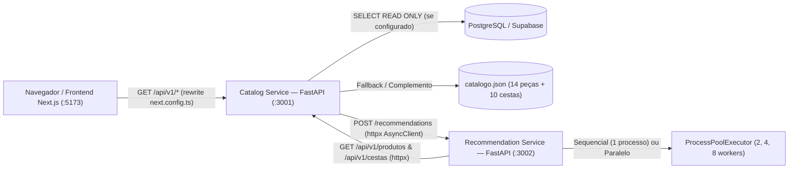

# Arquitetura Distribuída e Benchmark — FCCPD (Unidade 2)

> **Projeto:** Origem — Marketplace da Economia Criativa de Pernambuco  
> **Branch isolada:** `feat/fccpd-u2-fastapi` (derivada de `origin/main`)  
> **Disciplina:** Fundamentos de Computação Concorrente, Paralela e Distribuída (FCCPD) — Unidade 2  
> **Nota histórica (Unidade 1):** A entrega da Unidade 1 (controle de concorrência no estoque/checkout com lock pessimista `SELECT ... FOR UPDATE`, fila assíncrona e testes) permanece preservada nas branches `main` e `simulacao-fccpd`, documentada em [EVIDENCIAS.md](../../EVIDENCIAS.md) e [docs/03-computacao-concorrente-distribuida/01-concorrencia-e-mensageria.md](../03-computacao-concorrente-distribuida/01-concorrencia-e-mensageria.md).

---

## 1. Arquitetura Distribuída

A aplicação foi estruturada com dois serviços independentes em **Python + FastAPI**, comunicando-se exclusivamente via **HTTP/REST** com `httpx`, servindo o frontend **Next.js** preservando integralmente o Design System original do Origem.



### Fluxo ponta a ponta ao abrir uma peça (`/produtos/[id]`)

1. O navegador chama `GET /api/v1/produtos/{id}/recomendacoes?limit=4&mode=parallel&workers=4` no próprio domínio Next.js (`:5173`), que faz proxy para o **Catalog Service** (`:3001`).
2. O **Catalog Service** valida a existência da peça e dispara uma requisição `POST http://localhost:3002/recommendations` via `httpx.AsyncClient`.
3. O **Recommendation Service** (`:3002`) não acessa o banco nem lê `catalogo.json` diretamente: ele consulta o catálogo ao vivo no **Catalog Service** (`GET /api/v1/produtos?limit=2000` e `GET /api/v1/cestas`) via `httpx.AsyncClient` em paralelo (`asyncio.gather`).
4. O **Recommendation Service** executa o algoritmo da HU-24 em modo `sequential` ou `parallel` (`ProcessPoolExecutor`), devolvendo os itens ranqueados e as métricas separadas (`compute_ms` vs `catalog_fetch_ms`).
5. O **Catalog Service** enriquece os itens recomendados com os dados completos de vitrine (`imageUrl`, `stock`, `artisanId`, etc.) e devolve ao frontend junto às métricas de rede e computação.
6. Em caso de indisponibilidade do serviço de recomendações, o Catalog Service retorna HTTP `503` explícito e o frontend exibe um estado de erro com opção de tentar novamente (sem fallback local silencioso).

---

## 2. Justificativa da Separação dos Serviços e Fonte de Dados

### Por que separar `catalog-service` (`:3001`) e `recommendation-service` (`:3002`)?

- **Isolamento de responsabilidades:** o `catalog-service` é o dono dos dados do acervo (produtos, fotos, artesãos e cestas históricas) e expõe contratos REST públicos compatíveis com o frontend. O `recommendation-service` é um serviço de computação sem estado de banco (*stateless*), focado em vetorização, similaridade de cosseno e ranqueamento.
- **Escalabilidade e proteção contra CPU-bound:** o cálculo de recomendações em lotes ou catálogos maiores é intensivo em CPU (*CPU-bound*). Isolá-lo em um processo/serviço dedicado com `ProcessPoolExecutor` evita bloquear o event loop do gateway de catálogo e permite escalar os dois serviços de forma independente.
- **Fronteira estrita:** não há importação de módulos Python entre `services/catalog-service` e `services/recommendation-service`. Toda comunicação inter-serviços ocorre via HTTP/REST com `httpx`.

### Fonte de dados utilizada e identificação explícita

- **Fonte ativa no ambiente validado:** `postgresql_read_only+local_json` (**15 peças** no total = **1 peça** real lida do Supabase PostgreSQL em transação `BEGIN READ ONLY` + **14 peças** e **10 cestas** do arquivo local [services/catalog-service/data/catalogo.json](../../services/catalog-service/data/catalogo.json)).
- **Operação independente sem banco:** caso `USE_POSTGRES=false` ou o PostgreSQL esteja inacessível, o `catalog-service` opera automaticamente com `dataSource = "local_json_only"` usando exclusivamente `catalogo.json`.
- **Dados sintéticos no benchmark:** apenas os cenários `synthetic_n200`, `synthetic_n500`, `synthetic_n1000` e `synthetic_n2000` utilizam o gerador determinístico ([services/recommendation-service/app/synthetic.py](../../services/recommendation-service/app/synthetic.py), `seed=42`), sempre identificados nos JSON/CSVs e nos relatórios com `is_synthetic: true`.

---

## 3. Localização do Trecho Paralelo (`ProcessPoolExecutor`)

O motor de recomendação reaproveita a lógica da **HU-24** (features ponderadas de técnica `1.0`, polo `0.8`, categoria `0.4`, faixa de preço `0.3`; similaridade de cosseno `0.6` + co-ocorrência `0.4`; regras BDD de mesma técnica ou mesmo polo, exclusão da própria peça e exclusão de estoque zerado; desempate determinístico por `(-score, product_id)`).

- **Gerenciamento do pool no startup/shutdown (compatível com Windows `spawn`):**  
  [services/recommendation-service/app/main.py](../../services/recommendation-service/app/main.py#L49-L63) — `lifespan` instancia `ProcessPoolExecutor(max_workers=MAX_WORKERS)` uma única vez na inicialização do servidor e o encerra no shutdown.
- **Funções top-level pickláveis (executadas nos processos trabalhadores):**  
  - `_score_candidates_chunk` em [services/recommendation-service/app/engine.py](../../services/recommendation-service/app/engine.py#L124-L153) — avalia um *chunk* de candidatos contra o produto alvo.
  - `_recommend_batch_chunk` em [services/recommendation-service/app/engine.py](../../services/recommendation-service/app/engine.py#L175-L189) — processa um *chunk* de produtos alvo contra o catálogo.
- **Versões Sequencial e Paralela usando exatamente o mesmo núcleo matemático (`_score_candidates_chunk` / `_recommend_for_target`):**  
  - Recomendação única: `recommend_single_sequential` ([engine.py#L206-L238](../../services/recommendation-service/app/engine.py#L206-L238)) vs `recommend_single_parallel` ([engine.py#L241-L289](../../services/recommendation-service/app/engine.py#L241-L289)).
  - Recomendação em lote: `recommend_batch_sequential` ([engine.py#L292-L315](../../services/recommendation-service/app/engine.py#L292-L315)) vs `recommend_batch_parallel` ([engine.py#L318-L344](../../services/recommendation-service/app/engine.py#L318-L344)).
- **Despacho não bloqueante no FastAPI:**  
  [services/recommendation-service/app/main.py](../../services/recommendation-service/app/main.py#L160-L171) e [main.py#L232-L243](../../services/recommendation-service/app/main.py#L232-L243) utilizam `loop.run_in_executor(None, ...)` para aguardar o `ProcessPoolExecutor` sem travar o event loop assíncrono do Uvicorn.

---

## 4. Metodologia do Benchmark e Especificações da Máquina

- **Script reproduzível:** [benchmarks/benchmark_recommendations.py](../../benchmarks/benchmark_recommendations.py)
- **Execução:** `1` iteração de aquecimento (*warm-up*) por configuração seguida de `5` repetições medidas com `time.perf_counter()`.
- **Processos avaliados:** `1` (sequencial), `2`, `4` e `8` workers no `ProcessPoolExecutor` (com pool pré-aquecido para isolar o paralelismo de execução do custo de inicialização de processos no Windows `spawn`).
- **Métricas calculadas:** Média (ms), Mediana (ms), Desvio-Padrão (ms), Throughput (itens/s), Speedup ($S_p = T_{\text{seq}} / T_p$), Eficiência ($E_p = S_p / p$), separação explícita entre latência HTTP (`catalog_fetch_ms` / `gateway_http_ms`) e processamento algorítmico (`compute_ms`), e verificação criptográfica de equivalência (`result_digest` SHA-256).

### Especificações da Máquina Utilizada (coletadas automaticamente)

| Atributo | Valor Real |
|---|---|
| **Sistema Operacional** | `Windows-11-10.0.26200-SP0` (`AMD64`) |
| **Processador** | `AMD Ryzen 5 8500G w/ Radeon 740M Graphics` |
| **Núcleos Físicos / Lógicos** | **6 físicos / 12 lógicos** |
| **Memória RAM** | **31,12 GB** |
| **Python / Multiprocessing** | **Python 3.13.14** (`spawn`) |
| **Data da execução (UTC)** | `2026-11-24T21:29:57Z` |

---

## 5. Resultados Reais Obtidos

### 5.1 Processamento Algorítmico Isolado (`engine.py` — cálculo em lote de recomendações top-4)

Fonte base: `http_catalog_service (postgresql_read_only+local_json)` (`N = 15` reais; `N = 200..2000` sintéticos determinísticos `seed=42`).

| Cenário | Sintético? | Workers | Modo | Média (ms) | Mediana (ms) | Desvio-Padrão (ms) | Throughput (itens/s) | Speedup | Eficiência | Equivalente? |
|---|---|---:|---|---:|---:|---:|---:|---:|---:|---|
| `original_n15` | Não | 1 | `sequential` | 1,436 | 0,582 | 1,979 | 10.446,85 | 1,00x | 100,0% | Sim (`53e4e55de6f99de0`) |
| `original_n15` | Não | 2 | `parallel` | 1,341 | 1,340 | 0,099 | 11.182,35 | 1,07x | 53,5% | Sim (`53e4e55de6f99de0`) |
| `original_n15` | Não | 4 | `parallel` | 3,608 | 2,272 | 3,470 | 4.157,13 | 0,40x | 10,0% | Sim (`53e4e55de6f99de0`) |
| `original_n15` | Não | 8 | `parallel` | 3,908 | 2,939 | 2,019 | 3.838,14 | 0,37x | 4,6% | Sim (`53e4e55de6f99de0`) |
| `synthetic_n200` | Sim | 1 | `sequential` | 54,967 | 53,862 | 5,938 | 3.638,57 | 1,00x | 100,0% | Sim (`00a2436ee0b21199`) |
| `synthetic_n200` | Sim | 2 | `parallel` | 35,600 | 35,820 | 2,890 | 5.617,93 | 1,54x | 77,2% | Sim (`00a2436ee0b21199`) |
| `synthetic_n200` | Sim | 4 | `parallel` | 23,199 | 23,515 | 2,020 | 8.621,21 | 2,37x | 59,2% | Sim (`00a2436ee0b21199`) |
| `synthetic_n200` | Sim | 8 | `parallel` | 17,882 | 16,888 | 2,698 | 11.184,34 | **3,07x** | 38,4% | Sim (`00a2436ee0b21199`) |
| `synthetic_n500` | Sim | 1 | `sequential` | 383,299 | 396,800 | 23,430 | 1.304,46 | 1,00x | 100,0% | Sim (`c287c4d9a685743d`) |
| `synthetic_n500` | Sim | 2 | `parallel` | 234,286 | 230,268 | 17,702 | 2.134,15 | 1,64x | 81,8% | Sim (`c287c4d9a685743d`) |
| `synthetic_n500` | Sim | 4 | `parallel` | 141,709 | 139,707 | 6,269 | 3.528,36 | 2,70x | 67,6% | Sim (`c287c4d9a685743d`) |
| `synthetic_n500` | Sim | 8 | `parallel` | 108,580 | 107,455 | 12,582 | 4.604,90 | **3,53x** | 44,1% | Sim (`c287c4d9a685743d`) |
| `synthetic_n1000` | Sim | 1 | `sequential` | 2.517,707 | 2.328,143 | 989,310 | 397,19 | 1,00x | 100,0% | Sim (`7e4a9f6df632f45b`) |
| `synthetic_n1000` | Sim | 2 | `parallel` | 1.017,277 | 1.021,391 | 15,922 | 983,02 | 2,47x | 123,8% | Sim (`7e4a9f6df632f45b`) |
| `synthetic_n1000` | Sim | 4 | `parallel` | 576,293 | 572,348 | 31,242 | 1.735,23 | 4,37x | 109,2% | Sim (`7e4a9f6df632f45b`) |
| `synthetic_n1000` | Sim | 8 | `parallel` | 393,341 | 394,634 | 16,432 | 2.542,33 | **6,40x** | 80,0% | Sim (`7e4a9f6df632f45b`) |
| `synthetic_n2000` | Sim | 1 | `sequential` | 5.177,807 | 4.129,632 | 1.720,585 | 386,26 | 1,00x | 100,0% | Sim (`4bc9a9b104b14643`) |
| `synthetic_n2000` | Sim | 2 | `parallel` | 2.171,544 | 2.138,479 | 52,862 | 921,00 | 2,38x | 119,2% | Sim (`4bc9a9b104b14643`) |
| `synthetic_n2000` | Sim | 4 | `parallel` | 1.974,426 | 1.956,164 | 276,380 | 1.012,95 | 2,62x | 65,6% | Sim (`4bc9a9b104b14643`) |
| `synthetic_n2000` | Sim | 8 | `parallel` | 1.272,687 | 1.197,158 | 293,282 | 1.571,48 | **4,07x** | 50,9% | Sim (`4bc9a9b104b14643`) |

> **Observação estatística:** Nos cenários `synthetic_n1000` e `synthetic_n2000` com `workers=1`, o desvio-padrão foi elevado (`989 ms` e `1720 ms`) por oscilações de escalonamento/GC na execução longa em single-thread. Comparando pela **mediana** (mais robusta a outliers), o speedup com 8 workers continua expressivo: **5,90x** em `N=1000` (`2328,14 ms / 394,63 ms`) e **3,45x** em `N=2000` (`4129,63 ms / 1197,16 ms`). Eficiências acima de 100% em `N=1000/2000` com `workers=2` na média decorrem exclusivamente desses outliers no baseline `workers=1` (pela mediana, `2328,14 / 1021,39 = 2,28x` ou efeito de menor pressão de GC por chunk).

### 5.2 Comunicação HTTP Distribuída Ponta a Ponta (`:3001` ↔ `:3002`)

#### A) Fluxo da vitrine: `GET /api/v1/produtos/p01/recomendacoes` (catálogo real, `N=15`)

| Modo | Workers | Latência HTTP Total Média (ms) | Mediana (ms) | Gateway HTTP (`:3001→:3002`) (ms) | Fetch Catálogo (`:3002→:3001`) (ms) | Processamento Algorítmico (ms) | IDs Iguais? |
|---|---:|---:|---:|---:|---:|---:|---|
| `sequential` | 1 | 11,086 | 11,245 | 9,500 | 5,107 | **0,133** | Sim (`p02, p04, p06, db77...`) |
| `parallel` | 2 | 15,618 | 12,954 | 13,842 | 5,631 | 4,202 | Sim |
| `parallel` | 4 | 12,280 | 12,588 | 10,620 | 5,541 | 1,316 | Sim |
| `parallel` | 8 | 31,311 | 32,440 | 29,033 | 6,812 | 16,769 | Sim |

#### B) Lote distribuído via HTTP: `POST /recommendations/batch` (`:3002` buscando catálogo de `:3001`)

| Cenário | Sintético? | Workers | Modo | HTTP Total Média (ms) | Fetch HTTP Catálogo (ms) | Processamento Algorítmico (ms) | Speedup (só computação) | Equivalente? |
|---|---|---:|---|---:|---:|---:|---:|---|
| `original` (`N=15`) | Não | 1 | `sequential` | 8,356 | 5,761 | **0,290** | 1,00x | Sim |
| `original` (`N=15`) | Não | 2 | `parallel` | 17,301 | 7,729 | 6,626 | 0,04x | Sim |
| `original` (`N=15`) | Não | 4 | `parallel` | 13,104 | 8,366 | 1,742 | 0,17x | Sim |
| `original` (`N=15`) | Não | 8 | `parallel` | 15,631 | 9,540 | 2,877 | 0,10x | Sim |
| `synthetic_n500` | Sim | 1 | `sequential` | 270,411 | 6,859 | 252,947 | 1,00x | Sim |
| `synthetic_n500` | Sim | 2 | `parallel` | 204,787 | 8,148 | 185,109 | 1,37x | Sim |
| `synthetic_n500` | Sim | 4 | `parallel` | 144,525 | 7,598 | 125,025 | 2,02x | Sim |
| `synthetic_n500` | Sim | 8 | `parallel` | 142,479 | 10,079 | 116,454 | **2,17x** | Sim |
| `synthetic_n1000` | Sim | 1 | `sequential` | 1.906,873 | 390,037 | 1.491,838 | 1,00x | Sim |
| `synthetic_n1000` | Sim | 2 | `parallel` | 1.191,637 | 380,325 | 790,611 | 1,89x | Sim |
| `synthetic_n1000` | Sim | 4 | `parallel` | 535,218 | 8,367 | 504,021 | 2,96x | Sim |
| `synthetic_n1000` | Sim | 8 | `parallel` | 788,649 | 393,352 | 365,981 | **4,08x** | Sim |

---

## 6. Interpretação dos Ganhos e Perdas

1. **Onde o paralelo perde (`N = 15`, catálogo atual):**  
   Para 15 peças, o processamento sequencial leva apenas **0,13 ms** (alvo único) ou **0,29 ms** (lote completo). Dividir esse trabalho entre 2 a 8 processos via `ProcessPoolExecutor` introduz serialização (*pickle*) de argumentos/retornos e troca de contexto entre processos no Windows (`spawn`), elevando o tempo para `1,3 ms` a `16,8 ms` (speedup `< 1`, perda clara de desempenho).
2. **Ponto de equilíbrio (*crossover*) e ganhos em escala (`N >= 200`):**  
   Como o cálculo de similaridade par-a-par cresce em $O(N^2 \cdot d)$, a partir de **200 produtos** o trabalho CPU-bound por *chunk* supera amplamente o custo de IPC, produzindo speedup consistente até **3,07x** (`N=200`), **3,53x** (`N=500`) e **4,07x–6,40x** (`N=1000/2000`) com 8 workers.
3. **Saturação além dos núcleos físicos (Lei de Amdahl e SMT):**  
   O processador possui **6 núcleos físicos** (12 threads via SMT). Por isso, ao saltar de 4 para 8 workers, o speedup cresce de forma sublinear (eficiência cai de ~59–109% em 4 workers para ~38–80% em 8 workers), já que os 8 processos disputam apenas 6 núcleos físicos além da fração sequencial de preparação dos vetores e ordenação final.
4. **Impacto da comunicação distribuída e do banco remoto:**  
   Nos testes HTTP ponta a ponta, `catalog_fetch_ms` variou de `~6–8 ms` (hit de cache em memória no `:3001`) a `~380–393 ms` (quando o TTL de 10s expirou e o `:3001` reconsultou o Supabase PostgreSQL remoto). Isso comprova na prática que a separação entre latência de rede/I/O e processamento paralelo de CPU é indispensável para diagnosticar gargalos reais em sistemas distribuídos.

---

## 7. Logs Reais de Comunicação HTTP

Arquivo completo salvo em [benchmarks/results/http_communication.log](../../benchmarks/results/http_communication.log) (extraído de `catalog_service.err.log` e `recommendation_service.err.log`):

```text
# Catalog Service (:3001)
2026-11-24 18:29:55,491 [INFO] catalog-service - Catalog Service iniciado | data_source=postgresql_read_only+local_json | products=15 | artisans=11 | recommendation_url=http://localhost:3002
2026-11-24 18:29:56,937 [INFO] catalog-service - OUTBOUND HTTP POST http://localhost:3002/recommendations | product_id=p01 mode=parallel workers=4
2026-11-24 18:29:56,947 [INFO] catalog-service - HTTP GET /api/v1/produtos -> 200 (0.47 ms)
2026-11-24 18:29:56,949 [INFO] catalog-service - HTTP GET /api/v1/cestas -> 200 (0.29 ms)
2026-11-24 18:29:57,119 [INFO] httpx - HTTP Request: POST http://localhost:3002/recommendations "HTTP/1.1 200 OK"
2026-11-24 18:29:57,123 [INFO] catalog-service - HTTP GET /api/v1/produtos/p01/recomendacoes -> 200 (185.95 ms)

# Recommendation Service (:3002)
2026-11-24 18:29:53,543 [INFO] recommendation-service - Recommendation Service iniciado | cpu_count=12 | default_workers=4 | max_workers=8 | catalog_url=http://localhost:3001
2026-11-24 18:29:56,943 [INFO] recommendation-service.catalog_client - OUTBOUND HTTP GET http://localhost:3001/api/v1/produtos?limit=2000 & http://localhost:3001/api/v1/cestas
2026-11-24 18:29:56,948 [INFO] httpx - HTTP Request: GET http://localhost:3001/api/v1/produtos?limit=2000 "HTTP/1.1 200 OK"
2026-11-24 18:29:56,951 [INFO] httpx - HTTP Request: GET http://localhost:3001/api/v1/cestas "HTTP/1.1 200 OK"
2026-11-24 18:29:57,116 [INFO] recommendation-service - HTTP POST /recommendations -> 200 (174.26 ms)
```

---

## 8. Como Executar Localmente

### Pré-requisitos
- **Python 3.11+** (validado com 3.13.14) e ambiente `.venv` na raiz.
- **Node.js 20.9+** para o frontend Next.js.

### 1. Instalar dependências (caso ainda não tenha `.venv`)
```powershell
python -m venv .venv
.\.venv\Scripts\python.exe -m pip install -r services\catalog-service\requirements.txt -r services\recommendation-service\requirements.txt
cd frontend ; npm install ; cd ..
```

### 2. Subir os 3 processos em terminais separados
- **Terminal 1 — Catalog Service (`:3001`):**
  ```powershell
  cd services\catalog-service
  ..\..\.venv\Scripts\python.exe -m uvicorn app.main:app --host 127.0.0.1 --port 3001
  ```
- **Terminal 2 — Recommendation Service (`:3002`):**
  ```powershell
  cd services\recommendation-service
  ..\..\.venv\Scripts\python.exe -m uvicorn app.main:app --host 127.0.0.1 --port 3002
  ```
- **Terminal 3 — Frontend Next.js (`:5173`):**
  ```powershell
  cd frontend
  npm run dev
  ```
Acesse `http://localhost:5173`, abra qualquer peça (ex.: `http://localhost:5173/produtos/p01`) e alterne entre **Sequencial** e **Paralelo (2, 4, 8 workers)** na seção **"Você também pode gostar"**.

### 3. Executar testes automatizados e benchmark
```powershell
.\.venv\Scripts\python.exe -m pytest services\catalog-service\tests -v
.\.venv\Scripts\python.exe -m pytest services\recommendation-service\tests -v
.\.venv\Scripts\python.exe benchmarks\benchmark_recommendations.py --with-http --repeats 5 --warmups 1
```
*(Sem `--with-http`, executa apenas a bateria algorítmica isolada usando o JSON local se o `:3001` estiver desligado.)*

## 9. Laboratório interativo

Acesse `/laboratorio-de-desempenho` no frontend. Cada clique faz 12 chamadas reais e sucessivas a `POST /api/v1/laboratorio/amostra` via rewrite do Next. O Catalog encaminha cada amostra a `POST /recommendations/batch`. O Recommendation busca produtos e cestas no Catalog por HTTP e calcula top-4 para todos os alvos. O PostgreSQL permanece somente leitura. Sem banco configurado o tamanho do acervo atual pode ser diferente do registrado nas evidências.

| Escolha | Efeito |
|---|---|
| Acervo atual | Usa os produtos e cestas do serviço, identificando catálogo local ou PostgreSQL + catálogo local. |
| Sintético | Expande deterministicamente o acervo para 200, 500 ou 1.000 produtos, com seed 42. |
| Workers | Sequencial usa 1. Paralelo distribui o trabalho em até 2, 4 ou 8 partes no pool persistente. |

O navegador alterna a ordem dos modos a cada rodada. Descarta o primeiro par como aquecimento e resume as cinco amostras seguintes de cada modo pela mediana. O SHA-256 da carga inclui os produtos ordenados, cestas, alvos e limite. O serviço calcula esse digest fora do tempo algorítmico. O navegador exige a mesma carga, origem e digest do resultado nas 12 respostas antes de publicar a comparação. Se o catálogo mudar ou um serviço falhar, a interface descarta a execução incompleta e oferece nova tentativa.

| Medida | Intervalo observado |
|---|---|
| Cálculo | Execução do algoritmo no Recommendation, incluindo despacho e espera pelo pool no modo paralelo. |
| Busca do catálogo | Tempo do Recommendation aguardando o par de consultas HTTP de produtos e cestas. |
| Chamada entre serviços | Catalog aguarda a resposta completa do Recommendation. Inclui busca e cálculo. |
| Latência do cliente | `performance.now()` no navegador, da chamada via Next até a leitura e decodificação da resposta. Inclui a chamada entre serviços. |

Cada intervalo tem sua própria mediana. Somá-los duplicaria trabalho já incluído. Throughput de cálculo é o número de alvos dividido pelos segundos medianos de cálculo. Speedup é a razão entre os tempos medianos sequencial e paralelo. Eficiência divide o speedup pelos workers da execução paralela. Em cargas pequenas, a distribuição e a sincronização podem custar mais que o cálculo poupado.

**Evidências da interface em produção local.** As respostas capturadas pelo Playwright estão nos arquivos [acervo atual](evidencias/lote-15.json) e [500 produtos sintéticos](evidencias/lote-500.json). Cada arquivo contém as 12 respostas, começando pelo par de aquecimento, e os valores exibidos na interface. A latência do cliente é medida pelo navegador. Veja a [configuração do laboratório](evidencias/laboratorio.png), o [resultado do acervo](evidencias/resultado-15.png), o [resultado sintético](evidencias/resultado-500.png) e os [filtros móveis](evidencias/catalogo-mobile.png). Os valores históricos das seções 4–7 pertencem à bateria de benchmark de linha de comando.

### Validação pelo navegador em 24 de novembro de 2026

| Carga | Cálculo sequencial | Cálculo paralelo (4 workers) | Speedup | Eficiência | Latência do cliente, sequencial / paralelo |
|---|---:|---:|---:|---:|---:|
| 15 peças do acervo ativo | 0,522 ms | 1,742 ms | 0,30× | 7,49% | 19,2 / 21,1 ms |
| 500 produtos sintéticos | 431,719 ms | 138,261 ms | 3,12× | 78,06% | 464,4 / 175,1 ms |

Playwright conferiu as medianas de cálculo, busca e gateway contra as respostas efetivamente recebidas na mesma execução. Os dois modos produziram o mesmo digest para cada carga. A injeção de um HTTP 503 na requisição do laboratório mostrou o estado de erro; a nova tentativa completou o ensaio com o serviço real. A alteração controlada da assinatura de entrada da segunda chamada interrompeu a comparação.

Foram verificadas as 15 páginas de peças, os 11 perfis, as imagens e os status HTTP das rotas inexistentes. Home, detalhe, perfil e laboratório couberam nas larguras de 390, 768 e 1440 px. Nos percursos normais não houve falha HTTP inesperada ou exceção JavaScript. [Boneco de Barro com imagem ilustrativa](evidencias/boneco-de-barro.png) · [Perfil de artesão](evidencias/perfil-artesao.png) · [Laboratório no celular](evidencias/laboratorio-mobile.png).
