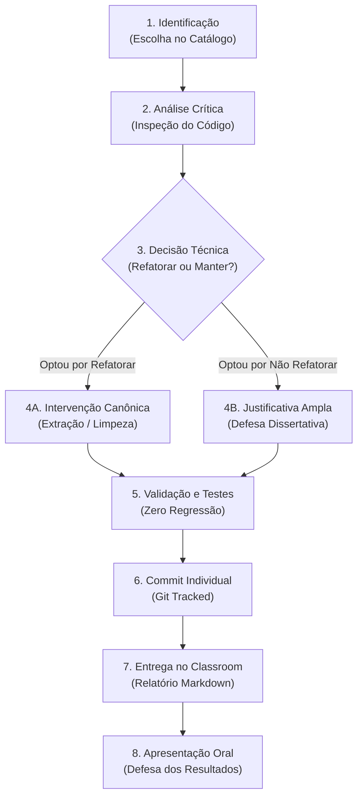

# Atividade Acadêmica: Code Smells e Refatoração de Software
## Projeto Integrador Origem — Marketplace de Artesanato de Pernambuco

> **Documento Mestre de Coordenação, Auditoria e Acompanhamento da Equipe**
> **Branch de Trabalho:** `feat/frontend-next`
> **Fase Atual:** Catálogo consolidado e acompanhamento das intervenções
> **Última Atualização:** 16 de novembro de 2026

---

## Sumário

- [A. Contexto da Atividade](#a-contexto-da-atividade)
- [B. Escopo da Auditoria](#b-escopo-da-auditoria)
- [C. Catálogo de Possíveis Code Smells](#c-catálogo-de-possíveis-code-smells)
- [D. Análise Técnica Detalhada dos Candidatos](#d-análise-técnica-detalhada-dos-candidatos)
  - [CS-01: Código Duplicado e Acoplamento Estrutural em Repositórios](#cs-01-código-duplicado-e-acoplamento-estrutural-em-repositórios)
  - [CS-02: Mudança Divergente no Serviço de Catálogo](#cs-02-mudança-divergente-no-serviço-de-catálogo)
  - [CS-03: Componente de Visualização com Lógica de Mock e Múltiplas Responsabilidades](#cs-03-componente-de-visualização-com-lógica-de-mock-e-múltiplas-responsabilidades)
  - [CS-04: Obsessão por Primitivos na Taxonomia e Filtragem Cultural](#cs-04-obsessão-por-primitivos-na-taxonomia-e-filtragem-cultural)
  - [CS-05 a CS-19: Candidatos adicionais](#cs-05-a-cs-19-candidatos-adicionais)
- [E. Distribuição de Responsabilidades da Equipe](#e-distribuição-de-responsabilidades-da-equipe)
- [F. Plano de Execução em 8 Etapas](#f-plano-de-execução-em-8-etapas)
- [G. Evidências e Resultados Coletivos](#g-evidências-e-resultados-coletivos)
- [H. Checklist Coletivo de Conformidade](#h-checklist-coletivo-de-conformidade)
- [I. Estado Atual e Próximos Passos](#i-estado-atual-e-próximos-passos)

---

## A. Contexto da Atividade

A presente atividade acadêmica tem como foco a aplicação prática dos conceitos de **Engenharia de Software**, **Qualidade de Código**, **Clean Code** e **Refatoração** (*Fowler, Beck, Martin*), utilizando como objeto de estudo o ecossistema real do **Projeto Origem**.

### Regras Oficiais da Atividade (Diretrizes Pedagógicas)

1. **Atuação Individual no Trabalho em Equipe:** Cada integrante da equipe deve selecionar de forma autônoma e analisar criticamente uma parte específica do código-fonte do projeto.
2. **Identificação Fundamentada:** Identificar formalmente pelo menos um *Code Smell*, descrevendo sua localização, classificação teórica e impactos em métricas de qualidade de software (legibilidade, coesão, acoplamento, manutenibilidade e extensibilidade).
3. **Avaliação Crítica e Pragmática:** A identificação de um Code Smell **não obriga** uma refatoração imediata. Cada integrante deve julgar se a intervenção é justificável ou se o código atual deve ser preservado.
4. **Intervenção ou Justificativa Dissertativa:**
   - **Caso opte por refatorar:** Aplicar uma técnica canônica de refatoração, garantir rigorosamente a preservação de comportamento (não quebrar funcionalidades nem contratos) e justificar os ganhos obtidos.
   - **Caso opte por não refatorar:** Elaborar uma justificativa técnica aprofundada e dissertativa em Markdown demonstrando por que manter a estrutura atual é a decisão mais prudente no contexto atual da aplicação.
5. **Rastreabilidade via Git:** Cada integrante deve ser responsável por pelo menos um **commit individual**, contendo mensagem descritiva indicando o Code Smell abordado e a intervenção realizada ou decisão documentada.
6. **Apresentação e Defesa Oral:** Cada integrante deverá defender individualmente seus resultados, detalhando a motivação técnica, os ganhos de qualidade alcançados, os riscos mitigados e as limitações remanescentes.

---

## B. Escopo da Auditoria

A auditoria de qualidade foi conduzida diretamente sobre a branch oficial de desenvolvimento `feat/frontend-next`, cobrindo as camadas recentemente integradas do frontend e do backend.

### Módulos Examinados

| Camada | Diretório / Módulo | Tecnologias Envolvidas | Foco da Inspeção |
| :--- | :--- | :--- | :--- |
| **Backend — Repositories** | `backend/src/repositories/` | Node.js, Express, TypeScript | Acesso a dados, parsing de catálogo, conversão de entidades |
| **Backend — Services** | `backend/src/services/` | Node.js, TypeScript | Regras de negócio, paginação, filtros por polo/técnica |
| **Backend — Controllers & Routes** | `backend/src/controllers/`, `backend/src/routes/` | Express, TypeScript | Contratos HTTP, validação de entrada, tratamento de exceções |
| **Frontend — Services** | `frontend/src/services/` | Next.js, Fetch API, TypeScript | Camada de abstração HTTP, consumo das APIs `/produtos` e `/artesaos` |
| **Frontend — Views & Contexts** | `frontend/src/views/`, `frontend/src/context/` | React 19, Next.js App Router | Estado compartilhado, acoplamento de visualização e regras de domínio |

### Metodologia de Análise

- **Inspeção Estática Orientada a Princípios:** Avaliação contra os princípios SOLID (*Single Responsibility, Open/Closed, Liskov Substitution, Interface Segregation, Dependency Inversion*).
- **Catálogo de Fowler & Beck:** Confronto com as definições formais de *Bad Smells* em código orientado a objetos e estruturado (*Refactoring: Improving the Design of Existing Code*).
- **Preservação de Regras de Negócio (`AGENTS.md`):** Garantia de que soluções temporárias conscientes de integração (ex.: leitura de `catalogo.json` para MVP) não sejam confundidas precipitadamente com defeitos graves, separando dívidas técnicas de decisões de transição arquitetural.

---

## C. Catálogo de Possíveis Code Smells

O catálogo reúne **19 candidatos**, identificados no [mapeamento técnico](MAPEAMENTO.md). “Candidato” não significa defeito confirmado nem obrigação de refatorar: cada decisão deve considerar o comportamento atual, os critérios da atividade e o risco de mudar contratos ou regras de negócio. Os estados abaixo distinguem intervenções já registradas de recomendações ainda não executadas.

| ID | Nome / Classificação Canônica | Arquivo(s) ou área principal | Camada | Impacto principal | Gravidade | Estado / recomendação |
| :---: | :--- | :--- | :---: | :--- | :---: | :--- |
| **CS-01** | Código Duplicado (*Duplicated Code*) | `backend/src/repositories/produto.repository.ts`, `artesao.repository.ts` | Backend | Regras utilitárias repetidas e risco de divergência | Média | Refatorado; typecheck e comparação de 12 rotas registrados. Commit individual pendente no relatório. |
| **CS-02** | Mudança Divergente (*Divergent Change*) | `frontend/src/services/catalogService.ts` | Frontend | Consultas, gestão cadastral e estoque no mesmo serviço | Média | Refatorado e validado por build/typecheck e lint focado; navegação manual não executada. |
| **CS-03** | Inveja de Recursos / Intimidade Inapropriada (*Feature Envy / Inappropriate Intimacy*) | `frontend/src/views/ProductDetail.tsx`, `frontend/src/utils/media.ts` | Frontend | Regras de galeria e URLs de mock acopladas à view | Média | Refatorado e validado; relatório individual disponível; hash de commit não informado. |
| **CS-04** | Obsessão por Primitivos (*Primitive Obsession*) | Serviços do backend e filtros do frontend | Full stack | Valores culturais tipados como `string`, dependentes de taxonomia inconsistente | Média | Aguardar decisão do CS-05 antes de tipar os valores. |
| **CS-05** | Conhecimento de domínio duplicado e divergente (taxonomia) | `ia-recomendador/dados/catalogo.json`, `backend/src/constants/taxonomy.ts`, `frontend/src/design-system/tokens.ts` | Full stack + IA | Filtros e cadastros divergem do catálogo disponível | Alta | Decisão do grupo necessária sobre a taxonomia oficial; consultar RF-CAT-02 no backlog. |
| **CS-06** | Código Duplicado (*Duplicated Code*) — paginação e filtros | `backend/src/services/produto.service.ts`, `artesao.service.ts` | Backend | Lógica repetida e sanitização inconsistente de filtros | Média | Refatorado e validado no relatório individual; commit não informado. |
| **CS-07** | Código Duplicado (*Duplicated Code*) — parsing de query | `backend/src/controllers/produto.controller.ts`, `artesao.controller.ts` | Backend | Parsing manual repetido e respostas silenciosamente inválidas | Baixa (bug de borda corrigido) | Refatorado com Zod; typecheck e comparação HTTP registrados; commit pendente. |
| **CS-08** | Generalidade Especulativa (*Speculative Generality*) | `backend/src/config/database.ts`, `backend/src/config/env.ts` | Backend | Infraestrutura configurada sem consumidores atuais | Baixa | Não refatorar neste momento; dependências previstas para etapas futuras do projeto. |
| **CS-09** | Classe Grande / Método Longo (*Large Class / Long Method*) | `frontend/src/components/Header.tsx` | Frontend | Navegação, busca, minicarrinho e efeitos concentrados | Média | Refatorar com cautela, preservando HTML, classes e design. |
| **CS-10** | Classe Grande / Método Longo (*Large Class / Long Method*) | `frontend/src/views/ArtisanPanel.tsx` | Frontend | Formulário, validação, métricas e listagem concentrados | Média | Recomendada extração de funções e componentes; não iniciada. |
| **CS-11** | Método Longo / Aglomerado de Dados (*Long Method / Data Clumps*) | `frontend/src/views/Login.tsx` | Frontend | Login e cadastro de artesão misturam fluxos e estado de perfil | Média | Recomendada extração de funções e objeto de parâmetros; não iniciada. |
| **CS-12** | Código Duplicado (*Duplicated Code*) — estados de carregamento/erro | 6 views e `frontend/src/components/AsyncState.tsx` | Frontend | Blocos de layout assíncrono duplicados em 9 pontos | Baixa | Refatorado com `ResourceGate`; build de produção e conferência visual registrados; commit `19e9f52`. |
| **CS-13** | Código Duplicado (*Duplicated Code*) — regras pequenas | Subtotal, validação de e-mail e faixas de preço no frontend/IA | Frontend + IA | Regras repetidas; faixas de preço podem ter intenção distinta | Média | Avaliar extração seletiva; não unificar as faixas sem confirmar a regra de negócio. |
| **CS-14** | Intimidade Inapropriada (*Inappropriate Intimacy*) / violação de camadas | `frontend/src/design-system/components/ProductCard.tsx` | Frontend | Tipo de domínio `Product` usado por serviços a partir do Design System | Média | Recomendada movimentação do tipo para `frontend/src/types/`; não iniciada. |
| **CS-15** | Código Morto (*Dead Code*) | `backend/src/repositories/artesao.repository.ts` | Backend | Re-export de `slugify` sem consumidores | Baixa | Remoção trivial recomendada, como complemento do CS-01; não iniciada. |
| **CS-16** | Comentários desatualizados (*Comments*) | `frontend/src/services/artisanService.ts`, `ArtisanPanel.tsx`, `storage.ts` | Frontend | Documentação e texto podem contradizer a integração atual | Baixa | Corrigir comentários; qualquer alteração no texto visível exige autorização de design/UX. |
| **CS-17** | Obsessão por Primitivos / duplicação de regra | `ProductDetail.tsx`, `ArtisanProfile.tsx` | Frontend | Associação de produto e artesão pelo nome era frágil | Média | Resolvido com `findArtisanOf()` e validado por build; relatório individual não localizado. |
| **CS-18** | Código Duplicado estrutural (*Duplicated Code*) | 7 arquivos em `frontend/src/context/` | Frontend | Boilerplate repetido de contexto React | Baixa | Não refatorar: idioma idiomático, claro e sem regra de negócio duplicada. |
| **CS-19** | Código de Erro em vez de Exceção (*Replace Error Code with Exception*) | `ia-recomendador/recomendador.py`, `ia-recomendador/service.py` | IA | Erro representado por dicionário e inspecionado pelo chamador | Baixa | Não refatorar: contrato intencional e testado; baixo risco com um único chamador. |

O detalhamento técnico, evidências e recomendações de cada candidato estão no [MAPEAMENTO.md](MAPEAMENTO.md). Os relatórios individuais já criados estão em [`integrantes/`](integrantes/); a síntese do documento mestre não substitui esses relatórios.

---

## D. Análise Técnica Detalhada dos Candidatos

### CS-01: Código Duplicado e Acoplamento Estrutural em Repositórios

- **Identificador:** `CS-01`
- **Nome Canônico:** Código Duplicado (*Duplicated Code*) / Cirurgia por Espingarda (*Shotgun Surgery*)
- **Localização Exata:**
  - `backend/src/repositories/produto.repository.ts` (linhas 36-55 e 62-77)
  - `backend/src/repositories/artesao.repository.ts` (linhas 35-52 e 58-73)

#### Trecho do Código Original

```typescript
// Presente identicamente em produto.repository.ts e artesao.repository.ts:

export function slugify(value: string): string {
  return value
    .normalize('NFD')
    .replace(/[\u0300-\u036f]/g, '')
    .toLowerCase()
    .replace(/[^a-z0-9]+/g, '-')
    .replace(/(^-|-$)/g, '');
}

const TECHNIQUE_MAP: Record<string, string> = {
  ceramica: 'Cerâmica Figurativa',
  couro: 'Couro',
  xilogravura: 'Xilogravura',
  papel_mache: 'Papel Machê',
  renda_renascenca: 'Renda Renascença',
  bordado: 'Bordado',
};

// Resolução de caminho duplicada na íntegra em ambas as classes de repositório:
private resolveCatalogPath(): string {
  const currentDir = path.dirname(fileURLToPath(import.meta.url));
  const candidatePaths = [
    path.resolve(currentDir, '../../../ia-recomendador/dados/catalogo.json'),
    path.resolve(process.cwd(), '../ia-recomendador/dados/catalogo.json'),
    path.resolve(process.cwd(), 'ia-recomendador/dados/catalogo.json'),
  ];

  for (const candidate of candidatePaths) {
    if (fs.existsSync(candidate)) {
      return candidate;
    }
  }

  throw new Error('Arquivo catalogo.json não encontrado nas localizações esperadas.');
}
```

#### Diagnóstico Técnico
Nas Etapas 7.1 e 7.2 foi necessária a rápida integração de dados a partir do arquivo JSON da IA. Como consequência, a função de normalização de strings `slugify`, a tabela de taxonomia visual `TECHNIQUE_MAP` e a lógica de busca resiliente do caminho do arquivo `resolveCatalogPath` foram duplicadas literalmente em ambos os repositórios.

#### Impactos na Qualidade de Software
- **Legibilidade:** Polui os repositórios com funções utilitárias que não são de sua responsabilidade conceitual.
- **Coesão:** Repositórios deveriam apenas orquestrar consultas e mapeamentos; não deveriam conhecer detalhes de parsing de caminhos do sistema operacional ou normalização textual genérica.
- **Acoplamento:** Se um novo formato de caminho for adicionado ou uma nova técnica cultural for cadastrada, dois arquivos distintos precisam ser modificados em sincronia (*Shotgun Surgery*).
- **Manutenibilidade:** Risco iminente de correção de bugs em uma cópia e esquecimento na outra.
- **Extensibilidade:** Dificulta a reutilização de `slugify` por futuros módulos (ex.: categorias ou polos).

#### Gravidade e Justificativa
**Média.** Não causa erro em tempo de execução imediato, mas viola frontalmente o princípio DRY (*Don't Repeat Yourself*) e degrada a manutenibilidade do backend logo em sua gênese.

#### Alternativas de Intervenção
1. **Extração de Módulos Compartilhados:** Criar `backend/src/utils/string.util.ts` para `slugify`, centralizar `TECHNIQUE_MAP` em `backend/src/constants/taxonomy.ts` e criar um loader compartilhado para `resolveCatalogPath` em `backend/src/repositories/catalogLoader.ts`.
2. **Manutenção do Status Quo:** Manter duplicado justificando que ambos os repositórios serão futuramente substituídos por consultas Prisma/PostgreSQL, tornando o arquivo JSON obsoleto.

#### Benefícios da Refatoração
- Eliminação total de código duplicado no backend.
- Centralização da taxonomia cultural do projeto em um único local.
- Resolução de caminho testável e reutilizável por qualquer repositório.

#### Riscos e Limitações
- Baixíssimo risco. A refatoração é puramente estrutural e não altera a assinatura de nenhum método público exposto aos controllers.

#### Validação Comportamental
- Executar `GET /api/v1/produtos?limit=100` e conferir se os 14 produtos continuam sendo retornados com `artisanId`.
- Executar `GET /api/v1/artesaos?limit=100` e verificar se os 10 artesãos continuam sendo extraídos e deduplicados.
- Executar testes de build do TypeScript: `npm run build` no backend.

---

### CS-02: Mudança Divergente no Serviço de Catálogo

- **Identificador:** `CS-02`
- **Nome Canônico:** Mudança Divergente (*Divergent Change*)
- **Localização Original:** `frontend/src/services/catalogService.ts`
- **Estado:** Refatorado, com preservação dos contratos existentes.

#### Diagnóstico e intervenção

O objeto original reunia três grupos de mudanças independentes: consultas da vitrine (`list`/`get`), manutenção cadastral (`create`/`update`/`remove`) e operações de estoque (`adjustStock`/`reserveStock`). O arquivo não caracterizava uma *Large Class* pelo tamanho; a classificação adequada era *Divergent Change*, com severidade **Média**.

A responsabilidade foi dividida em:

- `frontend/src/services/catalogService.ts`: consultas públicas.
- `frontend/src/services/artisanCatalogService.ts`: mutações do catálogo pelo fluxo de gestão.
- `frontend/src/services/stockService.ts`: ajuste e reserva de estoque.
- `frontend/src/services/catalogTypes.ts` e `frontend/src/services/catalogRequest.ts`: tipos e wrapper HTTP compartilhados.

`CatalogContext.tsx` e `orderService.ts` agora importam a operação do serviço correspondente. As URLs, métodos HTTP, corpos das requisições e mensagens de erro foram mantidos.

#### Impactos na Qualidade de Software
- **Coesão:** cada serviço reúne operações do mesmo contexto funcional.
- **Acoplamento:** vitrine, gestão do artesão e checkout dependem apenas dos serviços que consomem.
- **Manutenibilidade:** alterações podem ser localizadas no serviço responsável sem ampliar o objeto de consultas públicas.

#### Gravidade e Justificativa
**Média.** O serviço não era grande; a concentração de responsabilidades aumentava o custo e o risco de mudanças coordenadas entre fluxos diferentes.

#### Validação e limites

O backend atualmente implementa somente `GET /produtos` e `GET /produtos/:id` em `backend/src/routes/produto.routes.ts`. Portanto, as chamadas de escrita permanecem sem rotas correspondentes e esta intervenção não as torna funcionais. `adjustStock` ainda calcula o saldo no cliente, o que mantém a condição de corrida existente; garantir atomicidade requer suporte transacional no backend. A refatoração preserva o comportamento em vez de alterar esses contratos ou responsabilidades de outra camada.
---

### CS-03: Componente de Visualização com Lógica de Mock e Múltiplas Responsabilidades

- **Identificador:** `CS-03`
- **Nome Canônico:** Inveja de Recursos (*Feature Envy*) / Intimidade Inapropriada (*Inappropriate Intimacy*)
- **Localização original:** `frontend/src/views/ProductDetail.tsx` (galeria); regras de mídia também apareciam em `frontend/src/utils/avatar.ts`, `frontend/src/views/ArtisanPanel.tsx` e `frontend/src/views/Login.tsx`.
- **Estado atual:** refatorado para `frontend/src/utils/media.ts`; o relatório individual está em [`CS-03-picsum-media-coupling.md`](integrantes/CS-03-picsum-media-coupling.md).

#### Trecho do Código Original

```typescript
function getGalleryImages(product: Product): string[] {
  const match = product.imageUrl.match(/^(https:\/\/picsum\.photos\/seed\/)([^/]+)(\/.+)$/)
  if (!match) return [product.imageUrl]
  const [, prefix, seed, suffix] = match
  return [product.imageUrl, `${prefix}${seed}-detalhe${suffix}`, `${prefix}${seed}-ambiente${suffix}`]
}
```

#### Diagnóstico e intervenção
A função original `getGalleryImages` usava uma expressão regular acoplada ao formato de URL do serviço de mock `picsum.photos`. O conhecimento de como derivar imagens de galeria, ajustar avatar e construir placeholders estava espalhado entre uma view, um utilitário e outras telas. A intervenção centralizou esses helpers em `frontend/src/utils/media.ts` (incluindo `getProductGalleryImages` e os construtores de placeholders) e manteve `avatar.ts` como fachada compatível.

#### Impactos na Qualidade de Software
- **Legibilidade:** Antes da extração, a view misturava responsabilidades visuais com regras sintéticas de geração de assets.
- **Manutenibilidade:** A lógica de mídia repetida em views/utilitários faria uma troca de provedor exigir alterações coordenadas.
- **Testabilidade:** Antes da extração, não era possível testar a montagem da galeria sem renderizar o componente React; agora os helpers podem ser exercitados isoladamente.

#### Gravidade, validação e limites
**Média.** O acoplamento de mídia foi removido da view e a regra ficou reutilizável e testável isoladamente. O relatório registra `tsc --noEmit`, ESLint focado nos arquivos alterados e `next build` aprovados. Isso não implementa integração com storage real: o backend ainda pode devolver URLs vazias, e essa integração permanece fora do escopo desta refatoração.

**Evidência individual:** [`CS-03-picsum-media-coupling.md`](integrantes/CS-03-picsum-media-coupling.md). O relatório não informa hash do commit individual.

---

### CS-04: Obsessão por Primitivos na Taxonomia e Filtragem Cultural

- **Identificador:** `CS-04`
- **Nome Canônico:** Obsessão por Primitivos (*Primitive Obsession*)
- **Localização Exata:**
  - `backend/src/services/produto.service.ts` (linhas 25-33)
  - `frontend/src/context/ProductFilterContext.tsx` (linhas 23-26 e 71-77)

#### Trecho do Código Original

```typescript
// backend/src/services/produto.service.ts
export interface ListarProdutosQuery {
  page?: number;
  limit?: number;
  technique?: string; // string primitiva arbitrária
  hub?: string;       // string primitiva arbitrária
}

if (options.technique) {
  const techLower = options.technique.toLowerCase();
  produtos = produtos.filter((p) => p.technique.toLowerCase() === techLower);
}

// frontend/src/context/ProductFilterContext.tsx
techniques: string[]
toggleTechnique: (technique: string) => void
hubs: string[]
toggleHub: (hub: string) => void
```

#### Diagnóstico Técnico
Técnicas artesanais de Pernambuco (ex.: *Cerâmica Figurativa*, *Xilogravura*, *Renda Renascença*) e Polos de Produção (ex.: *Caruaru*, *Olinda*, *Petrolina*) possuem um vocabulário controlado e finito no domínio do Projeto Origem. No entanto, o sistema os manipula em todas as camadas como `string` solta, forçando sanitizações repetitivas como `.toLowerCase().trim()` e impedindo que o compilador TypeScript detecte digitações inválidas.

#### Impactos na Qualidade de Software
- **Segurança de Tipos:** Valores inválidos passam sem erro em tempo de compilação.
- **Extensibilidade:** Dificuldade em adicionar metadados aos polos (ex.: macrorregião: Agreste, Sertão, RMR) ou técnicas.
- **Legibilidade:** O código não expressa a riqueza do domínio cultural de Pernambuco.

#### Gravidade e Justificativa
**Média.** Não impede a execução, mas enfraquece as garantias estáticas do TypeScript e espalha validações manuais de string por múltiplos serviços. A intervenção permanece bloqueada até a taxonomia ser definida no CS-05.

#### Alternativas de Intervenção
1. **Modelagem de Tipos Literais / Enums:** criar uniões de literais em TypeScript (`CulturalTechnique`, `ProductionHub`) com arrays imutáveis e type guards, após definir a fonte de verdade.
2. **Manutenção do Status Quo:** manter strings primitivas até a resolução da divergência entre catálogo de IA, backend e frontend.

#### Estado e Dependência
O mapeamento confirmou que os vocabulários já divergem entre camadas (CS-05). Tipar agora uma das listas consolidaria valores incompatíveis. A intervenção do CS-04 fica, portanto, **bloqueada pela decisão de domínio do CS-05**; não há refatoração semântica aplicada ainda.

### CS-05 a CS-19: Candidatos adicionais

Os registros detalhados abaixo complementam os quatro casos analisados acima. A tabela da seção C contém localização, impacto, gravidade e recomendação resumidos; o [MAPEAMENTO.md](MAPEAMENTO.md) mantém as evidências de código e o raciocínio completo.

| ID | Diagnóstico e evidência resumidos | Próxima ação / estado |
| :---: | :--- | :--- |
| **CS-05** | Listas de técnicas e polos divergem entre o catálogo IA, backend e frontend; alguns valores disponíveis não aparecem nos filtros e outros filtros não encontram itens. | Consultar RF-CAT-02 e decidir a taxonomia oficial com o grupo antes de alterar fontes ou contratos. |
| **CS-06** | Paginação e metadados estavam copiados nos services de produto e artesão; filtros também tinham diferença de `.trim()`. | Refatoração em `backend/src/utils/pagination.util.ts`; relatório individual registra `paginate<T>()`, compatibilidade dos limites padrão e validação das asserções. |
| **CS-07** | Parsing duplicado de query/params permitia que `NaN` se propagasse e produzisse resposta `200` vazia em entradas inválidas. | Schemas Zod nos validadores; entradas inválidas passam a `400`, chamadas válidas foram comparadas e o fallback `q`/`nome` foi preservado. |
| **CS-08** | Prisma e variáveis de ambiente de banco, JWT e IA estão preparados sem uso completo nesta etapa. | Preservar por enquanto porque as integrações são previstas no projeto; não confundir prontidão parcial com defeito a remover. |
| **CS-09** | `Header.tsx` acumula navegação, menu mobile, busca, minicarrinho, efeitos de scroll e fechamento de overlays. | Se selecionado, extrair componentes/hooks mantendo marcação e classes para não alterar o design. |
| **CS-10** | `ArtisanPanel.tsx` concentra métricas, formulário, validação, montagem de payload e listagem/estoque. | Se selecionado, extrair função pura de validação e componentes menores; nenhuma intervenção registrada. |
| **CS-11** | `Login.handleSubmit` reúne validação, autenticação, cadastro e montagem de perfil de artesão; concentra estados do formulário. | Se selecionado, separar fluxos e considerar um tipo `ArtisanProfileDraft`; nenhuma intervenção registrada. |
| **CS-12** | Nove blocos em seis views repetiam a estrutura de carregamento/erro e duas variantes de espaçamento. | Refatorado para `ResourceGate` em `AsyncState.tsx`; 9 blocos passaram a um componente e as views tiveram redução de 47 linhas. |
| **CS-13** | Cálculo de subtotal e regex de e-mail aparecem em mais de um local; faixas de preço frontend/IA divergem. | Avaliar extração das regras realmente comuns; preservar diferenças de preço se forem intencionais. |
| **CS-14** | Tipo de domínio `Product` está declarado em componente do Design System e é importado por serviços/estado global. | Mover para `frontend/src/types/product.ts` se selecionado; mudança proposta é apenas de tipos. |
| **CS-15** | Re-export de `slugify` em `artesao.repository.ts` não possui consumidores identificados após CS-01. | Remover como limpeza pequena, sem prioridade de intervenção individual. |
| **CS-16** | Comentários e um texto de interface ainda descrevem uso de Fake API/localStorage de forma ampla. | Atualizar documentação técnica; texto apresentado ao usuário requer autorização antes de alteração. |
| **CS-17** | A busca de artesão por nome era vulnerável a nomes repetidos e diferenças de acentuação/espaço. | Já resolvido com `findArtisanOf()` priorizando `artisanId`; build frontend registrado no mapeamento. |
| **CS-18** | Sete contexts repetem o padrão de hook seguro com `throw` quando usado fora do provider. | Não refatorar: padrão idiomático de React, simples de entender e sem duplicação de regra de domínio. |
| **CS-19** | O recomendador retorna `{"erro": ...}` e o service inspeciona essa chave. | Não refatorar: contrato deliberado, isolado e coberto pelos testes existentes do recomendador. |

#### Achados relacionados, mas fora do escopo de refatoração

O mapeamento também registra pendências funcionais que não devem ser apresentadas como code smells, pois sua correção mudaria comportamento ou escopo:

- O painel do artesão filtra por `ownerEmail`, mas o backend não popula esse campo nos produtos.
- Rotas de escrita do catálogo, reserva de estoque e cadastro de artesão ainda não estão implementadas no backend.
- `adjustStock` ainda faz leitura e escrita no cliente, portanto continua sujeito a condição de corrida.
- `frontend/dist/` está versionado e não corresponde ao Next.js atual; o lint global reporta erros nesse artefato gerado.
- O backend lê `catalogo.json` a cada requisição; o mapeamento considera aceitável no MVP enquanto a persistência ainda evolui.

Esses itens ficam registrados para planejamento futuro e não foram alterados por esta atualização documental.

---

## E. Distribuição de Responsabilidades da Equipe

O registro abaixo reflete os relatórios individuais existentes no repositório. A inclusão de um candidato no catálogo não atribui automaticamente sua execução a uma pessoa. Onde não há confirmação documental, o campo permanece pendente.

| Integrante | Code Smell Selecionado | Camada / Módulo | Decisão Técnica | Status da Atividade | Arquivo Individual | Hash do Commit |
| :--- | :---: | :---: | :---: | :---: | :---: | :---: |
| *Nome não informado no relatório* | **CS-01** | Backend — Repositórios | Refatoração (Extract Module / Function) | Refatorado e validado; relatório preenchido | [`CS-01-duplicated-code.md`](integrantes/CS-01-duplicated-code.md) | Pendente no relatório |
| Pedro Vinicius Silva de Souza | **CS-03** | Frontend — Views & Utils | Refatoração (Extract Module / Function) | Refatorado e validado; relatório preenchido | [`CS-03-picsum-media-coupling.md`](integrantes/CS-03-picsum-media-coupling.md) | Pendente no relatório |
| Luiz Henrique | **CS-07** | Backend — Controllers & Validators | Refatoração (Extract Module / Function + Zod) | Refatorado e validado; relatório preenchido | [`CS-07-query-parsing-duplication.md`](integrantes/CS-07-query-parsing-duplication.md) | Pendente no relatório |
| Marcos Antônio | **CS-06** | Backend — Services & Utils | Refatoração (Extract Function / Interface) | Refatorado e validado; relatório preenchido | [`CS-06-pagination-duplication.md`](integrantes/CS-06-pagination-duplication.md) | Não informado no relatório |
| Eduardo Henrique | **CS-12** | Frontend — Views e componente compartilhado | Refatoração (`ResourceGate`) | Refatorado e validado; relatório preenchido | [`CS-12-loading-error-duplicated-code.md`](integrantes/CS-12-loading-error-duplicated-code.md) | `19e9f52` |
| *Não atribuído* | **CS-02, CS-04, CS-05, CS-08 a CS-11, CS-13 a CS-16, CS-18, CS-19** | Conforme catálogo | Pendente de escolha/decisão | Sem relatório individual registrado | — | — |
| *Sem relatório individual localizado* | **CS-17** | Frontend — associação produto/artesão | Resolvido no código por `findArtisanOf()` | Build registrado no mapeamento; relatório individual não localizado | — | Não informado |

> [!IMPORTANT]
> **Critério de Exclusividade:** cada integrante deve selecionar candidato diferente ou delimitar explicitamente um recorte, após conferir se outra pessoa já está trabalhando nele. O CS-05 exige decisão coletiva antes de qualquer implementação e bloqueia a tipagem proposta no CS-04.

---

## F. Plano de Execução em 8 Etapas

Para assegurar uma condução metódica e sem riscos ao repositório, cada membro deve seguir este fluxo sequencial:



1. **Etapa 1 — Identificação:** O integrante escolhe um dos candidatos catalogados (`CS-01` a `CS-19`) ou submete um novo candidato para validação da equipe.
2. **Etapa 2 — Análise Crítica:** Mapeia os arquivos, inspeciona o código original e pontua os impactos nos pilares de qualidade.
3. **Etapa 3 — Decisão Técnica:** Pesa criticamente o custo-benefício. Decide formalmente entre aplicar a refatoração ou elaborar uma defesa fundamentada para manter o código como está.
4. **Etapa 4 — Execução:**
   - Se refatorar: executa a menor alteração suficiente no código, seguindo princípios de Clean Code.
   - Se mantiver: redige a dissertação técnica demonstrando o pragmatismo da decisão.
5. **Etapa 5 — Validação:** Executa os testes de compilação, requisições HTTP e verificação em tela para garantir integridade funcional inalterada.
6. **Etapa 6 — Commit Individual:** Realiza o commit assinado em seu nome na branch, com mensagem padronizada no padrão Conventional Commits.
7. **Etapa 7 — Entrega no Classroom:** Anexa ou referencia o relatório individual em formato Markdown devidamente preenchido.
8. **Etapa 8 — Apresentação Individual:** Prepara a exposição concisa (2 a 3 minutos) abordando motivação, decisões, evidências e aprendizados.

---

## G. Evidências e Resultados Coletivos

Este espaço é reservado para consolidar os resultados de testes e validações das intervenções realizadas pelos integrantes:

| ID | Tipo de Intervenção | Comando de Teste Utilizado | Resultado Observado | Status de Regressão |
| :---: | :--- | :--- | :--- | :---: |
| **CS-01** | Refatoração Modular (Extract Module/Function) | `npm run build` && `tsc` && script de 12 endpoints HTTP | **Aprovado** (0 erros de compilação, 12/12 rotas com payloads 100% idênticos) | **Zero Regressão** |
| **CS-02** | Serviços separados por responsabilidade | `npm run build` e ESLint focado nos arquivos alterados | Build e tipos aprovados; lint focado aprovado. O lint global ainda encontra 214 erros em `frontend/dist`, artefato gerado. | Build/typecheck validados; navegação manual não executada |
| **CS-03** | Refatoração Modular (`frontend/src/utils/media.ts`) | `tsc --noEmit`, ESLint focado nos 5 arquivos e `npm run build` (Next 16.4.5) | **Aprovado** (0 erros no typecheck/ESLint focado; 10/10 rotas compiladas no `next build`) | Zero regressão registrada |
| **CS-04** | Sem intervenção | — | Aguardando a decisão de domínio do CS-05 | Não aplicável |
| **CS-05** | Sem intervenção | — | Pendente: decidir taxonomia oficial; consultar RF-CAT-02 | Não aplicável |
| **CS-06** | Extração de utilitário genérico de paginação | Relatório individual registra 4/4 asserções aprovadas e compatibilidade de paginação | **Aprovado**; detalhes em [`CS-06-pagination-duplication.md`](integrantes/CS-06-pagination-duplication.md) | Zero regressão nos contratos válidos, conforme relatório |
| **CS-07** | Refatoração Modular (`backend/src/validators/` + Zod) | `tsc --noEmit` + comparação HTTP de chamadas válidas e casos de borda | **Aprovado** (20/20 chamadas válidas idênticas; entradas inválidas retornam `400`) | Zero regressão nos contratos válidos; comportamento inválido agora explícito |
| **CS-08 a CS-11** | Candidatos sem intervenção registrada | — | Aguardando seleção/decisão individual | Não aplicável |
| **CS-12** | Componente compartilhado `ResourceGate` | `npm run build` no frontend e conferência visual; não há suíte de testes frontend | Build de produção e checagem de tipos aprovados; 9 blocos substituídos por componente compartilhado; 47 linhas removidas das views | HTML e classes preservados segundo relatório |
| **CS-13 a CS-16** | Candidatos sem intervenção registrada | — | Aguardando seleção/decisão individual | Não aplicável |
| **CS-17** | Extração de `findArtisanOf()` | `npm run build` no frontend | Build aprovado, conforme mapeamento | Não há comparação de contrato registrada |
| **CS-18 e CS-19** | Decisão documentada no mapeamento: não refatorar | Testes existentes do recomendador para CS-19; sem mudança de código | Recomendações fundamentadas; relatórios individuais não registrados | Sem alteração funcional |

---

## H. Checklist Coletivo de Conformidade

Tabela de acompanhamento para garantir que nenhum critério obrigatório da atividade acadêmica seja esquecido pela equipe:

| Critério obrigatório | CS-01 | CS-03 | CS-06 | CS-07 | CS-12 | CS-17 |
| :--- | :---: | :---: | :---: | :---: | :---: | :---: |
| 1. Code Smell identificado e localizado | [X] | [X] | [X] | [X] | [X] | [X] |
| 2. Diagnóstico técnico de qualidade | [X] | [X] | [X] | [X] | [X] | Parcial — mapeamento |
| 3. Avaliação crítica da intervenção | [X] | [X] | [X] | [X] | [X] | Parcial — mapeamento |
| 4. Refatoração ou justificativa de manutenção | [X] | [X] | [X] | [X] | [X] | Refatorado |
| 5. Comportamento validado | [X] | [X] | [X] | [X] | [X] | Build registrado |
| 6. Relatório individual em Markdown | [X] | [X] | [X] | [X] | [X] | [ ] |
| 7. Commit individual registrado | [ ] | [ ] | [ ] | [ ] | [X] (`19e9f52`) | [ ] |
| 8. Roteiro/preparação para apresentação | [X] | [X] | [X] | [X] | [X] | [ ] |

> [!NOTE]
> A ausência de marcação significa **não comprovado na documentação consultada**, não necessariamente que a atividade não tenha sido realizada. CS-02 tem intervenção coletiva registrada, mas ainda não possui responsável ou relatório individual identificado neste quadro.

---

## I. Estado Atual e Próximos Passos

### O Que Foi Concluído
- [x] Inspeção exaustiva do código-fonte na branch `feat/frontend-next`.
- [x] Consolidação de 19 candidatos no [MAPEAMENTO.md](MAPEAMENTO.md), incluindo recomendação e estado conhecido.
- [x] Criação da estrutura de documentação versionável em `docs/qualidade/code-smells/`.
- [x] Elaboração do Documento Mestre (`README.md`).
- [x] Criação do modelo reutilizável individual (`integrantes/MODELO_INDIVIDUAL.md`).
- [x] **Execução e Validação da Intervenção CS-01:** Refatoração modular de `produto.repository.ts` e `artesao.repository.ts`, com extração de `string.util.ts`, `taxonomy.ts` e `catalogLoader.ts`.
- [x] **Preservação Comportamental Comprovada:** 12/12 rotas HTTP testadas com payloads estritamente idênticos à linha de base pré-refatoração; typecheck com 0 erros.
- [x] **Relatório Individual CS-01 Concluído:** Registrado formalmente em `integrantes/CS-01-duplicated-code.md`.
- [x] **Execução, Validação e Relatório do CS-03 Concluídos:** Lógica de galeria e placeholders do Picsum extraída para `frontend/src/utils/media.ts`, validada via `tsc --noEmit`, ESLint focado e `next build`, e documentada em `integrantes/CS-03-picsum-media-coupling.md`.
- [x] **Execução, Validação e Relatório do CS-07 Concluídos:** Parsing e validação de query strings e `:id` extraídos para `backend/src/validators/request.validator.ts` e `catalog.validator.ts`, validados via `tsc --noEmit` e bateria HTTP antes/depois (20 rotas válidas idênticas e correção do bug de `NaN` em `limit`), e documentados em `integrantes/CS-07-query-parsing-duplication.md`.
- [x] **Execução, Validação e Relatório do CS-06 Concluídos:** Paginação genérica extraída para `backend/src/utils/pagination.util.ts`, com filtros normalizados e validação registrada em `integrantes/CS-06-pagination-duplication.md`.
- [x] **Execução, Validação e Commit do CS-12 Concluídos:** `ResourceGate` centraliza estados de carregamento/erro; build e conferência visual registrados no relatório individual, com commit `19e9f52`.
- [x] **Resolução Técnica do CS-17 Registrada:** associação produto/artesão centralizada em `findArtisanOf()` e build frontend aprovado, conforme `MAPEAMENTO.md`.

### Próximos Passos
1. Atualizar os relatórios de CS-01, CS-03, CS-06 e CS-07 com os hashes dos commits individuais, se já realizados; caso contrário, concluir os commits conforme as regras da atividade.
2. Formalizar o responsável e o relatório individual do CS-17, ou marcar explicitamente que não será usado como intervenção acadêmica individual.
3. Decidir em grupo a fonte oficial da taxonomia do CS-05 com base no requisito RF-CAT-02; somente então avaliar os tipos do CS-04.
4. Distribuir os candidatos ainda sem responsável e preencher relatórios individuais com análise, decisão, intervenção (ou justificativa), validação e rastreabilidade Git.
