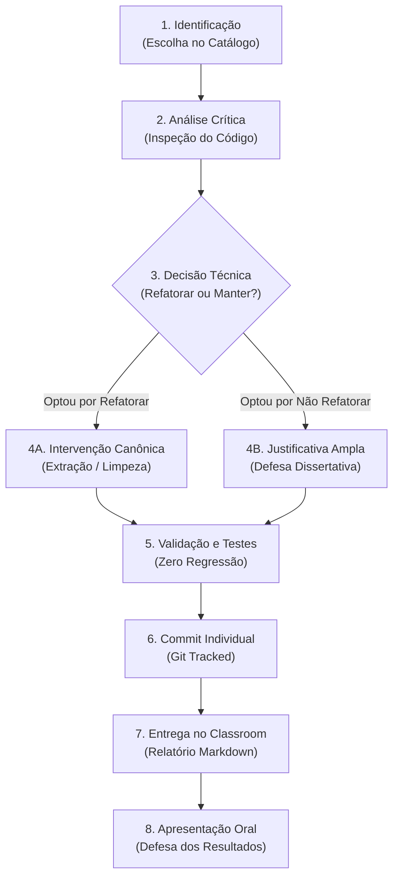

# Atividade Acadêmica: Code Smells e Refatoração de Software
## Projeto Integrador Origem — Marketplace de Artesanato de Pernambuco

> **Documento Mestre de Coordenação, Auditoria e Acompanhamento da Equipe**  
> **Branch de Trabalho:** `feat/frontend-next`  
> **Fase Atual:** Auditoria Inicial e Catálogo de Oportunidades de Refatoração  
> **Última Atualização:** 15 de novembro de 2026  

---

## Sumário

- [A. Contexto da Atividade](#a-contexto-da-atividade)
- [B. Escopo da Auditoria](#b-escopo-da-auditoria)
- [C. Catálogo de Possíveis Code Smells](#c-catálogo-de-possíveis-code-smells)
- [D. Análise Técnica Detalhada dos Candidatos](#d-análise-técnica-detalhada-dos-candidatos)
  - [CS-01: Código Duplicado e Acoplamento Estrutural em Repositórios](#cs-01-código-duplicado-e-acoplamento-estrutural-em-repositórios)
  - [CS-02: Acúmulo de Responsabilidades no Serviço de Catálogo](#cs-02-acúmulo-de-responsabilidades-no-serviço-de-catálogo)
  - [CS-03: Componente de Visualização com Lógica de Mock e Múltiplas Responsabilidades](#cs-03-componente-de-visualização-com-lógica-de-mock-e-múltiplas-responsabilidades)
  - [CS-04: Obsessão por Primitivos na Taxonomia e Filtragem Cultural](#cs-04-obsessão-por-primitivos-na-taxonomia-e-filtragem-cultural)
- [E. Distribuição de Responsabilidades da Equipe](#e-distribuição-de-responsabilidades-da-equipe)
- [F. Plano de Execução em 8 Etapas](#f-plano-de-execução-em-8-etapas)
- [G. Evidências e Resultados Coletivos](#g-evidências-e-resultados-coletivos)
- [H. Checklist Coletivo de Conformidade](#h-checklist-coletivo-de-conformidade)
- [I. Estado Atual e Próximos Passos](#i-estado-atual-e-próximos-passos)

---

## A. Contexto da Atividade

A presente atividade acadêmica tem como foco a aplicação prática dos conceitos de **Engenharia de Software**, **Qualidade de Código**, **Clean Code** e **Refatoração** (*Fowler, Beck, Martin*), utilizando como objeto de estudo o ecossistema real do **Projeto Origem**.

### Regras Oficiais da Atividade (Diretrizes Pedagógicas)

1. **Atuação Individual no Trabalho em Equipe:** Cada integrante da equipe deve selecionar de forma autônoma e analisar criticamente uma parte específica do código-fonte do projeto.
2. **Identificação Fundamentada:** Identificar formalmente pelo menos um *Code Smell*, descrevendo sua localização, classificação teórica e impactos em métricas de qualidade de software (legibilidade, coesão, acoplamento, manutenibilidade e extensibilidade).
3. **Avaliação Crítica e Pragmática:** A identificação de um Code Smell **não obriga** uma refatoração imediata. Cada integrante deve julgar se a intervenção é justificável ou se o código atual deve ser preservado.
4. **Intervenção ou Justificativa Dissertativa:**
   - **Caso opte por refatorar:** Aplicar uma técnica canônica de refatoração, garantir rigorosamente a preservação de comportamento (não quebrar funcionalidades nem contratos) e justificar os ganhos obtidos.
   - **Caso opte por não refatorar:** Elaborar uma justificativa técnica aprofundada e dissertativa em Markdown demonstrando por que manter a estrutura atual é a decisão mais prudente no contexto atual da aplicação.
5. **Rastreabilidade via Git:** Cada integrante deve ser responsável por pelo menos um **commit individual**, contendo mensagem descritiva indicando o Code Smell abordado e a intervenção realizada ou decisão documentada.
6. **Apresentação e Defesa Oral:** Cada integrante deverá defender individualmente seus resultados, detalhando a motivação técnica, os ganhos de qualidade alcançados, os riscos mitigados e as limitações remanescentes.

---

## B. Escopo da Auditoria

A auditoria de qualidade foi conduzida diretamente sobre a branch oficial de desenvolvimento `feat/frontend-next`, cobrindo as camadas recentemente integradas do frontend e do backend.

### Módulos Examinados

| Camada | Diretório / Módulo | Tecnologias Envolvidas | Foco da Inspeção |
| :--- | :--- | :--- | :--- |
| **Backend — Repositories** | `backend/src/repositories/` | Node.js, Express, TypeScript | Acesso a dados, parsing de catálogo, conversão de entidades |
| **Backend — Services** | `backend/src/services/` | Node.js, TypeScript | Regras de negócio, paginação, filtros por polo/técnica |
| **Backend — Controllers & Routes** | `backend/src/controllers/`, `backend/src/routes/` | Express, TypeScript | Contratos HTTP, validação de entrada, tratamento de exceções |
| **Frontend — Services** | `frontend/src/services/` | Next.js, Fetch API, TypeScript | Camada de abstração HTTP, consumo das APIs `/produtos` e `/artesaos` |
| **Frontend — Views & Contexts** | `frontend/src/views/`, `frontend/src/context/` | React 19, Next.js App Router | Estado compartilhado, acoplamento de visualização e regras de domínio |

### Metodologia de Análise

- **Inspeção Estática Orientada a Princípios:** Avaliação contra os princípios SOLID (*Single Responsibility, Open/Closed, Liskov Substitution, Interface Segregation, Dependency Inversion*).
- **Catálogo de Fowler & Beck:** Confronto com as definições formais de *Bad Smells* em código orientado a objetos e estruturado (*Refactoring: Improving the Design of Existing Code*).
- **Preservação de Regras de Negócio (`AGENTS.md`):** Garantia de que soluções temporárias conscientes de integração (ex.: leitura de `catalogo.json` para MVP) não sejam confundidas precipitadamente com defeitos graves, separando dívidas técnicas de decisões de transição arquitetural.

---

## C. Catálogo de Possíveis Code Smells

A auditoria identificou **4 candidatos principais a Code Smells**, cobrindo tanto a camada de backend quanto o frontend e a camada de integração HTTP:

| ID | Nome / Classificação Canônica | Arquivo(s) Afetado(s) | Camada | Impacto Principal | Gravidade | Recomendação Inicial |
| :---: | :--- | :--- | :---: | :--- | :---: | :--- |
| **CS-01** | **Código Duplicado / Shotgun Surgery** (*Duplicated Code*) | `backend/src/repositories/produto.repository.ts`<br>`backend/src/repositories/artesao.repository.ts` | Backend | Violação de DRY, risco de divergência de regras ao evoluir caminhos e técnicas | **Média** | **Refatorado e Validado** (Extract Module e Extract Function aplicados com sucesso) |
| **CS-02** | **Classe Grande / Mudança Divergente** (*Divergent Change / Large Class*) | `frontend/src/services/catalogService.ts` | Frontend | Acúmulo de vitrine pública, mutações administrativas e concorrência de estoque | **Alta** | **Refatoração com Cautela** ou **Justificativa de Transição** (Impacta múltiplos fluxos de tela) |
| **CS-03** | **Inveja de Recursos / Intimidade Inapropriada** (*Feature Envy / Inappropriate Intimacy*) | `frontend/src/views/ProductDetail.tsx` | Frontend | View acoplada a heurística de regex para fotos mockadas do Picsum | **Média** | **Justificativa de Manutenção** ou **Extração de Helper** (Depende de serviço real de mídia) |
| **CS-04** | **Obsessão por Primitivos** (*Primitive Obsession*) | `backend/src/services/produto.service.ts`<br>`frontend/src/context/ProductFilterContext.tsx` | Full Stack | Tratamento de termos culturais como `string` solta sem tipos ou enums nominais | **Baixa/Média** | **Refatoração Semântica** (Enriquecimento com tipos e uniões literais TypeScript) |

---

## D. Análise Técnica Detalhada dos Candidatos

### CS-01: Código Duplicado e Acoplamento Estrutural em Repositórios

- **Identificador:** `CS-01`
- **Nome Canônico:** Código Duplicado (*Duplicated Code*) / Cirurgia por Espingarda (*Shotgun Surgery*)
- **Localização Exata:**
  - `backend/src/repositories/produto.repository.ts` (linhas 36-55 e 62-77)
  - `backend/src/repositories/artesao.repository.ts` (linhas 35-52 e 58-73)

#### Trecho do Código Original

```typescript
// Presente identicamente em produto.repository.ts e artesao.repository.ts:

export function slugify(value: string): string {
  return value
    .normalize('NFD')
    .replace(/[\u0300-\u036f]/g, '')
    .toLowerCase()
    .replace(/[^a-z0-9]+/g, '-')
    .replace(/(^-|-$)/g, '');
}

const TECHNIQUE_MAP: Record<string, string> = {
  ceramica: 'Cerâmica Figurativa',
  couro: 'Couro',
  xilogravura: 'Xilogravura',
  papel_mache: 'Papel Machê',
  renda_renascenca: 'Renda Renascença',
  bordado: 'Bordado',
};

// Resolução de caminho duplicada na íntegra em ambas as classes de repositório:
private resolveCatalogPath(): string {
  const currentDir = path.dirname(fileURLToPath(import.meta.url));
  const candidatePaths = [
    path.resolve(currentDir, '../../../ia-recomendador/dados/catalogo.json'),
    path.resolve(process.cwd(), '../ia-recomendador/dados/catalogo.json'),
    path.resolve(process.cwd(), 'ia-recomendador/dados/catalogo.json'),
  ];

  for (const candidate of candidatePaths) {
    if (fs.existsSync(candidate)) {
      return candidate;
    }
  }

  throw new Error('Arquivo catalogo.json não encontrado nas localizações esperadas.');
}
```

#### Diagnóstico Técnico
Nas Etapas 7.1 e 7.2 foi necessária a rápida integração de dados a partir do arquivo JSON da IA. Como consequência, a função de normalização de strings `slugify`, a tabela de taxonomia visual `TECHNIQUE_MAP` e a lógica de busca resiliente do caminho do arquivo `resolveCatalogPath` foram duplicadas literalmente em ambos os repositórios.

#### Impactos na Qualidade de Software
- **Legibilidade:** Polui os repositórios com funções utilitárias que não são de sua responsabilidade conceitual.
- **Coesão:** Repositórios deveriam apenas orquestrar consultas e mapeamentos; não deveriam conhecer detalhes de parsing de caminhos do sistema operacional ou normalização textual genérica.
- **Acoplamento:** Se um novo formato de caminho for adicionado ou uma nova técnica cultural for cadastrada, dois arquivos distintos precisam ser modificados em sincronia (*Shotgun Surgery*).
- **Manutenibilidade:** Risco iminente de correção de bugs em uma cópia e esquecimento na outra.
- **Extensibilidade:** Dificulta a reutilização de `slugify` por futuros módulos (ex.: categorias ou polos).

#### Gravidade e Justificativa
**Média.** Não causa erro em tempo de execução imediato, mas viola frontalmente o princípio DRY (*Don't Repeat Yourself*) e degrada a manutenibilidade do backend logo em sua gênese.

#### Alternativas de Intervenção
1. **Extração de Módulos Compartilhados:** Criar `backend/src/utils/string.util.ts` para `slugify`, centralizar `TECHNIQUE_MAP` em `backend/src/constants/taxonomy.ts` e criar um loader compartilhado para `resolveCatalogPath` em `backend/src/repositories/catalogLoader.ts`.
2. **Manutenção do Status Quo:** Manter duplicado justificando que ambos os repositórios serão futuramente substituídos por consultas Prisma/PostgreSQL, tornando o arquivo JSON obsoleto.

#### Benefícios da Refatoração
- Eliminação total de código duplicado no backend.
- Centralização da taxonomia cultural do projeto em um único local.
- Resolução de caminho testável e reutilizável por qualquer repositório.

#### Riscos e Limitações
- Baixíssimo risco. A refatoração é puramente estrutural e não altera a assinatura de nenhum método público exposto aos controllers.

#### Validação Comportamental
- Executar `GET /api/v1/produtos?limit=100` e conferir se os 14 produtos continuam sendo retornados com `artisanId`.
- Executar `GET /api/v1/artesaos?limit=100` e verificar se os 10 artesãos continuam sendo extraídos e deduplicados.
- Executar testes de build do TypeScript: `npm run build` no backend.

---

### CS-02: Acúmulo de Responsabilidades no Serviço de Catálogo

- **Identificador:** `CS-02`
- **Nome Canônico:** Classe Grande (*Large Class*) / Mudança Divergente (*Divergent Change*)
- **Localização Exata:** `frontend/src/services/catalogService.ts` (linhas 38-83)

#### Trecho do Código Original

```typescript
export const catalogService = {
  // 1. Operações de Leitura Pública da Vitrine
  async list(): Promise<CatalogItem[]> { ... },
  async get(id: string): Promise<CatalogItem> { ... },

  // 2. Operações de Administração de Cadastro pelo Artesão
  async create(owner: Owner, input: CatalogItemInput): Promise<CatalogItem> { ... },
  async update(id: string, patch: Partial<CatalogItemInput>): Promise<CatalogItem> { ... },
  async remove(id: string): Promise<void> { ... },

  // 3. Gestão e Ajuste Manual de Saldo de Estoque
  async adjustStock(id: string, delta: number): Promise<CatalogItem> {
    const current = await catalogService.get(id)
    return request<CatalogItem>(`/produtos/${encodeURIComponent(id)}`, {
      method: 'PATCH',
      body: JSON.stringify({ stock: Math.max(0, current.stock + delta) }),
    })
  },

  // 4. Reserva Atômica de Estoque para Checkout de Compras
  async reserveStock(lines: StockReservation[]): Promise<CatalogItem[]> {
    const response = await request<ProductListResponse>('/estoque/reservas', {
      method: 'POST',
      body: JSON.stringify({ lines }),
    })
    return response.dados
  },
}
```

#### Diagnóstico Técnico
O objeto singleton `catalogService` concentra responsabilidades de três domínios funcionais completamente distintos:
1. Navegação pública de produtos da vitrine (consumidores anônimos).
2. Manutenção cadastral de catálogo (painel do artesão autenticado).
3. Gestão transacional e reserva de inventário (fluxo de finalização de compra / checkout).

Além disso, o método `adjustStock` implementa uma lógica no cliente (`read-then-write`) suscetível a condições de corrida (*Race Conditions*), calculando saldo no navegador em vez de delegar ao backend.

#### Impactos na Qualidade de Software
- **Coesão:** Baixa coesão. Uma alteração no contrato de reserva de estoque no checkout força modificações no mesmo arquivo que atende a vitrine pública.
- **Acoplamento:** Alto acoplamento entre contextos de navegação e fluxos transacionais.
- **Manutenibilidade:** Dificuldade em rastrear quem consome quais métodos do serviço.

#### Gravidade e Justificativa
**Alta.** A violação do Princípio da Responsabilidade Única (SRP) gera riscos reais de efeitos colaterais em telas críticas (como o Checkout) durante manutenções corriqueiras na vitrine de produtos.

#### Alternativas de Intervenção
1. **Segregação de Serviços:** Dividir em `catalogService.ts` (apenas leitura pública: `list`, `get`), `artisanCatalogService.ts` (operações autenticadas: `create`, `update`, `remove`) e `stockReservationService.ts` (operações transacionais de estoque: `reserveStock`).
2. **Preservação Justificada:** Manter a fachada única no frontend enquanto o backend ainda não possui os respectivos endpoints de checkout e autenticação implementados, documentando o plano de transição para a Fase 2 do projeto.

---

### CS-03: Componente de Visualização com Lógica de Mock e Múltiplas Responsabilidades

- **Identificador:** `CS-03`
- **Nome Canônico:** Inveja de Recursos (*Feature Envy*) / Intimidade Inapropriada (*Inappropriate Intimacy*)
- **Localização Exata:** `frontend/src/views/ProductDetail.tsx` (linhas 18-23 e 48-180)

#### Trecho do Código Original

```typescript
function getGalleryImages(product: Product): string[] {
  const match = product.imageUrl.match(/^(https:\/\/picsum\.photos\/seed\/)([^/]+)(\/.+)$/)
  if (!match) return [product.imageUrl]
  const [, prefix, seed, suffix] = match
  return [product.imageUrl, `${prefix}${seed}-detalhe${suffix}`, `${prefix}${seed}-ambiente${suffix}`]
}
```

#### Diagnóstico Técnico
A função `getGalleryImages` embutida no arquivo da página de detalhe do produto (`ProductDetail.tsx`) utiliza uma expressão regular acoplada aos identificadores específicos do serviço de mock externo `picsum.photos`. Se o backend fornecer imagens locais, URLs de CDN do Supabase Storage ou fotos de produção, a lógica falhará silenciosamente, degradando a galeria para apenas uma foto.

Além disso, a view gerencia diretamente 5 contextos React simultâneos (`useCart`, `useFavorites`, `useProductFilter`, `useCatalog`, `useArtisans`) misturados com renderização de acordeons, seletor de quantidade e badges de frete.

#### Impactos na Qualidade de Software
- **Legibilidade:** Mistura responsabilidades visuais da interface com regras sintéticas de geração de assets.
- **Manutenibilidade:** Quando as imagens reais do Supabase forem integradas, a view terá que ser editada para remover essa lógica.
- **Testabilidade:** Impossibilidade de testar a montagem da galeria sem renderizar todo o componente React.

#### Gravidade e Justificativa
**Média.** É um artifício de prototipação que permaneceu dentro da camada de apresentação visual.

#### Alternativas de Intervenção
1. **Extração de Helper/Hook:** Extrair para `frontend/src/utils/imageGallery.ts` ou criar um hook customizado `useProductGallery(product)`.
2. **Justificativa de Manutenção:** Manter inalterado temporariamente porque a integração de mídia real (GCS/Supabase Storage) está planejada para etapas posteriores, sendo um débito técnico tolerado e documentado.

---

### CS-04: Obsessão por Primitivos na Taxonomia e Filtragem Cultural

- **Identificador:** `CS-04`
- **Nome Canônico:** Obsessão por Primitivos (*Primitive Obsession*)
- **Localização Exata:**
  - `backend/src/services/produto.service.ts` (linhas 25-33)
  - `frontend/src/context/ProductFilterContext.tsx` (linhas 23-26 e 71-77)

#### Trecho do Código Original

```typescript
// backend/src/services/produto.service.ts
export interface ListarProdutosQuery {
  page?: number;
  limit?: number;
  technique?: string; // string primitiva arbitrária
  hub?: string;       // string primitiva arbitrária
}

if (options.technique) {
  const techLower = options.technique.toLowerCase();
  produtos = produtos.filter((p) => p.technique.toLowerCase() === techLower);
}

// frontend/src/context/ProductFilterContext.tsx
techniques: string[]
toggleTechnique: (technique: string) => void
hubs: string[]
toggleHub: (hub: string) => void
```

#### Diagnóstico Técnico
Técnicas artesanais de Pernambuco (ex.: *Cerâmica Figurativa*, *Xilogravura*, *Renda Renascença*) e Polos de Produção (ex.: *Caruaru*, *Olinda*, *Petrolina*) possuem um vocabulário controlado e finito no domínio do Projeto Origem. No entanto, o sistema os manipula em todas as camadas como `string` solta, forçando sanitizações repetitivas como `.toLowerCase().trim()` e impedindo que o compilador TypeScript detecte digitações inválidas.

#### Impactos na Qualidade de Software
- **Segurança de Tipos:** Valores inválidos passam sem erro em tempo de compilação.
- **Extensibilidade:** Dificuldade em adicionar metadados aos polos (ex.: macrorregião: Agreste, Sertão, RMR) ou técnicas.
- **Legibilidade:** O código não expressa a riqueza do domínio cultural de Pernambuco.

#### Gravidade e Justificativa
**Baixa a Média.** Não impede a execução, mas enfraquece as garantias estáticas do TypeScript e espalha validações manuais de string por múltiplos serviços.

#### Alternativas de Intervenção
1. **Modelagem de Tipos Literais / Enums:** Criar uniões de literais em TypeScript (`CulturalTechnique`, `ProductionHub`) com arrays imutáveis e type guards (`isCulturalTechnique()`).
2. **Manutenção do Status Quo:** Manter strings primitivas temporariamente para permitir flexibilidade durante a transição do catálogo estático da IA para a tabela do PostgreSQL.

---

## E. Distribuição de Responsabilidades da Equipe

A tabela a seguir deve ser utilizada para formalizar a alocação de cada integrante da equipe. **Nenhum integrante deve ter atribuição arbitrária antes de sua escolha explícita.**

| Integrante | Code Smell Selecionado | Camada / Módulo | Decisão Técnica | Status da Atividade | Arquivo Individual | Hash do Commit |
| :--- | :---: | :---: | :---: | :---: | :---: | :---: |
| *[Integrante 1 — CS-01]* | **CS-01** | Backend — Repositórios | Refatoração (Extract Module / Function) | **Validado** (Aguardando commit) | [`CS-01-duplicated-code.md`](integrantes/CS-01-duplicated-code.md) | *Pendente (a ser commitado)* |
| *[Nome do Integrante 2]* | *Pendente* | *Pendente* | *Pendente* | *Não Iniciado* | `integrantes/...` | *Pendente* |
| *[Nome do Integrante 3]* | *Pendente* | *Pendente* | *Pendente* | *Não Iniciado* | `integrantes/...` | *Pendente* |
| *[Nome do Integrante 4]* | *Pendente* | *Pendente* | *Pendente* | *Não Iniciado* | `integrantes/...` | *Pendente* |
| *[Nome do Integrante 5]* | *Pendente* | *Pendente* | *Pendente* | *Não Iniciado* | `integrantes/...` | *Pendente* |

> [!IMPORTANT]
> **Critério de Exclusividade:** Para assegurar diversidade na entrega da equipe e avaliação justa pela professora, recomenda-se que cada integrante selecione um candidato diferente ou um recorte bem delimitado de intervenção.

---

## F. Plano de Execução em 8 Etapas

Para assegurar uma condução metódica e sem riscos ao repositório, cada membro deve seguir este fluxo sequencial:



1. **Etapa 1 — Identificação:** O integrante escolhe um dos candidatos catalogados (`CS-01` a `CS-04`) ou submete um novo candidato para validação da equipe.
2. **Etapa 2 — Análise Crítica:** Mapeia os arquivos, inspeciona o código original e pontua os impactos nos pilares de qualidade.
3. **Etapa 3 — Decisão Técnica:** Pesa criticamente o custo-benefício. Decide formalmente entre aplicar a refatoração ou elaborar uma defesa fundamentada para manter o código como está.
4. **Etapa 4 — Execução:**
   - Se refatorar: executa a menor alteração suficiente no código, seguindo princípios de Clean Code.
   - Se mantiver: redige a dissertação técnica demonstrando o pragmatismo da decisão.
5. **Etapa 5 — Validação:** Executa os testes de compilação, requisições HTTP e verificação em tela para garantir integridade funcional inalterada.
6. **Etapa 6 — Commit Individual:** Realiza o commit assinado em seu nome na branch, com mensagem padronizada no padrão Conventional Commits.
7. **Etapa 7 — Entrega no Classroom:** Anexa ou referencia o relatório individual em formato Markdown devidamente preenchido.
8. **Etapa 8 — Apresentação Individual:** Prepara a exposição concisa (2 a 3 minutos) abordando motivação, decisões, evidências e aprendizados.

---

## G. Evidências e Resultados Coletivos

Este espaço é reservado para consolidar os resultados de testes e validações das intervenções realizadas pelos integrantes:

| ID | Tipo de Intervenção | Comando de Teste Utilizado | Resultado Observado | Status de Regressão |
| :---: | :--- | :--- | :--- | :---: |
| **CS-01** | Refatoração Modular (Extract Module/Function) | `npm run build` && `tsc` && script de 12 endpoints HTTP | **Aprovado** (0 erros de compilação, 12/12 rotas com payloads 100% idênticos) | **Zero Regressão** |
| **CS-02** | *Aguardando execução* | Teste de navegação e tipagem | *Aguardando* | *Sem regressão* |
| **CS-03** | *Aguardando execução* | Inspeção visual no navegador | *Aguardando* | *Sem regressão* |
| **CS-04** | *Aguardando execução* | Validação de tipos do compilador | *Aguardando* | *Sem regressão* |

---

## H. Checklist Coletivo de Conformidade

Tabela de acompanhamento para garantir que nenhum critério obrigatório da atividade acadêmica seja esquecido pela equipe:

| Critério Obrigatório da Atividade | Integrante 1 (CS-01) | Integrante 2 | Integrante 3 | Integrante 4 | Integrante 5 |
| :--- | :---: | :---: | :---: | :---: | :---: |
| 1. Code Smell formalmente identificado e localizado | [X] | [ ] | [ ] | [ ] | [ ] |
| 2. Diagnóstico técnico detalhado (coesão, acoplamento, etc.) | [X] | [ ] | [ ] | [ ] | [ ] |
| 3. Avaliação crítica da necessidade de refatoração | [X] | [ ] | [ ] | [ ] | [ ] |
| 4. Refatoração aplicada OU Justificativa dissertativa robusta | [X] | [ ] | [ ] | [ ] | [ ] |
| 5. Comportamento funcional preservado e validado | [X] | [ ] | [ ] | [ ] | [ ] |
| 6. Relatório individual em Markdown preenchido | [X] | [ ] | [ ] | [ ] | [ ] |
| 7. Commit individual com identificação clara no Git | [ ] | [ ] | [ ] | [ ] | [ ] |
| 8. Preparação para apresentação oral concluída | [X] | [ ] | [ ] | [ ] | [ ] |

---

## I. Estado Atual e Próximos Passos

### O Que Foi Concluído
- [x] Inspeção exaustiva do código-fonte na branch `feat/frontend-next`.
- [x] Identificação e catalogação de 4 candidatos consistentes a Code Smells.
- [x] Criação da estrutura de documentação versionável em `docs/qualidade/code-smells/`.
- [x] Elaboração do Documento Mestre (`README.md`).
- [x] Criação do modelo reutilizável individual (`integrantes/MODELO_INDIVIDUAL.md`).
- [x] **Execução e Validação da Intervenção CS-01:** Refatoração modular de `produto.repository.ts` e `artesao.repository.ts`, com extração de `string.util.ts`, `taxonomy.ts` e `catalogLoader.ts`.
- [x] **Preservação Comportamental Comprovada:** 12/12 rotas HTTP testadas com payloads estritamente idênticos à linha de base pré-refatoração; typecheck com 0 erros.
- [x] **Relatório Individual CS-01 Concluído:** Registrado formalmente em `integrantes/CS-01-duplicated-code.md`.

### Próximos Passos
1. Realização do commit individual referente ao CS-01 pelo integrante responsável na branch `feat/frontend-next`.
2. Demais integrantes realizarem a seleção de seus respectivos candidatos (CS-02, CS-03 ou CS-04) na Seção E.
3. Elaboração dos relatórios e intervenções individuais dos demais colegas utilizando o modelo padronizado.
