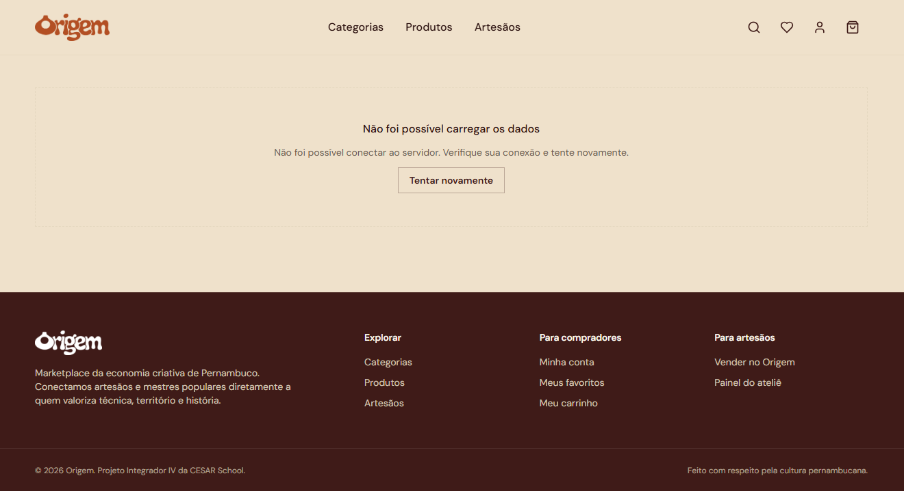

# Relatório Individual: Code Smell e Refatoração
## Projeto Integrador Origem — Atividade de Qualidade de Software

> **Intervenção Individual:** CS-12 — Bloco de "carregando / erro" repetido nas views (*Duplicated Code*)  
> **Status:** Refatoração aplicada e validada (build de produção + conferência visual)  
> **Branch:** `feat/frontend-next`  

---

## 1. Identificação do Integrante

- **Nome Completo:** Eduardo Henrique
- **Matrícula / E-mail Institucional:** 2025100608
- **Papel no Projeto:** Designer UI/UX & Frontend
- **Branch de Trabalho:** `feat/frontend-next`
- **Data da Conclusão:** 16/11/2026

---

## 2. Code Smell Selecionado

- **Identificador no Catálogo:** `CS-12`
- **Nome Canônico:** Código Duplicado (*Duplicated Code*)
- **Classificação Teórica:** Martin Fowler & Kent Beck (*Refactoring*, 2ª ed.) / Taxonomia de Mäntylä et al. (2003 — *Dispensables*)
- **Camada Afetada:** Frontend — Views (`frontend/src/views/`) e componente compartilhado `frontend/src/components/AsyncState.tsx`

---

## 3. Localização e Código Original

O [MAPEAMENTO.md](../MAPEAMENTO.md) registrava o padrão em 4 telas. Na reconferência do código (base `98e33ef`), a duplicação era maior: **9 blocos em 6 arquivos**.

| Arquivo | Linhas (antes) | Blocos | Espaçamento |
| :--- | :-: | :-: | :--- |
| `frontend/src/views/ProductDetail.tsx` | 56–64 | 1 (carregando ou erro) | `pb-24 pt-32` |
| `frontend/src/views/ArtisanProfile.tsx` | 27–45 | 2 (carregando + erro) | `pb-24 pt-32` |
| `frontend/src/views/ArtisanPanel.tsx` | 60–68 | 1 (carregando ou erro) | `pb-16 pt-24 sm:pb-24 sm:pt-28` |
| `frontend/src/views/Checkout.tsx` | 146–158 | 1 (carregando ou erro) | `pb-16 pt-24 sm:pb-24 sm:pt-28` |
| `frontend/src/views/AdminPanel.tsx` | 70–94 | 2 (carregando + erro) | `pb-16 pt-24 sm:pb-24 sm:pt-28` |
| `frontend/src/views/OrderConfirmation.tsx` | 15–23 | 1 (carregando) | `pb-16 pt-24 sm:pb-24 sm:pt-28` |

### Trecho do Código Original

```tsx
// frontend/src/views/ArtisanPanel.tsx (linhas 60-68)
if (status !== 'ready') {
  return (
    <main id="main-content" className="pb-16 pt-24 sm:pb-24 sm:pt-28">
      <Container>
        {status === 'error' ? <ErrorBlock message={loadError} onRetry={reload} /> : <LoadingBlock label="Carregando catálogo…" />}
      </Container>
    </main>
  )
}

// frontend/src/views/ProductDetail.tsx (linhas 56-64) — mesma estrutura, outro espaçamento
if (status !== 'ready' && !product) {
  return (
    <main id="main-content" className="pb-24 pt-32">
      <Container>
        {status === 'error' ? <ErrorBlock message={error} onRetry={reload} /> : <LoadingBlock label="Carregando peça…" />}
      </Container>
    </main>
  )
}
```

---

## 4. Diagnóstico e Impactos na Qualidade

O componente `AsyncState.tsx` já oferecia `LoadingBlock` e `ErrorBlock`, mas cada tela remontava manualmente o **invólucro da página** (`<main id="main-content">` + classes de espaçamento + `<Container>`) e a escolha entre carregamento e erro. O conhecimento "como uma página se apresenta enquanto o recurso não está pronto" estava espalhado em 6 arquivos.

- **Legibilidade:** cada view abria com 7 a 13 linhas de marcação de infraestrutura antes da lógica própria da tela, o que desviava a leitura do que a view realmente faz.
- **Coesão:** a responsabilidade de apresentar estados assíncronos pertence ao `AsyncState.tsx`, mas estava dividida entre ele e as views.
- **Acoplamento:** as 6 views dependiam diretamente de detalhes de layout (o `id="main-content"`, usado pelo link "pular para o conteúdo", e as classes de espaçamento) que deveriam ser decididos em um só lugar.
- **Manutenibilidade:** ajustar o espaçamento, o `id` de acessibilidade ou acrescentar, por exemplo, um `aria-busy` exigia editar 9 blocos sem esquecer nenhum (risco típico de *Shotgun Surgery*). Os espaçamentos já existiam em duas variantes sem registro do motivo.
- **Extensibilidade:** cada nova tela que carrega dados da API tenderia a copiar o bloco pela décima vez.

---

## 5. Alternativas Consideradas

1. **Abordagem A — *Extract Component* `ResourceGate` em `AsyncState.tsx` (escolhida):**
   - *Descrição:* criar um componente que recebe `status` (`'loading' | 'error'`), `label`, `error`, `onRetry` e `spacing` e renderiza o invólucro completo. As condições de cada tela (quando mostrar) permanecem na view; só a apresentação é centralizada.
   - *Vantagens:* elimina os 9 invólucros; as duas variantes de espaçamento ficam nomeadas (`page` e `detail`); o HTML gerado é idêntico ao anterior; nenhuma regra de negócio muda.
   - *Desvantagens:* acrescenta um componente e uma prop de espaçamento que o leitor precisa conhecer.
2. **Abordagem B — Componente de layout genérico `PageShell` + manter `LoadingBlock`/`ErrorBlock` nas views:**
   - *Descrição:* extrair apenas `<main>` + `<Container>` e deixar a escolha entre carregamento e erro em cada tela.
   - *Vantagens:* serviria também para as páginas "prontas" e para a tela "Peça não encontrada".
   - *Desvantagens:* resolve só metade da duplicação (o ternário `status === 'error' ? … : …` continuaria repetido) e alcança telas fora do escopo do smell, aumentando o risco visual.
3. **Abordagem C — Manter o código atual:**
   - *Descrição:* aceitar a repetição por ser marcação simples e sem regra de negócio.
   - *Vantagens:* zero risco imediato.
   - *Desvantagens:* diferente do CS-18 (boilerplate idiomático do React), aqui o bloco repetido carrega uma **decisão de produto** (espaçamento e `id` de acessibilidade) que já tinha divergido em duas variantes. Manter preservaria o custo de manutenção sem benefício.

---

## 6. Decisão Fundamentada

- **Decisão Final:** `[X] Refatorar o código imediatamente` | `[ ] Manter a implementação atual justificadamente`
- **Justificativa da Decisão:**  
  A refatoração tem escopo pequeno, risco baixo e ganho claro. É puramente estrutural: não altera dados, chamadas à API, condições de exibição nem regras de negócio, só o lugar onde a marcação de "carregando / erro" é declarada. Como o `AGENTS.md` exige preservar o visual existente, o componente foi desenhado para gerar exatamente o mesmo HTML de antes, incluindo as duas variantes de espaçamento, que foram mantidas e nomeadas em vez de unificadas (unificar mudaria a aparência de duas telas). As condições específicas de cada tela, como o `!isSubmitting` do checkout ou a ordem "carregando antes de erro" do painel administrativo, permaneceram nas views, porque são lógica da tela, e não duplicação. Com isso, a próxima mudança nesse estado (por exemplo, acessibilidade) passa a ser feita em um único arquivo.

---

## 7. Intervenção Realizada

- **Técnica de Refatoração Aplicada:** *Extract Component* (equivalente React do *Extract Function* de Fowler & Beck), com *Replace Magic Literal* para as classes de espaçamento.
- **Arquivos Criados ou Modificados:**
  - `frontend/src/components/AsyncState.tsx` (**modificado**, 29 → 65 linhas): novo componente `ResourceGate` e o mapa `resourceGateSpacing` (`page` / `detail`).
  - `frontend/src/views/ProductDetail.tsx` (**modificado**): 1 bloco substituído (`spacing="detail"`).
  - `frontend/src/views/ArtisanProfile.tsx` (**modificado**): 2 blocos substituídos (`spacing="detail"`); o `ErrorBlock` inline da lista de peças foi mantido, pois não é página inteira.
  - `frontend/src/views/ArtisanPanel.tsx` (**modificado**): 1 bloco substituído.
  - `frontend/src/views/Checkout.tsx` (**modificado**): 1 bloco substituído.
  - `frontend/src/views/AdminPanel.tsx` (**modificado**): 2 blocos substituídos, mantendo a ordem de verificação e o `onRetry` que recarrega os três recursos.
  - `frontend/src/views/OrderConfirmation.tsx` (**modificado**): 1 bloco substituído.
- **Passo a Passo da Intervenção:**  
  1. Reconferi o mapeamento com `grep` e encontrei 9 ocorrências em 6 arquivos (e não 4, como estava registrado). As telas `Cart`, `Favorites` e `Account` usam `LoadingBlock`/`ErrorBlock` **dentro** do conteúdo da página, um padrão diferente, e ficaram fora do escopo.
  2. Identifiquei as duas variantes de espaçamento e as registrei como `page` (padrão) e `detail`.
  3. Criei `ResourceGate` em `AsyncState.tsx`, reaproveitando `LoadingBlock` e `ErrorBlock` sem alterá-los.
  4. Substituí os 9 blocos, mantendo em cada view a condição original do `if`. Onde o `if` já restringe o tipo (`status !== 'ready'`), o TypeScript garante que só `'loading' | 'error'` chega ao componente.
  5. Removi os imports que ficaram sem uso (`LoadingBlock`/`ErrorBlock`) e conferi que `Container` continua usado pelo conteúdo principal de cada tela.

---

## 8. Comparação Antes vs. Depois

### Antes da Refatoração
```tsx
// frontend/src/views/AdminPanel.tsx (linhas 70-94)
if (statuses.includes('loading')) {
  return (
    <main id="main-content" className="pb-16 pt-24 sm:pb-24 sm:pt-28">
      <Container>
        <LoadingBlock label="Carregando painel…" />
      </Container>
    </main>
  )
}
if (statuses.includes('error')) {
  return (
    <main id="main-content" className="pb-16 pt-24 sm:pb-24 sm:pt-28">
      <Container>
        <ErrorBlock
          message={usersError ?? ordersError ?? catalogError}
          onRetry={() => { reloadUsers(); reloadOrders(); reloadCatalog() }}
        />
      </Container>
    </main>
  )
}
```

### Depois da Refatoração
```tsx
// frontend/src/components/AsyncState.tsx (novo)
const resourceGateSpacing = {
  page: 'pb-16 pt-24 sm:pb-24 sm:pt-28',
  detail: 'pb-24 pt-32',
} as const

export function ResourceGate({ status, label, error, onRetry, spacing = 'page' }: ResourceGateProps) {
  return (
    <main id="main-content" className={resourceGateSpacing[spacing]}>
      <Container>
        {status === 'error' ? <ErrorBlock message={error} onRetry={onRetry} /> : <LoadingBlock label={label} />}
      </Container>
    </main>
  )
}

// frontend/src/views/AdminPanel.tsx
if (statuses.includes('loading')) {
  return <ResourceGate status="loading" label="Carregando painel…" />
}
if (statuses.includes('error')) {
  return (
    <ResourceGate
      status="error"
      error={usersError ?? ordersError ?? catalogError}
      onRetry={() => { reloadUsers(); reloadOrders(); reloadCatalog() }}
    />
  )
}

// frontend/src/views/ArtisanPanel.tsx
if (status !== 'ready') {
  return <ResourceGate status={status} label="Carregando catálogo…" error={loadError} onRetry={reload} />
}
```

- **Métricas Observadas:**
  - *Invólucros `<main>` + `<Container>` de carregamento/erro:* Antes: **9** (em 6 arquivos) → Depois: **1** (em `ResourceGate`).
  - *Variantes de espaçamento declaradas como literal:* Antes: 9 cópias de 2 strings → Depois: 1 mapa nomeado.
  - *Linhas nas 6 views:* Antes: 1.633 → Depois: **1.586** (−47).
  - *Linhas em `AsyncState.tsx`:* Antes: 29 → Depois: 65 (+36, incluindo comentários de documentação).
  - *Saldo do diff:* 59 inserções e 70 remoções (`git diff --stat`), ou seja, −11 linhas no total, com a duplicação concentrada em um ponto.

---

## 9. Testes e Evidências de Validação

O projeto não tem suíte de testes de frontend (não há script `test` no `frontend/package.json`). A validação usou o build de produção do Next.js, que também executa a checagem de tipos do TypeScript, mais a conferência visual da tela de erro.

- **Comandos Executados:**
  ```powershell
  cd frontend
  npm run build
  ```
- **Evidências de Sucesso:**
  ```text
  ▲ Next.js 16.4.5 (Turbopack)
  ✓ Running next.config took 341ms
    Creating an optimized production build ...
  ✓ Compiled successfully in 44s
    Running TypeScript ...
    Finished TypeScript in 18.8s ...
  ✓ Collecting page data using 7 workers in 15.9s
  ✓ Generating static pages using 7 workers (10/10) in 544ms
  ✓ Finalizing page optimization in 18ms

  Route (app)
  ┌ ○ /
  ├ ○ /_not-found
  ├ ○ /admin
  ├ ƒ /artesaos/[id]
  ├ ○ /carrinho
  ├ ○ /checkout
  ├ ○ /conta
  ├ ○ /entrar
  ├ ○ /favoritos
  ├ ○ /painel
  ├ ƒ /pedido/[id]
  └ ƒ /produtos/[id]
  ```
  As 6 views alteradas estão entre as rotas geradas (`/produtos/[id]`, `/artesaos/[id]`, `/painel`, `/checkout`, `/admin` e `/pedido/[id]`), e a etapa de TypeScript terminou sem erros.
- **Comportamento Visual / Telas:** o HTML gerado é o mesmo de antes (mesmo `id`, mesmas classes e mesmos componentes internos). A conferência foi feita com o backend **desligado**, abrindo a página de uma peça (`/produtos/<id>`, espaçamento `detail`): o `ResourceGate` exibiu o bloco de erro com a mensagem da API e o botão "Tentar novamente", com o mesmo layout de antes da mudança.

  

- **Não executado:** o ESLint focado nos arquivos alterados não foi rodado nesta validação.
- **Observação sobre a base:** o build acima foi executado quando a branch ainda continha a refatoração do CS-09, depois retirada do remoto pelo grupo. O commit do CS-12 foi então reaplicado sobre `98e33ef`. Os 7 arquivos alterados pelo CS-12 são idênticos nas duas bases (só o `Header` e os arquivos do CS-09 diferem).

---

## 10. Benefícios Alcançados, Riscos e Limitações

- **Benefícios Concretos:**
  - Um único ponto de manutenção para o estado de página "carregando / erro" e para o `id="main-content"` usado na navegação por teclado.
  - As duas variantes de espaçamento, antes implícitas, agora têm nome e documentação.
  - As views ficaram mais curtas e começam pela própria lógica da tela.
  - Novas telas que consomem a API passam a ter um componente pronto, evitando a décima cópia.
- **Riscos Remanescentes:** baixos. Quem precisar de uma terceira variante de espaçamento deve acrescentá-la ao mapa `resourceGateSpacing`, e não passar classes soltas, para não reabrir o smell.
- **Limitações da Abordagem:**
  - As telas `Cart`, `Favorites` e `Account` usam os blocos dentro do conteúdo (sob o título da página) e não foram alteradas, por ser um padrão diferente.
  - A tela "Peça não encontrada" (`ProductDetail.tsx`) também tem `<main>` + `<Container>`, mas não é um estado assíncrono e ficou fora do escopo.
  - Não há testes automatizados de interface; a garantia de "zero regressão visual" vem da equivalência do HTML gerado e da conferência manual.

---

## 11. Rastreabilidade Git

- **Hash do Commit Individual:** `19e9f52`
- **Mensagem do Commit:** `refactor(frontend): extrai ResourceGate para estados de carregamento e erro das views (CS-12)`
- **Branch:** `feat/frontend-next`
- **Autor do Commit:** `duduhnrq`

---

## 12. Roteiro Sintético para Apresentação em Sala

1. **O Problema (30 seg):**  
   *"Escolhi o CS-12, Código Duplicado. Toda tela que busca dados na API precisa mostrar 'carregando' ou 'erro' enquanto espera. Cada tela fazia isso copiando o mesmo bloco de página, com o `<main>`, as classes de espaçamento e o `Container`. O mapeamento apontava 4 telas, mas ao conferir no código encontrei 9 cópias em 6 arquivos, e já em duas variantes de espaçamento diferentes."*
2. **A Avaliação Crítica (45 seg):**  
   *"Avaliei se era uma repetição aceitável, como o boilerplate dos contexts do CS-18, que o grupo decidiu não refatorar. A diferença é que aqui o bloco carrega uma decisão de produto: o espaçamento e o `id` usado pela navegação por teclado. Mudar qualquer um deles exigiria editar 9 lugares. Como a regra do projeto é não alterar o visual, a decisão foi refatorar gerando exatamente o mesmo HTML."*
3. **A Ação e Resultados (45 seg):**  
   *"Criei o componente `ResourceGate` no arquivo que já cuidava desses estados, o `AsyncState.tsx`, com as duas variantes de espaçamento nomeadas como `page` e `detail`. Cada tela continua decidindo quando mostrar o estado, mas não como mostrá-lo. Os 9 blocos viraram 1, as views perderam 47 linhas e o build e a checagem de tipos passaram."*
4. **Lição Aprendida (30 seg):**  
   *"A principal lição é que nem toda repetição é igual: o que pesa é se o trecho repetido carrega conhecimento que pode mudar. Também aprendi a conferir o mapeamento no código antes de agir, porque o problema real era o dobro do que estava registrado."*
