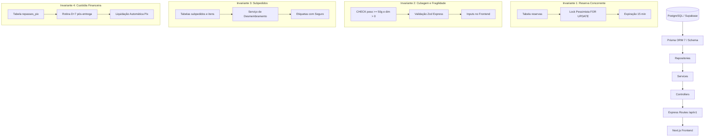

# Documento Mestre de Migração do Backlog Origem para o Jira

> **Projeto:** Origem — Marketplace da Economia Criativa e Artesanato Autoral de Pernambuco  
> **Finalidade do Documento:** Especificação técnica e normativa completa para criação, estruturação e governança das issues no Jira via ChatGPT Work (integração Atlassian).  
> **Versão de Referência:** 2.0 (Consolidação Unidade 2 — Avaliação 2)  
> **Branch de Trabalho:** `feat/frontend-next`  
> **Total de Issues Previstas:** 92 issues (10 Épicos + 18 Histórias de Usuário + 64 Tarefas SMART)  
> **Fontes Normativas Oficiais:**  
> - `references/backlog-priorizado-origem.md` (Histórias INVEST, BDD/Gherkin e 64 tarefas SMART)  
> - `references/relatorio-execucao-testes-origem.md` (19 casos de teste oficiais da squad)  
> - `references/projeto-integrador-origem.md` (Requisitos técnicos da disciplina e entregáveis AV2)  
> - `references/checklist-implementacao-origem.md` (Matriz de conformidade e taxonomia de requisitos)  
> - `AGENTS.md` (Diretrizes de preservação e governança do projeto)  
> - Relatórios de Auditoria Técnica das Etapas 6.1 e 6.1.1  

---

## 1. Estrutura Geral do Projeto

### 1.1. Identificação e Finalidade
- **Nome do Projeto:** Origem (CESAR School · Turma ADS020_ED · 2026.2).
- **Missão do Sistema:** Marketplace especializado no artesanato autoral e na economia criativa de Pernambuco, conectando mestres artesãos dos principais polos culturais (Alto do Moura/Caruaru, Tracunhaém, Bezerros, Pesqueira, Goiana) a compradores em todo o território nacional.
- **Diferenciais de Negócio:** Storytelling cultural biográfico, catálogo com cubagem física obrigatória para cálculo de frete, reserva concorrente atômica de peças exclusivas por 15 minutos (Invariante 1), desmembramento logístico de pedidos consolidados em subpedidos individuais por ateliê (Invariante 3) e retenção financeira em custódia com liquidação desacoplada via Pix em D+7 após entrega (Invariante 4).

### 1.2. Escopo da Avaliação 2 (AV2)
O objetivo da Avaliação 2 é entregar a aplicação full stack funcional e integrada:
1. **Frontend:** Interface Next.js (App Router) responsiva, acessível e refatorada, substituindo progressivamente os dados estáticos/simulados da Fake API pelas rotas oficiais da API RESTful.
2. **Backend:** Servidor Node.js com Express e TypeScript rigoroso (NodeNext ESM), estruturado em camadas (Routes, Controllers, Services, Repositories), expondo endpoints sob o prefixo padronizado `/api/v1` com tratamento centralizado de erros (`{ "erro": string }`).
3. **Persistência:** Banco de dados relacional PostgreSQL hospedado na infraestrutura Supabase, integrado ao backend via Prisma ORM 7 com adaptador `@prisma/adapter-pg` e pool `pg.Pool`. A modelagem é desenvolvida cooperativamente com a equipe da disciplina de Banco de Dados.
4. **Módulo de IA:** Recomendador inteligente de peças afins baseado em similaridade de cosseno ponderada por atributos culturais (técnica, polo, categoria, preço) e reforço de co-ocorrência em cestas de compra (Requisito da Avaliação 2 — PI L377 / Could Have do Backlog).

### 1.3. Stack Tecnológica Oficial
- **Frontend:** Next.js 16.4.5, React 19.3.1, Tailwind CSS v4, Lucide React, TypeScript 5.6.3. Porta de desenvolvimento: `5173`.
- **Backend:** Node.js v22 (LTS), Express 5.0.1, TypeScript 5.7.2 (NodeNext ESM com extensões `.js` em imports relativos), Zod 4.6.7 (validação de schema e sanitização de ambiente), CORS 2.8.5, dotenv 16.4.7. Porta de desenvolvimento: `3001`.
- **ORM e Banco:** Prisma ORM 7.10.1, `@prisma/adapter-pg` 7.10.1, driver `pg` 8.16.3, PostgreSQL 16+ (Supabase).
- **Módulo de IA:** Python 3.11, NumPy, BentoML (em `ia-recomendador/`), testado isoladamente via pytest.
- **Autenticação:** JWT com hash de senhas seguro (Argon2id ou bcrypt) e controle de acesso baseado em papéis (RBAC: `COMPRADOR`, `ARTESAO`, `CURADOR`, `ADMIN`).

### 1.4. Responsabilidades por Área Sugerida
Para efeitos de classificação e filtragem no Jira, as tarefas são distribuídas nas seguintes áreas de especialidade técnica (sem atribuição a pessoas individuais):
- **Banco:** Modelagem DDL, tabelas relacionais, constraints `CHECK`, índices (FTS/GIN, parciais), migrations e views no PostgreSQL/Supabase.
- **Backend:** Roteamento Express, controllers, serviços de domínio, repositórios Prisma, autenticação JWT, middlewares RBAC, mensageria e rotinas agendadas (cron jobs).
- **Frontend:** Páginas Next.js, componentes visuais, formulários, máscaras, contextos React, hooks de integração e consumo de endpoints da API.
- **IA:** Manutenção do algoritmo de recomendação, vetorização de catálogo e integração do microsserviço/serviço de peças afins.
- **QA:** Elaboração e execução de testes automatizados unitários, de integração e de estresse concorrente, além da validação dos cenários BDD/Gherkin.
- **Integração:** Configuração de webhooks, comunicação entre frontend e backend, parametrização de CORS e variáveis de ambiente.

### 1.5. Convenções de Identificação de Issues no Jira
Para garantir rastreabilidade bidirecional entre o repositório Git e o Jira, adota-se a seguinte taxonomia:
- **Épicos (10):** Chaves no padrão `EPIC-01` a `EPIC-10` (ou o prefixo gerado pelo Jira, vinculando o ID normativo no título e campo de label).
- **Histórias de Usuário (18):** Chaves preservando o identificador `HU-01` a `HU-18` (ex.: `[HU-01] Cadastro Unificado e Autenticação de Usuários`).
- **Tarefas SMART (64):** Chaves preservando a sigla original da tarefa técnica (ex.: `[T-CAD-01] Criação das tabelas de usuários e papéis de acesso`).
- **Casos de Teste (19):** Referenciados pela sigla oficial `TC01` a `TC18` e `TC-STRESS-01`.

### 1.6. Workflow Kanban Recomendado
1. **Backlog Priorizado:** Issue cadastrada com Definition of Ready (DoR) atendida, aguardando início de ciclo.
2. **Pronto para Desenvolvimento (Ready):** Dependências de schema e contratos técnicos resolvidas; pronta para execução.
3. **Em Desenvolvimento (In Progress):** Codificação ativa em branch de trabalho.
4. **Revisão Técnica / PR (Code Review):** Pull Request aberto com testes estáticos e validação TypeScript aprovados.
5. **Validação de QA (In Test):** Execução dos critérios de aceite BDD e casos de teste com evidência gravada.
6. **Concluído (Done):** Código integrado à branch principal, migrations versionadas, testes passando e checklist de conformidade atualizado.

### 1.7. Critérios de Conclusão e Definições de Pronto (DoD)
Para preservar a fidelidade às fontes normativas e não impor requisitos adicionais de forma indevida, diferenciam-se três níveis de conclusão:

1. **Definition of Done (DoD) de cada Tarefa SMART (Nível de Sub-task/Task):**
   - Cada uma das 64 tarefas técnicas possui seu DoD original específico definido no backlog (detalhado na Seção 4).
   - A tarefa é considerada concluída no Jira quando seu critério específico é entregue e verificado (ex.: para `T-CAD-04`, telas responsivas com máscaras de CPF/telefone e validação; para `T-CAD-01`, tabelas `usuarios` e `usuarios_papeis` criadas no banco; para `T-CAD-02`, rota `POST /auth/register` funcionando com hash de senha).
   - Uma tarefa de frontend não deve ser mantida aberta apenas porque a migration de banco da história ainda não foi rodada, desde que o escopo delimitado da task de UI tenha sido concluído e testado em sua camada.

2. **Critérios de Conclusão de uma História de Usuário (Nível de Story):**
   - Uma História (`HU-XX`) só transita para **Concluída / Done** quando todas as suas tarefas filhas (Banco, Backend e Frontend) estiverem finalizadas e todos os cenários de aceite em **BDD / Gherkin** estiverem implementados e validados com testes automatizados de integração.

3. **Critérios de Conclusão da Entrega Full Stack (Nível de Avaliação 2 — AV2):**
   - Conforme o Projeto Integrador, o produto final integrado exige a eliminação total de dados simulados em `localStorage` ou Fake API nos fluxos principais de compra, catálogo, checkout e autenticação, operando de ponta a ponta com o backend Express e banco PostgreSQL no Supabase.

### 1.8. Divergência Documental de Horas e Decisão para o Jira
- **Soma das 64 Tarefas Individuais:** A soma aritmética exata das estimativas de todas as 64 tarefas SMART do backlog é de **223 horas** (16h + 15h + 11h + 16h + 9h + 16h + 8h + 15h + 15h + 8h + 15h + 14h + 15h + 14h + 8h + 9h + 9h + 10h = 223h).
- **Registro no Cabeçalho do Backlog:** Na tabela resumo de `references/backlog-priorizado-origem.md` (linha 66), consta o texto `"64 Tarefas · 226h"`, representando uma divergência documental interna de +3h no total geral original.
- **Decisão para o Jira:** No Jira, o campo `Original Estimate` de cada issue receberá estritamente a estimativa documentada na respectiva tarefa SMART (ex.: `3h`, `4h`, etc.), resultando no total *bottom-up* de **223 horas**. Não serão adicionadas horas fictícias a nenhuma tarefa arbitrária para forçar a soma em 226h, preservando a rastreabilidade exata item a item.

---

## 2. Os 10 Épicos Oficiais do Backlog

| ID de Ref. | Nome Original Completo | Ordem | Prioridade MoSCoW | Histórias Vinculadas | Dependências Diretas | Critério de Conclusão do Épico |
| :---: | :--- | :---: | :---: | :--- | :--- | :--- |
| **EPIC-01** | Épico 1: Identidade, Acesso e Governança de Perfis | 1º | MUST HAVE | HU-01, HU-03, HU-02 | Provisionamento do PostgreSQL (Supabase) e chaves JWT | Usuários autenticados com JWT seguro, RBAC ativo (Comprador, Artesão, Curador, Admin), chave Pix blindada e recuperação de senha por token. |
| **EPIC-02** | Épico 2: Gestão do Ateliê e Curadoria Delegada | 2º | MUST HAVE | HU-04 | EPIC-01 (Perfil de Artesão Titular) | Ateliês cadastrados atomicamente com endereço de expedição 1:1, validação de polos pernambucanos e bloqueio de múltiplos ateliês. |
| **EPIC-03** | Épico 3: Acervo Cultural, Cubagem Física e Lotes Limitados | 3º | MUST HAVE | HU-05, HU-06 | EPIC-02 (Ateliê existente para vinculação) | Peças catalogadas com restrição física estrita (peso $\ge 50$g, dimensões $>0$, `is_fragil`) e lotes limitados decrementados atomicamente sem overselling. |
| **EPIC-04** | Épico 4: Vitrine Regional, Busca e Cotação Logística | 4º | MUST HAVE | HU-07, HU-08 | EPIC-03 (Catálogo de peças ativas com cubagem) | Vitrine pública com busca textual FTS (índices GIN), filtros facetados por polo/técnica, simulação prévia de frete e portfólio cultural isolado do artesão. |
| **EPIC-05** | Épico 5: Carrinho Multi-Origem e Reserva Concorrente de Peças | 5º | MUST HAVE | HU-09 | EPIC-03, EPIC-04 | Carrinho agrupando peças por ateliê com fretes independentes e reserva atômica de 15 minutos com lock pessimista impedindo venda duplicada (Invariante 1). |
| **EPIC-06** | Épico 6: Checkout Unificado e Pagamento Consolidado | 6º | MUST HAVE | HU-10, HU-11 | EPIC-05 (Reserva ativa de 15 minutos) | Pagamento único consolidado gerando Pix dinâmico com tempo casado à reserva, ingestão de webhook com idempotência e livro de múltiplos endereços. |
| **EPIC-07** | Épico 7: Orquestração de Subpedidos e Logística Regional (SLA 7 Dias) | 7º | MUST HAVE | HU-12, HU-13 | EPIC-06 (Pedido aprovado via gateway) | Pedido consolidado fatiado em subpedidos por ateliê com seguro rodoviário obrigatório, rastreamento ativo e cancelamento por estouro de 7 dias úteis. |
| **EPIC-08** | Épico 8: Custódia Financeira Desacoplada e Repasses Automatizados via Pix | 8º | MUST HAVE | HU-14 | EPIC-07 (Subpedidos com status ENTREGUE) | Valor líquido retido em custódia D+7 após entrega física e liquidado automaticamente via Pix para o titular na ausência de sinistros (Invariante 4). |
| **EPIC-09** | Épico 9: Gestão de Avarias em Transporte (Sinistros) e Arrependimento Legal (CDC) | 9º | MUST HAVE | HU-15, HU-16 | EPIC-07, EPIC-08 (Custódia retida do subpedido) | Abertura de avaria em até 48h com congelamento imediato do Pix, arbitragem de sinistro pelo administrador e logística reversa em 7 dias (Art. 49 CDC). |
| **EPIC-10** | Épico 10: Gestão Administrativa, Notificações e Auditoria da Plataforma | 10º | MUST HAVE | HU-17, HU-18 | EPIC-01 a EPIC-09 | Mensageria assíncrona tolerante a falhas (BullMQ) para avisos de SLA e painel administrativo com moderação curatorial e auditoria de sinistros. |

---

## 3. As 18 Histórias de Usuário Oficiais

---

### [HU-01] Cadastro Unificado e Autenticação de Usuários
- **Épico:** `EPIC-01` · Épico 1: Identidade, Acesso e Governança de Perfis
- **Prioridade MoSCoW:** MUST HAVE
- **Descrição INVEST:**
  > ***Como*** visitante da plataforma,  
  > ***quero*** me cadastrar e autenticar informando nome, e-mail, CPF/CNPJ, telefone WhatsApp e senha,  
  > ***para*** possuir uma conta de acesso unificada e segura que me permita comprar obras ou solicitar perfis avançados no sistema.
- **Critérios de Aceite (BDD / Gherkin):**
  ```gherkin
  Cenário 1: Cadastro de usuário com dados válidos
  Dado que o visitante acessa a tela de cadastro
  Quando preenche nome completo, e-mail não existente, CPF/CNPJ válido e senha forte (>= 8 caracteres, letra maiúscula, número e símbolo)
  E clica em "Criar Conta"
  Então a conta deve ser criada com status ativo no banco
  E o papel inicial "COMPRADOR" deve ser atribuído
  E o sistema deve retornar HTTP 201 Created com redirecionamento à vitrine autenticada

  Cenário 2: Tentativa de cadastro com dados duplicados
  Dado que o visitante informa um e-mail ou CPF/CNPJ já cadastrado no sistema
  Quando tenta submeter o formulário
  Então o sistema deve bloquear a operação com HTTP 409 Conflict
  E exibir a mensagem: "Este e-mail ou CPF/CNPJ já está associado a uma conta ativa"

  Cenário 3: Bloqueio temporário por força bruta no login (RNF-04)
  Dado que um usuário erra a senha por 5 vezes consecutivas para a mesma conta
  Quando tentar a 6ª submissão de senha incorreta
  Então o sistema deve bloquear novas tentativas por 15 minutos e retornar HTTP 429 Too Many Requests
  ```
- **Tarefas SMART Vinculadas:** `T-CAD-01` (Banco), `T-CAD-02` (Backend), `T-CAD-03` (Backend), `T-CAD-04` (Frontend).
- **Casos de Teste Associados:** `TC01` (Resultado oficial: ❌ Reprovado por ausência de bloqueio após 5 tentativas inválidas).
- **Estado Atual da Implementação:** **Parcialmente implementada**.
- **Evidências no Código:** [Login.tsx](file:///c:/Users/CAUÂ/Documents/GitHub/projetos/Origem/frontend/src/views/Login.tsx) (interface visual com abas de login/registro); [authService.ts](file:///c:/Users/CAUÂ/Documents/GitHub/projetos/Origem/frontend/src/services/authService.ts) (simulação em `localStorage`).
- **Ressalvas e Funcionalidades Simuladas:** Autenticação no navegador armazena senha em texto puro no `localStorage`; formulário omite CPF/CNPJ e WhatsApp; não há bloqueio por força bruta; rotas Express `/auth` não existem no backend atual.
- **Dependências Técnicas:** Schema Supabase (`usuarios`, `usuarios_papeis`), biblioteca de hash (Argon2id/bcrypt) e rota JWT no Express.
- **Condições para Conclusão:** Rotas `/auth/register` e `/auth/login` ativas e integradas ao frontend com CPF obrigatório, validação de unicidade e bloqueio após 5 erros com HTTP 429.

---

### [HU-03] Especialização de Artesão Titular e Blindagem de Curadoria
- **Épico:** `EPIC-01` · Épico 1: Identidade, Acesso e Governança de Perfis
- **Prioridade MoSCoW:** MUST HAVE
- **Descrição INVEST:**
  > ***Como*** artesão titular,  
  > ***quero*** registrar minha biografia cultural, cadastrar minha Chave Pix e gerenciar os vínculos de curadores operacionais,  
  > ***para*** vender minhas obras, receber repasses financeiros diretamente e delegar a administração do catálogo sem expor meus dados bancários.
- **Critérios de Aceite (BDD / Gherkin):**
  ```gherkin
  Cenário 1: Habilitação de artesão com chave Pix válida
  Dado que estou autenticado como usuário comum
  Quando preencho minha biografia cultural e uma Chave Pix válida no formato BACEN (CPF, e-mail, celular ou aleatória)
  E submeto a habilitação
  Então o registro de artesão titular deve ser criado no banco
  E o papel "ARTESAO" deve ser associado ao meu perfil

  Cenário 2: Blindagem de acesso financeiro por Curador (Invariante 5.5)
  Dado que estou autenticado com o papel exclusivo de "CURADOR"
  Quando tento disparar uma requisição PATCH para alterar a chave Pix do ateliê
  Então o sistema deve bloquear imediatamente a requisição com HTTP 403 Forbidden
  E gravar um registro de auditoria de segurança

  Cenário 3: Vinculação de curador pelo artesão titular
  Dado que sou o artesão titular do ateliê
  Quando informo o e-mail de outro usuário ativo na plataforma para atuar como curador
  Então o vínculo associativo deve ser criado em "atelies_curadores"
  E o usuário indicado passa a ter permissão de gerenciar catálogo e etiquetas
  ```
- **Tarefas SMART Vinculadas:** `T-ART-01` (Banco), `T-ART-02` (Backend), `T-ART-03` (Backend), `T-ART-04` (Frontend).
- **Casos de Teste Associados:** `TC02` (Resultado oficial: ⛔ Bloqueado porque o endpoint de Chave Pix e o papel CURADOR não existem).
- **Estado Atual da Implementação:** **Não iniciada**.
- **Evidências no Código:** [Login.tsx](file:///c:/Users/CAUÂ/Documents/GitHub/projetos/Origem/frontend/src/views/Login.tsx#L55) possui toggle simplificado de perfil artesão consumindo [artisanService.ts](file:///c:/Users/CAUÂ/Documents/GitHub/projetos/Origem/frontend/src/services/artisanService.ts).
- **Ressalvas e Funcionalidades Simuladas:** Não existe campo de Chave Pix; não existe entidade ou permissão para `CURADOR`; não existe middleware RBAC 403.
- **Dependências Técnicas:** Tabelas `artesaos` e `atelies_curadores` no Supabase, cifra de chave Pix e middleware de autorização no Express.
- **Condições para Conclusão:** Registro de Chave Pix com validação BACEN, papel `CURADOR` funcional e requisições deste perfil a rotas bancárias rejeitadas com HTTP 403.

---

### [HU-04] Parametrização do Ateliê e Endereço Físico de Origem
- **Épico:** `EPIC-02` · Épico 2: Gestão do Ateliê e Curadoria Delegada
- **Prioridade MoSCoW:** MUST HAVE
- **Descrição INVEST:**
  > ***Como*** artesão titular,  
  > ***quero*** cadastrar o nome comercial, o polo cultural de procedência e o endereço completo de expedição do meu ateliê,  
  > ***para*** que minha unidade produtiva seja identificada na plataforma e o cálculo de frete multi-origem utilize meu CEP real de saída de mercadorias.
- **Critérios de Aceite (BDD / Gherkin):**
  ```gherkin
  Cenário 1: Cadastro atômico de ateliê e endereço de expedição
  Dado que estou autenticado como artesão titular sem ateliê cadastrado
  Quando submeto nome comercial, polo homologado (ex: "Tracunhaém") e endereço com CEP, número e logradouro
  Então o registro de "atelies" e o registro de "enderecos" devem ser persistidos em uma única transação atômica
  E a relação 1:1 estrita deve ser estabelecida

  Cenário 2: Autopreenchimento por CEP
  Dado que estou no formulário de endereço do ateliê
  Quando digito um CEP válido de Pernambuco (8 dígitos) e saio do campo
  Então os campos de logradouro, bairro, cidade e UF devem ser preenchidos automaticamente em menos de 1 segundo

  Cenário 3: Restrição de unicidade de ateliê no MVP
  Dado que já possuo um ateliê ativo vinculado ao meu cadastro
  Quando tento submeter novo formulário de criação de ateliê
  Então o sistema deve rejeitar a operação com HTTP 422 Unprocessable Entity
  ```
- **Tarefas SMART Vinculadas:** `T-ATE-01` (Banco), `T-ATE-02` (Backend), `T-ATE-03` (Frontend).
- **Casos de Teste Associados:** `TC03` (Resultado oficial: ⛔ Bloqueado por ausência de rotas e persistência 1:1 de ateliê e endereço).
- **Estado Atual da Implementação:** **Parcialmente implementada**.
- **Evidências no Código:** [addressService.ts](file:///c:/Users/CAUÂ/Documents/GitHub/projetos/Origem/frontend/src/services/addressService.ts) possui consulta isolada ao ViaCEP.
- **Ressalvas e Funcionalidades Simuladas:** Não existe formulário no frontend para cadastrar ateliê com endereço de expedição; backend não possui rota `POST /atelies`.
- **Dependências Técnicas:** Tabelas `atelies` e `enderecos` (com chave estrangeira 1:1 estrita `enderecos.atelie_id UNIQUE`).
- **Condições para Conclusão:** Transação atômica que persiste ateliê e endereço de origem no Supabase com validação de polos pernambucanos homologados.

---

### [HU-05] Catalogação de Peças com Cubagem Obrigatória e Fotos
- **Épico:** `EPIC-03` · Épico 3: Acervo Cultural, Cubagem Física e Lotes Limitados
- **Prioridade MoSCoW:** MUST HAVE
- **Descrição INVEST:**
  > ***Como*** artesão ou curador autorizado,  
  > ***quero*** catalogar uma peça informando título, descrição, tipologia, preço, peso embalado, dimensões físicas, indicador de fragilidade e fotos,  
  > ***para*** disponibilizar a obra na vitrine pública garantindo parâmetros exatos para o cálculo automatizado do frete e do seguro de carga.
- **Critérios de Aceite (BDD / Gherkin):**
  ```gherkin
  Cenário 1: Publicação com cubagem e peso válidos
  Dado que preencho título, tipologia homologada, preço > 0, peso >= 50g, dimensões > 0 e envio 2 fotos
  Quando clico em "Publicar Peça"
  Então a peça deve ser gravada com status "DISPONIVEL" E as URLs das fotos otimizadas devem ser associadas

  Cenário 2: Rejeição por violação de peso mínimo (Invariante 2)
  Dado que tento cadastrar uma peça informando peso de 30 gramas
  Quando tento submeter a publicação
  Então o sistema deve rejeitar a operação com HTTP 422 Unprocessable Entity
  E destacar: "O peso mínimo embalado para cotação de frete é 50g"

  Cenário 3: Sinalização de fragilidade para seguro
  Dado que a peça cadastrada possui a opção "Peça Frágil (Cerâmica/Barro)" marcada como verdadeira
  Quando a peça é publicada
  Então ela deve ser gravada com is_fragil = true para fins de seguro de carga obrigatório
  ```
- **Tarefas SMART Vinculadas:** `T-PEC-01` (Banco), `T-PEC-02` (Backend), `T-PEC-03` (Backend), `T-PEC-04` (Frontend).
- **Casos de Teste Associados:** `TC04` (Resultado oficial: ❌ Reprovado porque o formulário e a API aceitaram peças com peso 30g e dimensões zero).
- **Estado Atual da Implementação:** **Parcialmente implementada (Divergente da Invariante Central 2)**.
- **Evidências no Código:** [ArtisanPanel.tsx](file:///c:/Users/CAUÂ/Documents/GitHub/projetos/Origem/frontend/src/views/ArtisanPanel.tsx#L18-L36) possui formulário de peça, mas omite completamente peso, dimensões e `is_fragil`.
- **Ressalvas e Funcionalidades Simuladas:** Peças criadas na interface usam Fake API e não exigem cubagem; upload é campo de texto para URL simples.
- **Dependências Técnicas:** Constraints `CHECK (peso_gramas >= 50)`, `CHECK (comprimento_cm > 0)` no PostgreSQL e validação Zod no Express.
- **Condições para Conclusão:** Formulário atualizado com campos de cubagem, API validando regras físicas com HTTP 422 em violações e persistência em `pecas` e `fotos_peca`.

---

### [HU-06] Gestão de Lotes Limitados e Controle de Estoque
- **Épico:** `EPIC-03` · Épico 3: Acervo Cultural, Cubagem Física e Lotes Limitados
- **Prioridade MoSCoW:** SHOULD HAVE
- **Descrição INVEST:**
  > ***Como*** artesão ou curador,  
  > ***quero*** cadastrar peças indicando uma quantidade física de estoque maior que 1 (Lote Limitado),  
  > ***para*** vender réplicas autorizadas da mesma tipologia e dimensões sem ter o trabalho de recadastrar o item individualmente a cada venda.
- **Critérios de Aceite (BDD / Gherkin):**
  ```gherkin
  Cenário 1: Cadastro de lote com estoque múltiplo
  Dado que estou cadastrando uma peça em lote
  Quando defino a quantidade em estoque como 10 unidades
  Então a peça deve ser salva com quantidade_estoque = 10
  E a vitrine deve exibir a contagem disponível

  Cenário 2: Decremento atômico de estoque no início da compra
  Dado um lote com quantidade_estoque = 5
  Quando um comprador inicia o checkout reservando 2 unidades
  Então o saldo de estoque disponível deve ser reduzido atomicamente para 3

  Cenário 3: Prevenção de saldo negativo (Overselling)
  Dado um lote com quantidade_estoque = 1
  Quando dois compradores tentam reservar simultaneamente 1 unidade cada
  Então exatamente 1 transação deve obter sucesso e a outra deve ser rejeitada com HTTP 409 Conflict
  E o saldo em estoque nunca deve ficar negativo
  ```
- **Tarefas SMART Vinculadas:** `T-LOT-01` (Banco), `T-LOT-02` (Backend), `T-LOT-03` (Frontend).
- **Casos de Teste Associados:** `TC08` (Bloqueado) e `TC-STRESS-01` (Reprovado na FakeAPI).
- **Estado Atual da Implementação:** **Parcialmente implementada**.
- **Evidências no Código:** [ArtisanPanel.tsx](file:///c:/Users/CAUÂ/Documents/GitHub/projetos/Origem/frontend/src/views/ArtisanPanel.tsx#L41) tem alerta de estoque baixo ($\le 3$); [CartContext.tsx](file:///c:/Users/CAUÂ/Documents/GitHub/projetos/Origem/frontend/src/context/CartContext.tsx) limita a quantidade selecionada.
- **Ressalvas e Funcionalidades Simuladas:** Controle opera apenas em memória no cliente; sem transação ACID no PostgreSQL.
- **Dependências Técnicas:** Coluna `pecas.quantidade_estoque` com constraint `CHECK (quantidade_estoque >= 0)` e transações com lock pessimista no Express.
- **Condições para Conclusão:** Concorrência real de múltiplos compradores testada contra o PostgreSQL com zero vendas duplicadas físicas.

---

### [HU-07] Vitrine Cultural com Filtros Dinâmicos e Busca Textual (FTS)
- **Épico:** `EPIC-04` · Épico 4: Vitrine Regional, Busca e Cotação Logística
- **Prioridade MoSCoW:** MUST HAVE
- **Descrição INVEST:**
  > ***Como*** comprador ou visitante,  
  > ***quero*** filtrar o acervo por polo geográfico e tipologia, realizar buscas textuais pelo nome ou descrição da peça e simular o frete na página do item,  
  > ***para*** encontrar obras de meu interesse cultural e conhecer previamente o custo e prazo de envio até minha residência.
- **Critérios de Aceite (BDD / Gherkin):**
  ```gherkin
  Cenário 1: Filtragem combinada por polo e tipologia
  Dado que acesso a vitrine pública
  Quando seleciono o polo "Tracunhaém" e a tipologia "Barro/Cerâmica"
  Então apenas peças disponíveis que atendam a ambos os critérios devem ser exibidas
  E a resposta da listagem deve ocorrer em tempo inferior a 400ms

  Cenário 2: Busca textual por termos culturais (FTS)
  Dado que digito "maracatu barro" no campo de busca
  Quando a pesquisa é executada
  Então as peças correspondentes devem ser retornadas ordenadas por relevância textual via índice GIN

  Cenário 3: Simulação de frete na página de detalhes
  Dado que informo um CEP de entrega válido na página da peça
  Quando clico em "Calcular Frete"
  Então o sistema deve consultar a API logística com base no CEP do ateliê de origem e cubagem da peça
  E exibir o valor e o prazo estimado em menos de 1.800ms
  ```
- **Tarefas SMART Vinculadas:** `T-VIT-01` (Banco), `T-VIT-02` (Backend), `T-VIT-03` (Backend), `T-VIT-04` (Frontend).
- **Casos de Teste Associados:** `TC06` (Resultado oficial: ❌ Reprovado; a observação oficial da equipe duplicou acidentalmente a nota do TC04; no código da branch atual, índices GIN e FTS no backend ainda não foram implementados).
- **Estado Atual da Implementação:** **Parcialmente implementada**.
- **Evidências no Código:** [Home.tsx](file:///c:/Users/CAUÂ/Documents/GitHub/projetos/Origem/frontend/src/views/Home.tsx) e [ProductFilters.tsx](file:///c:/Users/CAUÂ/Documents/GitHub/projetos/Origem/frontend/src/components/ProductFilters.tsx) possuem filtros por técnica e polo; [ProductDetail.tsx](file:///c:/Users/CAUÂ/Documents/GitHub/projetos/Origem/frontend/src/views/ProductDetail.tsx#L42) exibe aviso estático de frete.
- **Ressalvas e Funcionalidades Simuladas:** A busca atual é filtragem de strings em memória do React; não há índices GIN/tsvector no banco; simulação de frete na página da peça não existe.
- **Dependências Técnicas:** Índice GIN em `pecas(to_tsvector('portuguese', titulo || ' ' || descricao))` e rota `POST /frete/simular` no Express.
- **Condições para Conclusão:** Endpoint `GET /api/v1/produtos` com busca FTS e componente de cálculo de frete funcional na página do produto.

---

### [HU-08] Perfil Biográfico e Portfólio do Mestre Artesão
- **Épico:** `EPIC-04` · Épico 4: Vitrine Regional, Busca e Cotação Logística
- **Prioridade MoSCoW:** MUST HAVE
- **Descrição INVEST:**
  > ***Como*** comprador interessado na procedência cultural,  
  > ***quero*** acessar a página dedicada de um Mestre Artesão específico para ler sua trajetória histórica e visualizar todas as suas obras catalogadas,  
  > ***para*** compreender o valor autoral do trabalho e adquirir peças diretamente de sua tradição artística.
- **Critérios de Aceite (BDD / Gherkin):**
  ```gherkin
  Cenário 1: Exibição de storytelling e acervo do artesão
  Dado que clico no nome do artesão em qualquer card da vitrine
  Quando a página "/mestre/:id" é carregada
  Então devo visualizar sua fotografia, polo regional, biografia cultural completa
  E a grade de suas peças disponíveis para venda

  Cenário 2: Isolamento de catálogo por produtor
  Dado que o Mestre A possui 5 peças e o Mestre B possui 3
  Quando acesso a página do Mestre A
  Então nenhuma peça do Mestre B deve constar na listagem retornada

  Cenário 3: Otimização de SEO cultural
  Dado que a página do mestre é indexada por motores de busca
  Quando o HTML é renderizado
  Então as meta tags Open Graph (Title, Description) devem conter o nome do mestre e o resumo de sua história
  ```
- **Tarefas SMART Vinculadas:** `T-MES-01` (Banco), `T-MES-02` (Backend), `T-MES-03` (Frontend).
- **Casos de Teste Associados:** `TC07` (Resultado oficial: ✅ Aprovado via interface Vercel com isolamento de acervo).
- **Estado Atual da Implementação:** **Parcialmente implementada (UI Concluída e Aprovada; Backend Ausente)**.
- **Evidências no Código:** [ArtisanProfile.tsx](file:///c:/Users/CAUÂ/Documents/GitHub/projetos/Origem/frontend/src/views/ArtisanProfile.tsx) e [artisanService.ts](file:///c:/Users/CAUÂ/Documents/GitHub/projetos/Origem/frontend/src/services/artisanService.ts).
- **Ressalvas e Funcionalidades Simuladas:** A interface consome mocks ou Fake API; o endpoint real `GET /api/v1/artesaos/:id` e a tabela `artesaos` no Supabase ainda não estão conectados nesta branch.
- **Dependências Técnicas:** Schema Supabase (`artesaos`, `atelies`, `pecas`) e rota pública no Express.
- **Condições para Conclusão:** Conexão da tela `ArtisanProfile.tsx` ao backend Express real mantendo o isolamento de catálogo aprovado no TC07.

---

### [HU-09] Carrinho Fracionado e Reserva Concorrente de Peça Única (Invariante 1)
- **Épico:** `EPIC-05` · Épico 5: Carrinho Multi-Origem e Reserva Concorrente de Peças
- **Prioridade MoSCoW:** MUST HAVE
- **Descrição INVEST:**
  > ***Como*** comprador,  
  > ***quero*** consolidar itens de múltiplos ateliês no carrinho e ter peças únicas reservadas atomicamente por 15 minutos ao prosseguir para o pagamento,  
  > ***para*** que nenhum outro usuário adquira a mesma peça exclusiva enquanto concluo a transação e eu visualize com clareza os fretes fracionados por origem.
- **Critérios de Aceite (BDD / Gherkin):**
  ```gherkin
  Cenário 1: Agrupamento visual de carrinho multi-origem
  Dado que adiciono itens do Ateliê A (Tracunhaém) e do Ateliê B (Bezerros)
  Quando visualizo meu carrinho de compras
  Então os itens devem ser exibidos em 2 blocos separados por ateliê
  E cada bloco deve apresentar seu frete individualizado e o total consolidado da compra

  Cenário 2: Colisão concorrente na reserva de peça única
  Dado que uma peça única possui estoque = 1
  Quando 50 compradores clicam simultaneamente em avançar para o pagamento
  Então exatamente 1 comprador deve obter a reserva com HTTP 201 Created
  E exatamente 49 compradores devem receber notificação de item reservado com HTTP 409 Conflict
  E nenhuma venda duplicada física deve ocorrer

  Cenário 3: Expiração automática da reserva aos 15 minutos
  Dado que uma peça foi reservada com sucesso
  Quando se decorrem 15 minutos sem a confirmação do pagamento
  Então a rotina agendada deve cancelar a reserva expirada
  E o status da peça deve retornar imediatamente para "DISPONIVEL" no catálogo
  ```
- **Tarefas SMART Vinculadas:** `T-RES-01` (Banco), `T-RES-02` (Backend), `T-RES-03` (Backend), `T-RES-04` (Frontend).
- **Casos de Teste Associados:** `TC08` (Resultado oficial: ⛔ Bloqueado) e `TC-STRESS-01` (Resultado oficial: ❌ Reprovado na FakeAPI).
- **Estado Atual da Implementação:** **Parcialmente implementada (Divergente da Invariante 1)**.
- **Evidências no Código:** [Cart.tsx](file:///c:/Users/CAUÂ/Documents/GitHub/projetos/Origem/frontend/src/views/Cart.tsx) e [cartService.ts](file:///c:/Users/CAUÂ/Documents/GitHub/projetos/Origem/frontend/src/services/cartService.ts).
- **Ressalvas e Funcionalidades Simuladas:** Carrinho não divide itens por ateliê; aplica frete fixo flat; cronômetro de 15 minutos inexistente; tabela `reservas` ausente no banco; rotina de expiração inexistente.
- **Dependências Técnicas:** Tabela `reservas` no Supabase (com correção do UNIQUE incondicional), lock pessimista (`SELECT FOR UPDATE`) no Express e job de expiração.
- **Condições para Conclusão:** Carrinho agrupando itens por ateliê com fretes independentes e teste de estresse aprovando colisão com HTTP 409 e zero overselling.

---

### [HU-10] Checkout Unificado e Captura Centralizada via Pix e Cartão
- **Épico:** `EPIC-06` · Épico 6: Checkout Unificado e Pagamento Consolidado
- **Prioridade MoSCoW:** MUST HAVE
- **Descrição INVEST:**
  > ***Como*** comprador,  
  > ***quero*** pagar o valor consolidado de toda a compra (peças e fretes de todas as origens) em uma única transação via Pix ou Cartão de Crédito,  
  > ***para*** não ser obrigado a efetuar múltiplos pagamentos fragmentados para cada ateliê remetente.
- **Critérios de Aceite (BDD / Gherkin):**
  ```gherkin
  Cenário 1: Geração de Pix casado com o tempo de reserva
  Dado que escolho pagar o pedido via Pix
  Quando confirmo a finalização da compra
  Então o sistema deve gerar um QR Code dinâmico com expiração exatamente casada com o tempo restante da reserva ativa
  E apresentar o código "Copia e Cola"

  Cenário 2: Ingestão de pagamento com chave de idempotência (RNF-06)
  Dado que o gateway financeiro notifica a aprovação do pagamento via webhook
  Quando o webhook é recebido repetidas vezes pela aplicação
  Então o pedido deve ser marcado como "APROVADO" apenas na primeira execução
  E as requisições duplicadas devem ser ignoradas sem duplicar subpedidos ou eventos financeiros

  Cenário 3: Cancelamento de reserva em caso de recusa
  Dado que a transação via cartão é recusada pela operadora
  Quando a notificação de recusa é processada
  Então o pedido deve assumir status "RECUSADO" E as reservas devem ser canceladas imediatamente, devolvendo as peças ao catálogo
  ```
- **Tarefas SMART Vinculadas:** `T-PAG-01` (Banco), `T-PAG-02` (Backend), `T-PAG-03` (Backend), `T-PAG-04` (Frontend).
- **Casos de Teste Associados:** `TC09` (Resultado oficial: ⛔ Bloqueado por ausência de rota de webhook e middleware de idempotência).
- **Estado Atual da Implementação:** **Parcialmente implementada**.
- **Evidências no Código:** [Checkout.tsx](file:///c:/Users/CAUÂ/Documents/GitHub/projetos/Origem/frontend/src/views/Checkout.tsx) e [orderService.ts](file:///c:/Users/CAUÂ/Documents/GitHub/projetos/Origem/frontend/src/services/orderService.ts#L68).
- **Ressalvas e Funcionalidades Simuladas:** Pagamento simula aprovação via `setTimeout(1000)`; não gera payload Pix oficial dinâmico; pedidos salvos apenas em `localStorage`; webhook e `idempotency_key` ausentes.
- **Dependências Técnicas:** Schema Supabase (`pedidos`), provedor Pix e middleware de idempotência no Express.
- **Condições para Conclusão:** Checkout gerando QR Code Pix dinâmico com webhook processando notificações e deduplicando chamadas repetidas via cabeçalho `Idempotency-Key`.

---

### [HU-11] Livro de Endereços do Comprador (Address Book)
- **Épico:** `EPIC-06` · Épico 6: Checkout Unificado e Pagamento Consolidado
- **Prioridade MoSCoW:** SHOULD HAVE
- **Descrição INVEST:**
  > ***Como*** comprador frequente,  
  > ***quero*** cadastrar e salvar múltiplos endereços de entrega em minha conta,  
  > ***para*** selecioná-los rapidamente no checkout com recálculo automático de frete sem a necessidade de redigitar dados a cada compra.
- **Critérios de Aceite (BDD / Gherkin):**
  ```gherkin
  Cenário 1: Troca de endereço no checkout com recálculo
  Dado que possuo mais de um endereço cadastrado
  Quando seleciono um endereço alternativo na tela de checkout
  Então os fretes de todos os ateliês do pedido devem ser recalculados automaticamente antes de liberar o pagamento

  Cenário 2: Preservação histórica de endereços em pedidos
  Dado que utilizei um endereço em um pedido consolidado já finalizado
  Quando apago esse endereço da minha lista cadastral
  Então o endereço associado ao pedido histórico deve permanecer íntegro e inalterado no banco

  Cenário 3: Limite máximo de endereços cadastrados
  Dado que já possuo 5 endereços salvos
  Quando tento cadastrar um sexto endereço
  Então o sistema deve solicitar a remoção ou edição de um endereço existente
  ```
- **Tarefas SMART Vinculadas:** `T-END-01` (Banco), `T-END-02` (Backend), `T-END-03` (Frontend).
- **Casos de Teste Associados:** `TC10` (Resultado oficial: ⛔ Bloqueado por ausência de livro de endereços na interface `/conta`).
- **Estado Atual da Implementação:** **Não iniciada**.
- **Evidências no Código:** [Account.tsx](file:///c:/Users/CAUÂ/Documents/GitHub/projetos/Origem/frontend/src/views/Account.tsx) edita apenas Nome.
- **Ressalvas e Funcionalidades Simuladas:** Endereços múltiplos não são armazenados; checkout não possui seletor de endereços salvos.
- **Dependências Técnicas:** Chave estrangeira `enderecos.usuario_id` no Supabase e rotas `GET/POST/DELETE /enderecos` no Express.
- **Condições para Conclusão:** Seletor de endereços no checkout recalculando fretes e gestão de até 5 endereços no perfil do comprador.

---

### [HU-12] Desmembramento em Subpedidos e Emissão de Etiquetas com Seguro
- **Épico:** `EPIC-07` · Épico 7: Orquestração de Subpedidos e Logística Regional (SLA 7 Dias)
- **Prioridade MoSCoW:** MUST HAVE
- **Descrição INVEST:**
  > ***Como*** sistema e ateliê produtor,  
  > ***quero*** que cada pedido consolidado aprovado seja desmembrado em subpedidos isolados por ateliê com etiquetas de envio e seguro de carga pré-pagos,  
  > ***para*** que cada artesão prepare e despache exclusivamente suas peças com garantia de cobertura financeira contra sinistros de transporte.
- **Critérios de Aceite (BDD / Gherkin):**
  ```gherkin
  Cenário 1: Desmembramento exato por ateliê
  Dado um pedido consolidado aprovado com peças de 3 ateliês distintos
  Quando o evento "PagamentoAprovado" é processado
  Então devem ser gerados exatamente 3 subpedidos independentes no banco de dados
  E cada subpedido deve conter exclusivamente os itens e frete do respectivo ateliê

  Cenário 2: Snapshot financeiro imutável no subpedido
  Dado o desmembramento de itens no subpedido
  Quando os registros são salvos
  Então o preco_unitario_historico e a comissao_plataforma_historica devem ser congelados com o valor do instante da compra

  Cenário 3: Guia obrigatório de embalagem para peças frágeis
  Dado um subpedido contendo peças de cerâmica com is_fragil = true
  Quando o artesão clica em "Emitir Etiqueta de Envio"
  Então o modal "Guia de Embalagem Segura para Peças Frágeis" deve ser exibido obrigatoriamente antes de liberar o PDF
  ```
- **Tarefas SMART Vinculadas:** `T-SUB-01` (Banco), `T-SUB-02` (Backend), `T-SUB-03` (Backend), `T-SUB-04` (Frontend).
- **Casos de Teste Associados:** `TC05` (Resultado oficial: ✅ Aprovado na rodada histórica com 3 subpedidos gerados no banco testado) e `TC11` (Resultado oficial: ⛔ Bloqueado por ausência de `is_fragil` e trava 428 no deploy atual).
- **Estado Atual da Implementação:** **Não iniciada nesta branch**.
- **Evidências no Código:** [orderService.ts](file:///c:/Users/CAUÂ/Documents/GitHub/projetos/Origem/frontend/src/services/orderService.ts) manipula apenas pedido plano.
- **Ressalvas e Funcionalidades Simuladas:** Na branch `feat/frontend-next`, a lógica de subpedidos ainda não foi portada para `backend/src/`.
- **Dependências Técnicas:** Tabelas `subpedidos` e `itens_subpedido` no Supabase e serviço assíncrono de faturamento no Express.
- **Condições para Conclusão:** Faturamento gerando subpedidos independentes com snapshot imutável de valores e modal obrigatório de embalagem para peças frágeis.

---

### [HU-13] Rastreamento, SLA de 7 Dias Úteis e Cancelamento por Atraso
- **Épico:** `EPIC-07` · Épico 7: Orquestração de Subpedidos e Logística Regional (SLA 7 Dias)
- **Prioridade MoSCoW:** MUST HAVE
- **Descrição INVEST:**
  > ***Como*** comprador e administração da plataforma,  
  > ***quero*** acompanhar o código de rastreamento do meu subpedido e contar com um prazo limite de 7 dias úteis para postagem pelo ateliê,  
  > ***para*** monitorar o trânsito da entrega e ter a garantia de cancelamento com estorno integral caso o artesão descumpra o prazo de envio.
- **Critérios de Aceite (BDD / Gherkin):**
  ```gherkin
  Cenário 1: Postagem realizada dentro do prazo de 7 dias úteis
  Dado um subpedido com status "AGUARDANDO_POSTAGEM"
  Quando o ateliê informa um código de rastreio válido dentro dos 7 dias úteis
  Então o status deve transitar para "POSTADO"
  E a data_postagem deve ser registrada, notificando o comprador

  Cenário 2: Alertas preventivos nos dias 3 e 5 úteis
  Dado um subpedido sem código de rastreio registrado
  Quando o cron job diário executa no 3º e no 5º dia útil após o pagamento
  Então alertas preventivos devem ser enviados automaticamente ao artesão e curador do ateliê

  Cenário 3: Cancelamento com estorno de 100% por violação de SLA
  Dado que se esgotaram os 7 dias úteis sem registro de postagem pelo ateliê
  Quando o comprador clica em "Cancelar por Atraso"
  Então o subpedido deve mudar para "CANCELADO_POR_ATRASO"
  E o comprador deve receber 100% de estorno do valor do subpedido (peça + frete) no gateway
  ```
- **Tarefas SMART Vinculadas:** `T-SLA-01` (Banco), `T-SLA-02` (Backend), `T-SLA-03` (Backend), `T-SLA-04` (Frontend).
- **Casos de Teste Associados:** `TC12` (Resultado oficial: ⛔ Bloqueado por ausência de status logísticos e rotina de SLA).
- **Estado Atual da Implementação:** **Não iniciada**.
- **Evidências no Código:** [OrderConfirmation.tsx](file:///c:/Users/CAUÂ/Documents/GitHub/projetos/Origem/frontend/src/views/OrderConfirmation.tsx) exibe apenas dados estáticos do pedido.
- **Ressalvas e Funcionalidades Simuladas:** Ausente timeline de envio; ausente monitoramento de SLA e cancelamento automático.
- **Dependências Técnicas:** Colunas `data_limite_postagem`, `codigo_rastreio` e enum `StatusLogistico` no Supabase e scheduler no Express.
- **Condições para Conclusão:** Atualização de rastreio pelo ateliê, alertas automáticos e botão de cancelamento habilitado no 8º dia útil com estorno de 100%.

---

### [HU-14] Custódia Pós-Entrega (D + 7) e Liquidação Automatizada via Pix
- **Épico:** `EPIC-08` · Épico 8: Custódia Financeira Desacoplada e Repasses Automatizados via Pix
- **Prioridade MoSCoW:** MUST HAVE
- **Descrição INVEST:**
  > ***Como*** artesão titular e administração da plataforma,  
  > ***quero*** que o valor líquido das peças fique retido em custódia preventiva por 7 dias corridos após a confirmação de entrega e seja transferido automaticamente via Pix,  
  > ***para*** garantir o cumprimento do direito de arrependimento legal do comprador e remunerar o mestre artesão diretamente sem burocracias de subcontas bancárias.
- **Critérios de Aceite (BDD / Gherkin):**
  ```gherkin
  Cenário 1: Retenção em custódia com snapshot da Chave Pix
  Dado um subpedido gerado a partir de pagamento aprovado
  Quando o registro em "repasses_pix" é criado
  Então o status deve ser "RETIDO_EM_CUSTODIA"
  E a chave Pix atual do artesão titular deve ser copiada imutavelmente para a ordem de repasse

  Cenário 2: Início da contagem da janela D+7 após entrega física
  Dado que o webhook da transportadora confirma a entrega física do pacote ao comprador
  Quando o evento é processado
  Então a data_previsao_liberacao deve ser calculada como data_entrega + 7 dias corridos

  Cenário 3: Liquidação automatizada via Pix sem disputas
  Dado que a data atual atinge a data_previsao_liberacao e inexistem disputas abertas
  Quando o job financeiro diário executa
  Então a transferência Pix do valor líquido deve ser executada com Idempotency-Key
  E o status deve transitar para "LIQUIDADO_PIX", gravando o código End-to-End do BACEN

  Cenário 4: Congelamento compulsório por abertura de disputa
  Dado um repasse retido em custódia
  Quando o comprador abre uma disputa de avaria ou arrependimento dentro dos 7 dias pós-entrega
  Então o repasse deve transitar imediatamente para "CONGELADO_POR_DISPUTA", bloqueando o Pix
  ```
- **Tarefas SMART Vinculadas:** `T-CUS-01` (Banco), `T-CUS-02` (Backend), `T-CUS-03` (Backend), `T-CUS-04` (Frontend).
- **Casos de Teste Associados:** `TC13` (Resultado oficial: ✅ Aprovado na homologação oficial da equipe).
- **Estado Atual da Implementação:** **Não iniciada nesta branch**.
- **Evidências no Código:** Inexistente em `backend/src/` e `frontend/src/views/ArtisanPanel.tsx`.
- **Ressalvas e Funcionalidades Simuladas:** A rotina validada pela squad na build 2.0 ainda não foi portada para esta branch.
- **Dependências Técnicas:** Tabela `repasses_pix` no Supabase e job diário de liquidação com Idempotency-Key no Express.
- **Condições para Conclusão:** Repasses retidos em custódia até D+7 e transferidos via Pix com registro do código End-to-End do BACEN.

---

### [HU-15] Registro de Avaria em até 48h e Arbitragem de Sinistro
- **Épico:** `EPIC-09` · Épico 9: Gestão de Avarias em Transporte (Sinistros) e Arrependimento Legal (CDC)
- **Prioridade MoSCoW:** MUST HAVE
- **Descrição INVEST:**
  > ***Como*** comprador prejudicado e administração da plataforma,  
  > ***quero*** registrar queixas de peças frágeis quebradas durante o transporte anexando fotos em até 48 horas após a entrega e contar com arbitragem administrativa do laudo,  
  > ***para*** receber estorno integral coberto pelo seguro de carga da transportadora e assegurar que o artesão que embalou corretamente receba o pagamento de sua obra.
- **Critérios de Aceite (BDD / Gherkin):**
  ```gherkin
  Cenário 1: Abertura de sinistro no prazo legal de 48 horas
  Dado que o subpedido foi marcado como "ENTREGUE" há menos de 48 horas corridas
  Quando o comprador anexa fotos da embalagem externa, etiqueta e peça danificada
  Então o subpedido deve mudar para "EM_DISPUTA"
  E o repasse Pix correspondente deve ser congelado no mesmo instante

  Cenário 2: Bloqueio de queixa após 48 horas da entrega
  Dado que se passaram mais de 48 horas corridas desde a confirmação de entrega
  Quando o comprador tenta abrir reporte de avaria física de frete
  Então o sistema deve bloquear o formulário com a mensagem: "Prazo de 48h para sinistro de transporte expirado"

  Cenário 3: Resolução de sinistro favorável ao comprador e artesão
  Dado laudo administrativo comprovando dano por impacto da transportadora com embalagem adequada
  Quando o administrador conclui a arbitragem
  Então o comprador recebe 100% de reembolso no gateway
  E o repasse ao artesão é descongelado para liquidação normal coberta pelo seguro
  ```
- **Tarefas SMART Vinculadas:** `T-DIS-01` (Banco), `T-DIS-02` (Backend), `T-DIS-03` (Backend), `T-DIS-04` (Frontend).
- **Casos de Teste Associados:** `TC14` (Resultado oficial: ✅ Aprovado na homologação oficial da equipe).
- **Estado Atual da Implementação:** **Não iniciada nesta branch**.
- **Evidências no Código:** Inexistente em `backend/src/` e `frontend/src/views/Account.tsx`.
- **Ressalvas e Funcionalidades Simuladas:** Fluxo aprovado na rodada de testes necessita de implementação na branch atual.
- **Dependências Técnicas:** Tabela `disputas` no Supabase, bucket para fotos de sinistro e endpoints em `backend/src/controllers/disputas.controller.ts`.
- **Condições para Conclusão:** Formulário de avaria em até 48h com upload de fotos, congelamento de repasse e painel arbitral para o administrador.

---

### [HU-16] Exercício do Direito de Arrependimento em 7 Dias (CDC Art. 49)
- **Épico:** `EPIC-09` · Épico 9: Gestão de Avarias em Transporte (Sinistros) e Arrependimento Legal (CDC)
- **Prioridade MoSCoW:** MUST HAVE
- **Descrição INVEST:**
  > ***Como*** comprador,  
  > ***quero*** solicitar a devolução de uma peça por desistência imotivada em até 7 dias corridos após o recebimento,  
  > ***para*** exercer meu direito inquestionável de arrependimento assegurado pelo Código de Defesa do Consumidor sem custos de logística reversa.
- **Critérios de Aceite (BDD / Gherkin):**
  ```gherkin
  Cenário 1: Solicitação tempestiva com código reverso gratuito
  Dado um subpedido no status "ENTREGUE" há 7 dias corridos ou menos
  Quando o comprador clica em "Devolver por Desistência"
  Então o sistema deve aprovar a solicitação automaticamente
  E gerar código de postagem reversa pré-paga nos Correios/transportadora
  E congelar o repasse financeiro do artesão

  Cenário 2: Rejeição por intempestividade após 7 dias
  Dado que se passaram 8 dias corridos desde a confirmação de entrega
  Quando o comprador tenta acionar a devolução por desistência
  Então o sistema deve bloquear o botão informando a expiração do prazo do Art. 49 do CDC

  Cenário 3: Estorno integral pós-devolução física
  Dado que o código de rastreio reverso confirma que o pacote retornou intacto ao ateliê
  Quando o evento de devolução é processado
  Então o comprador recebe 100% de estorno do valor pago e o repasse ao artesão é cancelado
  ```
- **Tarefas SMART Vinculadas:** `T-ARR-01` (Banco), `T-ARR-02` (Backend), `T-ARR-03` (Frontend).
- **Casos de Teste Associados:** `TC15` (Resultado oficial: ✅ Aprovado na homologação oficial da equipe).
- **Estado Atual da Implementação:** **Não iniciada nesta branch**.
- **Evidências no Código:** Inexistente em `frontend/src/views/Account.tsx`.
- **Ressalvas e Funcionalidades Simuladas:** Necessário portar o fluxo de arrependimento e código reverso para a branch `feat/frontend-next`.
- **Dependências Técnicas:** Integração com API de logística reversa e campos de devolução em `subpedidos`.
- **Condições para Conclusão:** Emissão automática de código reverso até 7 dias pós-entrega com congelamento do repasse e estorno pós-retorno.

---

### [HU-02] Recuperação Segura de Senha
- **Épico:** `EPIC-01` · Épico 1: Identidade, Acesso e Governança de Perfis
- **Prioridade MoSCoW:** SHOULD HAVE
- **Descrição INVEST:**
  > ***Como*** usuário cadastrado que esqueceu suas credenciais,  
  > ***quero*** solicitar a redefinição de minha senha através do meu e-mail,  
  > ***para*** restabelecer o acesso à minha conta de forma autônoma e segura sem depender de atendimento manual.
- **Critérios de Aceite (BDD / Gherkin):**
  ```gherkin
  Cenário 1: Solicitação com e-mail existente
  Dado que solicito recuperação informando um e-mail válido existente
  Quando a requisição é submetida
  Então um token criptográfico descartável com validade de 30 minutos deve ser gerado
  E uma mensagem com o link de recuperação deve ser enfileirada para envio

  Cenário 2: Proteção contra enumeração de contas
  Dado que informo um e-mail inexistente na plataforma
  Quando submeto a recuperação de senha
  Então o sistema deve retornar HTTP 200 OK com mensagem genérica de sucesso
  E nenhum vazamento sobre a existência do e-mail deve ocorrer

  Cenário 3: Redefinição com invalidação de sessões ativas
  Dado que possuo um token de recuperação válido e não expirado
  Quando informo e salvo a nova senha forte
  Então a nova senha deve ser persistida com hash Argon2id
  E o token deve ser invalidado para novos usos, encerrando sessões ativas anteriores
  ```
- **Tarefas SMART Vinculadas:** `T-REC-01` (Banco), `T-REC-02` (Backend), `T-REC-03` (Frontend).
- **Casos de Teste Associados:** `TC16` (Resultado oficial: ⛔ Bloqueado por ausência de botão 'Esqueci minha senha' e serviço de e-mail).
- **Estado Atual da Implementação:** **Não iniciada**.
- **Evidências no Código:** [Login.tsx](file:///c:/Users/CAUÂ/Documents/GitHub/projetos/Origem/frontend/src/views/Login.tsx) não possui link de recuperação de senha.
- **Ressalvas e Funcionalidades Simuladas:** Ausente tela e fluxo de redefinição.
- **Dependências Técnicas:** Tabela `recuperacoes_senha` no Supabase e serviço de envio de e-mails transacionais.
- **Condições para Conclusão:** Fluxo completo com proteção contra enumeração (HTTP 200 genérico), token válido por 30 minutos e invalidação pós-uso.

---

### [HU-17] Hub de Notificações Transacionais Multicanal
- **Épico:** `EPIC-10` · Épico 10: Gestão Administrativa, Notificações e Auditoria da Plataforma
- **Prioridade MoSCoW:** SHOULD HAVE
- **Descrição INVEST:**
  > ***Como*** usuário da plataforma (comprador ou artesão),  
  > ***quero*** receber notificações automáticas por e-mail e WhatsApp a cada alteração de status do meu pedido e avisos sobre prazos iminentes,  
  > ***para*** me manter informado sem a necessidade de acessar o painel da plataforma constantemente.
- **Critérios de Aceite (BDD / Gherkin):**
  ```gherkin
  Cenário 1: Notificação assíncrona de pagamento aprovado
  Dado que o evento "PagamentoAprovado" é disparado no sistema
  Quando o worker de mensageria processa a mensagem
  Então o comprador deve receber o recibo consolidado por e-mail
  E o ateliê deve receber aviso de nova encomenda para postagem

  Cenário 2: Alerta preventivo de proximidade do 5º dia útil de SLA
  Dado um subpedido que atingiu o 5º dia útil sem registro de postagem
  Quando a rotina de fiscalização executa
  Então o artesão titular deve receber alerta urgente por e-mail e mensagem destacando o risco de cancelamento

  Cenário 3: Tolerância a falhas e retentativas exponenciais
  Dado que o provedor de e-mails retorne erro transitório (HTTP 503)
  Quando o envio falha
  Então a mensagem deve permanecer na fila BullMQ para reprocessamento com backoff exponencial
  E nenhuma transação de checkout em andamento deve ser bloqueada
  ```
- **Tarefas SMART Vinculadas:** `T-NOT-01` (Banco), `T-NOT-02` (Backend), `T-NOT-03` (Frontend).
- **Casos de Teste Associados:** `TC17` (Resultado oficial: ❌ Reprovado porque retentativas da fila travaram o event loop da API).
- **Estado Atual da Implementação:** **Não iniciada**.
- **Evidências no Código:** Inexistente em `backend/src/` e `backend/package.json`.
- **Ressalvas e Funcionalidades Simuladas:** Fila e templates de email ausentes nesta branch.
- **Dependências Técnicas:** Fila BullMQ/Redis e tabela `logs_notificacoes` no Supabase.
- **Condições para Conclusão:** Worker de background processando notificações sem degradar o tempo de resposta síncrono do Express.

---

### [HU-18] Painel Administrativo de Moderação, Auditoria e Fundo de Sinistros
- **Épico:** `EPIC-10` · Épico 10: Gestão Administrativa, Notificações e Auditoria da Plataforma
- **Prioridade MoSCoW:** MUST HAVE
- **Descrição INVEST:**
  > ***Como*** administrador da plataforma,  
  > ***quero*** moderar o acervo de peças, aprovar ou suspender ateliês e auditar métricas consolidadas de vendas, custódias retidas e ressarcimentos do fundo de sinistros,  
  > ***para*** zelar pelo alto padrão curatorial, mitigar riscos de fraudes e garantir o equilíbrio econômico do marketplace.
- **Critérios de Aceite (BDD / Gherkin):**
  ```gherkin
  Cenário 1: Suspensão curatorial de peça irregular
  Dado que o administrador identifica uma peça industrializada fora do perfil cultural de Pernambuco
  Quando aciona o comando "Suspender Peça" no painel de moderação
  Então a peça deve transitar imediatamente para "ARQUIVADA"
  E deixar de ser exibida em qualquer listagem da vitrine pública

  Cenário 2: Suspensão de ateliê por infrações operacionais
  Dado que um ateliê comete descumprimentos graves e reiterados de envio
  Quando o administrador suspende o cadastro do ateliê
  Então todas as suas peças ativas devem ser ocultadas da vitrine
  E o acesso de seus curadores ao catálogo deve ser bloqueado, preservando pedidos históricos

  Cenário 3: Auditoria contábil de custódias e fundo de sinistros
  Dado que o administrador acessa o painel financeiro geral da plataforma
  Quando a visualização consolida
  Então devem ser exibidos os totais acumulados de comissão própria da plataforma, saldo total em custódia (D+7) e montante utilizado em sinistros absorvidos
  ```
- **Tarefas SMART Vinculadas:** `T-ADM-01` (Banco), `T-ADM-02` (Backend), `T-ADM-03` (Frontend).
- **Casos de Teste Associados:** `TC18` (Resultado oficial: ✅ Aprovado na interface Vercel via moderação de catálogo em `/admin`).
- **Estado Atual da Implementação:** **Parcialmente implementada (UI Concluída e Aprovada; Backend Ausente)**.
- **Evidências no Código:** [AdminPanel.tsx](file:///c:/Users/CAUÂ/Documents/GitHub/projetos/Origem/frontend/src/views/AdminPanel.tsx) (dashboard completo com 4 abas).
- **Ressalvas e Funcionalidades Simuladas:** Ações operam sobre `localStorage`; backend `/admin` e banco ausentes nesta branch.
- **Dependências Técnicas:** Endpoints administrativos protegidos por RBAC (`ADMIN`) no Express e views agregadas no Supabase.
- **Condições para Conclusão:** Conexão do painel a endpoints administrativos com autorização estrita e suspensão real refletida na vitrine pública.

---

## 4. As 64 Tarefas SMART de Engenharia

| ID da Task | Resumo Adequado ao Jira | HU Pai | Área | Horas | Prioridade | Estado Atual | DoD Original / Critério de Aceite | Arquivos / Evidências | Pendências / Trabalho Restante | Testes |
| :---: | :--- | :---: | :---: | :---: | :---: | :---: | :--- | :--- | :--- | :---: |
| **T-CAD-01** | Criar tabelas de usuários e papéis com restrições de unicidade | HU-01 | Banco | 3h | Must Have | Não iniciada | Tabelas `usuarios` e `usuarios_papeis` criadas com PK UUID e UNIQUE em email e cpf_cnpj. | [modelagem-inicial-origem.sql](file:///c:/Users/CAUÂ/Documents/GitHub/projetos/Origem/references/modelagem-inicial-origem.sql#L46-L61) | Gerar migrations e aplicar DDL no Supabase. | TC01 |
| **T-CAD-02** | Implementar endpoint POST /auth/register com hash de senha | HU-01 | Backend | 4h | Must Have | Não iniciada | Rota `POST /auth/register` validando campos obrigatórios, gerando hash seguro e papel comprador. | [backend/src/routes/index.ts](file:///c:/Users/CAUÂ/Documents/GitHub/projetos/Origem/backend/src/routes/index.ts) | Criar auth.controller, auth.service e rotas no Express. | TC01 |
| **T-CAD-03** | Implementar endpoint POST /auth/login com JWT e bloqueio por força bruta | HU-01 | Backend | 4h | Must Have | Não iniciada | Rota `POST /auth/login` emitindo JWT e bloqueando após 5 erros por 15 min (HTTP 429). | [backend/src/routes/index.ts](file:///c:/Users/CAUÂ/Documents/GitHub/projetos/Origem/backend/src/routes/index.ts) | Implementar emissão JWT e controle de tentativas no Redis/Memória. | TC01 |
| **T-CAD-04** | Implementar máscaras e validação nos formulários de login e cadastro | HU-01 | Frontend | 5h | Must Have | Parcial | Telas responsivas com máscaras em tempo real para CPF e telefone e validação de campos. | [Login.tsx](file:///c:/Users/CAUÂ/Documents/GitHub/projetos/Origem/frontend/src/views/Login.tsx) | Adicionar campos de CPF e WhatsApp com máscaras e integrar à API real. | TC01 |
| **T-ART-01** | Criar tabelas de artesãos e ateliês_curadores no banco | HU-03 | Banco | 3h | Must Have | Não iniciada | Tabelas `artesaos` e `atelies_curadores` criadas com FK e integridade referencial. | [modelagem-inicial-origem.sql](file:///c:/Users/CAUÂ/Documents/GitHub/projetos/Origem/references/modelagem-inicial-origem.sql#L70-L89) | Gerar migrations e aplicar DDL no Supabase. | TC02 |
| **T-ART-02** | Implementar endpoint de habilitação de artesão e chave Pix criptografada | HU-03 | Backend | 4h | Must Have | Não iniciada | Rota para registrar biografia cultural e chave Pix com criptografia em repouso. | Inexistente no backend | Criar endpoint de habilitação com cifra de chave Pix. | TC02 |
| **T-ART-03** | Implementar middleware RBAC bloqueando acesso de curador à chave Pix | HU-03 | Backend | 4h | Must Have | Não iniciada | Middleware de autorização retornando HTTP 403 caso curador tente ver ou alterar Pix. | Inexistente no backend | Implementar middleware verificando papel do usuário logado. | TC02 |
| **T-ART-04** | Implementar gestão de curadores e proteção bancária no painel do ateliê | HU-03 | Frontend | 4h | Must Have | Não iniciada | Interface permitindo convidar curadores por e-mail e ocultando seção bancária para curador. | [ArtisanPanel.tsx](file:///c:/Users/CAUÂ/Documents/GitHub/projetos/Origem/frontend/src/views/ArtisanPanel.tsx) | Criar seção de curadores e ocultar dados bancários. | TC02 |
| **T-ATE-01** | Criar tabelas de ateliês e endereços com relação 1:1 estrita | HU-04 | Banco | 3h | Must Have | Parcial | Tabelas `atelies` e `enderecos` garantindo exatamente 1 endereço de expedição por ateliê. | [modelagem-inicial-origem.sql](file:///c:/Users/CAUÂ/Documents/GitHub/projetos/Origem/references/modelagem-inicial-origem.sql#L77-L102) | Gerar migrations e aplicar DDL no Supabase. | TC03 |
| **T-ATE-02** | Implementar endpoint POST /atelies com persistência atômica | HU-04 | Backend | 4h | Must Have | Implementada | Rota `POST /atelies` salvando ateliê e endereço em transação única com polo validado. | Inexistente no backend | Criar rota transacional com validação de polos pernambucanos. | TC03 |
| **T-ATE-03** | Desenvolver formulário de cadastro de ateliê com busca por CEP | HU-04 | Frontend | 4h | Must Have | Parcial | Tela com busca automática via CEP e dropdown de polos culturais pernambucanos. | [addressService.ts](file:///c:/Users/CAUÂ/Documents/GitHub/projetos/Origem/frontend/src/services/addressService.ts) | Criar tela/modal específico para cadastro do ateliê. | TC03 |
| **T-PEC-01** | Criar tabelas de peças e fotos com validações de cubagem no banco | HU-05 | Banco | 3h | Must Have | Não iniciada | Tabela `pecas` com restrição peso $\ge 50$g, dimensões $>0$ e tabela `fotos_peca`. | [modelagem-inicial-origem.sql](file:///c:/Users/CAUÂ/Documents/GitHub/projetos/Origem/references/modelagem-inicial-origem.sql#L104-L125) | Criar migrations com constraints `CHECK` no PostgreSQL. | TC04 |
| **T-PEC-02** | Implementar CRUD de peças com validação estrita de cubagem e fragilidade | HU-05 | Backend | 4h | Must Have | Não iniciada | Rotas de CRUD de peças bloqueando cadastro sem peso, dimensões ou flag de fragilidade (HTTP 422). | Inexistente no backend | Criar pecas.controller e service com validação via Zod. | TC04 |
| **T-PEC-03** | Implementar serviço de upload e otimização de fotos da peça | HU-05 | Backend | 4h | Must Have | Não iniciada | Módulo que recebe fotos, converte para formato otimizado e salva URLs no banco. | Inexistente no backend | Implementar pipeline de upload para storage em nuvem. | TC04 |
| **T-PEC-04** | Atualizar formulário de catálogo com campos de cubagem e galeria de fotos | HU-05 | Frontend | 5h | Must Have | Parcial | Tela com campos de medidas, peso, descrição, upload de fotos e seleção de foto principal. | [ArtisanPanel.tsx](file:///c:/Users/CAUÂ/Documents/GitHub/projetos/Origem/frontend/src/views/ArtisanPanel.tsx) | Adicionar inputs de peso, medidas, is_fragil e galeria de imagens. | TC04 |
| **T-LOT-01** | Adicionar coluna quantidade_estoque com restrição >= 0 na tabela pecas | HU-06 | Banco | 2h | Should Have | Não iniciada | Coluna `quantidade_estoque` na tabela `pecas` com restrição impedindo valores $<0$. | [modelagem-inicial-origem.sql](file:///c:/Users/CAUÂ/Documents/GitHub/projetos/Origem/references/modelagem-inicial-origem.sql#L116) | Criar migration com `CHECK (quantidade_estoque >= 0)`. | TC08 |
| **T-LOT-02** | Implementar lógica transacional de débito e devolução de estoque | HU-06 | Backend | 4h | Should Have | Não iniciada | Lógica transacional que debita estoque na compra e devolve se expirar, sem saldo negativo. | Inexistente no backend | Implementar transação com lock pessimista (`SELECT FOR UPDATE`). | TC08 |
| **T-LOT-03** | Implementar seletor de quantidade e alertas de estoque baixo na interface | HU-06 | Frontend | 3h | Should Have | Parcial | Interface permitindo escolher quantidade e exibindo alerta "Restam poucas unidades". | [ProductDetail.tsx](file:///c:/Users/CAUÂ/Documents/GitHub/projetos/Origem/frontend/src/views/ProductDetail.tsx) | Conectar seletor aos dados reais de estoque retornados pela API. | TC08 |
| **T-VIT-01** | Configurar busca textual FTS e índices GIN no catálogo | HU-07 | Banco | 3h | Must Have | Não iniciada | Configuração de FTS em título e descrição da peça e índices para filtros rápidos. | Inexistente no Supabase | Criar coluna tsvector e índice GIN em `pecas`. | TC06 |
| **T-VIT-02** | Implementar endpoint GET /catalogo com paginação, FTS e filtros | HU-07 | Backend | 4h | Must Have | Não iniciada | Rota `GET /catalogo` retornando peças ativas com paginação, FTS e filtros de polo/tipologia. | Inexistente no backend | Implementar endpoint de catálogo com paginação e busca no Express. | TC06 |
| **T-VIT-03** | Implementar serviço de simulação de frete baseado em cubagem e CEP | HU-07 | Backend | 4h | Must Have | Não iniciada | Endpoint de frete consumindo CEP do ateliê de origem e medidas da peça até destino. | Inexistente no backend | Criar rota `POST /frete/simular` com regras por polo. | TC06 |
| **T-VIT-04** | Implementar vitrine com barra de busca, filtros e simulador de frete | HU-07 | Frontend | 5h | Must Have | Parcial | Grid de produtos responsivo com barra de pesquisa, filtros e calculadora de frete. | [Home.tsx](file:///c:/Users/CAUÂ/Documents/GitHub/projetos/Origem/frontend/src/views/Home.tsx) | Adicionar simulador de frete em `ProductDetail.tsx`. | TC06 |
| **T-MES-01** | Criar consulta otimizada de acervo isolado por artesão titular | HU-08 | Banco | 1h | Must Have | Não iniciada | Consulta indexada para listar todas as peças ativas de um artesão titular com rapidez. | Inexistente no Supabase | Criar índices relacionando `pecas.atelie_id` e `atelies.artesao_id`. | TC07 |
| **T-MES-02** | Implementar endpoint público GET /artesaos/:id/portfolio | HU-08 | Backend | 3h | Must Have | Não iniciada | Rota retornando histórico cultural e catálogo ativo do mestre sem expor dados bancários. | Inexistente no backend | Criar artesaos.controller e service com exclusão de dados bancários. | TC07 |
| **T-MES-03** | Desenvolver página do mestre com storytelling cultural e galeria autoral | HU-08 | Frontend | 4h | Must Have | Implementada (UI) | Página com foto, biografia, polo e galeria exclusiva das obras de autoria do mestre. | [ArtisanProfile.tsx](file:///c:/Users/CAUÂ/Documents/GitHub/projetos/Origem/frontend/src/views/ArtisanProfile.tsx) | Conectar componente à API Express real em substituição aos mocks. | TC07 |
| **T-RES-01** | Criar tabela reservas com integridade de estoque no banco | HU-09 | Banco | 2h | Must Have | Não iniciada | Tabela `reservas` garantindo que uma peça única só tenha uma reserva ativa por vez. | [modelagem-inicial-origem.sql](file:///c:/Users/CAUÂ/Documents/GitHub/projetos/Origem/references/modelagem-inicial-origem.sql#L127-L134) | Criar migration corrigindo o UNIQUE incondicional de `peca_id`. | TC08 |
| **T-RES-02** | Implementar endpoint de reserva temporária de 15 minutos com HTTP 409 | HU-09 | Backend | 4h | Must Have | Não iniciada | Rota para travar a peça no carrinho com expiração de 15 min e HTTP 409 em colisão. | Inexistente no backend | Implementar rota de reserva atômica com lock pessimista. | TC08 |
| **T-RES-03** | Implementar rotina periódica de cancelamento de reservas expiradas | HU-09 | Backend | 4h | Must Have | Não iniciada | Processo periódico em background que cancela reservas $> 15$ min e devolve status DISPONIVEL. | Inexistente no backend | Implementar cron job / scheduler para expiração de reservas. | TC08 |
| **T-RES-04** | Atualizar tela do carrinho com divisão por ateliê e cronômetro de 15 min | HU-09 | Frontend | 5h | Must Have | Parcial | Carrinho agrupando produtos por ateliê e cronômetro regressivo com aviso visual. | [Cart.tsx](file:///c:/Users/CAUÂ/Documents/GitHub/projetos/Origem/frontend/src/views/Cart.tsx) | Agrupar itens por ateliê e adicionar cronômetro de 15 minutos. | TC08 |
| **T-PAG-01** | Criar tabelas de pedidos e pagamentos consolidados no PostgreSQL | HU-10 | Banco | 2h | Must Have | Não iniciada | Tabelas de pedidos com campos de totais, fretes e restrições de integridade. | [modelagem-inicial-origem.sql](file:///c:/Users/CAUÂ/Documents/GitHub/projetos/Origem/references/modelagem-inicial-origem.sql#L136-L147) | Criar migrations com suporte a payload Pix dinâmico. | TC09 |
| **T-PAG-02** | Implementar endpoint de checkout com geração de Pix dinâmico | HU-10 | Backend | 5h | Must Have | Não iniciada | Rota gerando QR Code Pix dinâmico com tempo casado à reserva e integração com cartão. | Inexistente no backend | Criar rota `POST /pedidos` com gerador de payload Pix oficial. | TC09 |
| **T-PAG-03** | Implementar webhook de pagamento com deduplicação via Idempotency-Key | HU-10 | Backend | 4h | Must Have | Não iniciada | Tratamento do retorno do gateway financeiro com controle de chave única para não duplicar. | Inexistente no backend | Implementar rota de webhook e tabela de idempotência no banco. | TC09 |
| **T-PAG-04** | Atualizar tela de checkout com Pix Copia-e-Cola e confirmação em tempo real | HU-10 | Frontend | 4h | Must Have | Parcial | Interface de pagamento com QR Code Pix, botão de cópia rápida e atualização automática. | [Checkout.tsx](file:///c:/Users/CAUÂ/Documents/GitHub/projetos/Origem/frontend/src/views/Checkout.tsx) | Implementar modal com QR Code Pix real e Copia-e-Cola. | TC09 |
| **T-END-01** | Criar suporte a múltiplos endereços para o comprador no banco | HU-11 | Banco | 2h | Should Have | Não iniciada | Relacionamento 1:N entre comprador e endereços, preservando histórico de pedidos. | [modelagem-inicial-origem.sql](file:///c:/Users/CAUÂ/Documents/GitHub/projetos/Origem/references/modelagem-inicial-origem.sql#L211) | Criar migration com `enderecos.usuario_id` no Supabase. | TC10 |
| **T-END-02** | Implementar endpoints de CRUD do livro de endereços do comprador | HU-11 | Backend | 3h | Should Have | Não iniciada | Rotas de inclusão, listagem e remoção de endereços com recálculo de frete. | Inexistente no backend | Criar enderecos.controller e rotas autenticadas por JWT. | TC10 |
| **T-END-03** | Desenvolver seletor de endereços salvos no checkout do comprador | HU-11 | Frontend | 3h | Should Have | Não iniciada | Interface em cartões permitindo escolher endereço salvo com recálculo automático de frete. | Inexistente no frontend | Adicionar aba de endereços em `Account.tsx` e rádio no checkout. | TC10 |
| **T-SUB-01** | Criar tabelas de subpedidos e itens com snapshot histórico de preços | HU-12 | Banco | 3h | Must Have | Não iniciada | Tabelas criadas com vínculo ao pedido principal e ateliê, congelando o preço histórico. | [modelagem-inicial-origem.sql](file:///c:/Users/CAUÂ/Documents/GitHub/projetos/Origem/references/modelagem-inicial-origem.sql#L149-L168) | Criar migrations com snapshot de valores unitários e taxas. | TC05 |
| **T-SUB-02** | Implementar serviço assíncrono de desmembramento de pedidos por ateliê | HU-12 | Backend | 4h | Must Have | Não iniciada | Rotina que divide o pedido consolidado pago em múltiplos subpedidos individuais por ateliê. | Inexistente no backend | Portar serviço de particionamento logístico para o Express. | TC05 |
| **T-SUB-03** | Implementar endpoint de emissão de etiquetas com seguro de carga | HU-12 | Backend | 4h | Must Have | Não iniciada | Chamada à API logística para gerar etiqueta oficial com seguro obrigatório de carga. | Inexistente no backend | Criar rota de geração de etiquetas com declaração de conteúdo. | TC11 |
| **T-SUB-04** | Desenvolver visualização de subpedidos e guia de embalagem segura | HU-12 | Frontend | 4h | Must Have | Não iniciada | Painel do ateliê exibindo remessas e bloqueando download de etiqueta até leitura do guia. | Inexistente no frontend | Criar tela de remessas e modal de guia de embalagem frágil. | TC11 |
| **T-SLA-01** | Criar campos de código de rastreio e SLA de 7 dias úteis em subpedidos | HU-13 | Banco | 2h | Must Have | Não iniciada | Campos de data limite de postagem, código de rastreamento e status logístico na tabela. | [modelagem-inicial-origem.sql](file:///c:/Users/CAUÂ/Documents/GitHub/projetos/Origem/references/modelagem-inicial-origem.sql#L154-L159) | Criar migration com campos de logística e SLA no Supabase. | TC12 |
| **T-SLA-02** | Implementar endpoint de registro de código de rastreio e status POSTADO | HU-13 | Backend | 4h | Must Have | Não iniciada | Rota para o ateliê registrar código de rastreio e cálculo automático do SLA em dias úteis. | Inexistente no backend | Criar rota `PATCH /subpedidos/:id/rastreio` restrita ao artesão. | TC12 |
| **T-SLA-03** | Implementar rotina de alertas de postagem e cancelamento automático | HU-13 | Backend | 4h | Must Have | Não iniciada | Disparo de lembretes no 3º/5º dia útil e liberação de cancelamento no 8º dia com estorno 100%. | Inexistente no backend | Implementar cron job para cálculo de dias úteis e cancelamento. | TC12 |
| **T-SLA-04** | Desenvolver linha do tempo de envio e botão de cancelamento por atraso | HU-13 | Frontend | 4h | Must Have | Não iniciada | Visualização das etapas da encomenda e botão de cancelamento após estouro de SLA. | [OrderConfirmation.tsx](file:///c:/Users/CAUÂ/Documents/GitHub/projetos/Origem/frontend/src/views/OrderConfirmation.tsx) | Criar timeline de rastreamento e botão de cancelamento. | TC12 |
| **T-CUS-01** | Criar tabela repasses_pix com cálculo de comissão da plataforma | HU-14 | Banco | 3h | Must Have | Não iniciada | Tabela `repasses_pix` com valor bruto, taxa da plataforma e valor líquido devido ao artesão. | [modelagem-inicial-origem.sql](file:///c:/Users/CAUÂ/Documents/GitHub/projetos/Origem/references/modelagem-inicial-origem.sql#L170-L181) | Criar migration vinculando repasses_pix a subpedidos. | TC13 |
| **T-CUS-02** | Implementar controle da janela de custódia de 7 dias pós-entrega | HU-14 | Backend | 4h | Must Have | Não iniciada | Ingestão da notificação de entrega e agendamento da liberação para D+7 dias corridos. | Inexistente no backend | Criar webhook de entrega atualizando `data_previsao_liberacao`. | TC13 |
| **T-CUS-03** | Implementar rotina automática diária de transferência Pix para o artesão | HU-14 | Backend | 4h | Must Have | Não iniciada | Processo diário que executa transferências Pix diretas para repasses vencidos sem disputa. | Inexistente no backend | Implementar scheduler diário para disparar repasses elegíveis. | TC13 |
| **T-CUS-04** | Desenvolver extrato financeiro de repasses no painel do artesão | HU-14 | Frontend | 4h | Must Have | Não iniciada | Tela exibindo valores em custódia e transferidos, blindando acesso para curadores. | [ArtisanPanel.tsx](file:///c:/Users/CAUÂ/Documents/GitHub/projetos/Origem/frontend/src/views/ArtisanPanel.tsx) | Criar aba financeira no painel do artesão com bloqueio RBAC. | TC13 |
| **T-DIS-01** | Criar tabela disputas vinculada a subpedidos no PostgreSQL | HU-15 | Banco | 2h | Must Have | Não iniciada | Tabela `disputas` vinculada ao subpedido com campos para descrição e URLs de fotos. | [modelagem-inicial-origem.sql](file:///c:/Users/CAUÂ/Documents/GitHub/projetos/Origem/references/modelagem-inicial-origem.sql#L183-L192) | Criar migration no Supabase para tabela de disputas. | TC14 |
| **T-DIS-02** | Implementar endpoint para comprador registrar avaria em até 48 horas | HU-15 | Backend | 4h | Must Have | Não iniciada | Rota que recebe fotos de peça quebrada, valida prazo de 48h e congela repasse Pix. | Inexistente no backend | Criar rota `POST /disputas` com trava de 48h pós-entrega. | TC14 |
| **T-DIS-03** | Implementar endpoint administrativo para laudo arbitral e estorno | HU-15 | Backend | 4h | Must Have | Não iniciada | Rota para o administrador registrar o parecer final, acionando estorno e seguro. | Inexistente no backend | Criar rota `PATCH /admin/disputas/:id` para decisão do laudo. | TC14 |
| **T-DIS-04** | Desenvolver formulário de contestação de avaria e visualizador de laudo | HU-15 | Frontend | 4h | Must Have | Não iniciada | Formulário de envio de fotos pelo comprador e tela administrativa com visualizador. | Inexistente no frontend | Criar formulário em pedidos e tela de laudo no AdminPanel. | TC14 |
| **T-ARR-01** | Adicionar campos de controle de devolução legal na tabela subpedidos | HU-16 | Banco | 1h | Must Have | Não iniciada | Inclusão de campos de código de postagem reversa e status de devolução na tabela. | [modelagem-inicial-origem.sql](file:///c:/Users/CAUÂ/Documents/GitHub/projetos/Origem/references/modelagem-inicial-origem.sql#L190) | Criar migration com campos de devolução legal no Supabase. | TC15 |
| **T-ARR-02** | Implementar validação do prazo de 7 dias e emissão de postagem reversa | HU-16 | Backend | 4h | Must Have | Não iniciada | Rota validando prazo legal de 7 dias pós-entrega, cancelando repasse e gerando código reverso. | Inexistente no backend | Criar rota `POST /devolucoes` com emissão de frete reverso. | TC15 |
| **T-ARR-03** | Desenvolver tela de solicitação de devolução com código dos Correios | HU-16 | Frontend | 3h | Must Have | Não iniciada | Interface para solicitar devolução e visualizar código gratuito com botão de cópia. | Inexistente no frontend | Criar botão e modal de devolução no detalhe do pedido. | TC15 |
| **T-REC-01** | Criar tabela recuperacoes_senha com expiração de 30 minutos no banco | HU-02 | Banco | 2h | Should Have | Não iniciada | Tabela `recuperacoes_senha` com referência a usuário, token criptografado e validade 30 min. | [modelagem-inicial-origem.sql](file:///c:/Users/CAUÂ/Documents/GitHub/projetos/Origem/references/modelagem-inicial-origem.sql#L63-L68) | Criar migration para tabela de tokens de recuperação. | TC16 |
| **T-REC-02** | Implementar endpoints de solicitação e redefinição de senha com token | HU-02 | Backend | 4h | Should Have | Não iniciada | Rota gerando link descartável e rota de redefinição gravando senha com hash seguro. | Inexistente no backend | Criar rotas `/auth/forgot-password` e `/auth/reset-password`. | TC16 |
| **T-REC-03** | Desenvolver telas de solicitação e redefinição de nova senha | HU-02 | Frontend | 3h | Should Have | Não iniciada | Formulário para e-mail cadastrado e tela com nova senha com validação de requisitos. | Inexistente no frontend | Criar páginas `/recuperar-senha` e `/redefinir-senha`. | TC16 |
| **T-NOT-01** | Criar tabela logs_notificacoes para auditoria multicanal no banco | HU-17 | Banco | 2h | Should Have | Não iniciada | Tabela `logs_notificacoes` registrando destinatário, canal, mensagem e data de envio. | [modelagem-inicial-origem.sql](file:///c:/Users/CAUÂ/Documents/GitHub/projetos/Origem/references/modelagem-inicial-origem.sql#L194-L201) | Criar migration para histórico de mensagens transacionais. | TC17 |
| **T-NOT-02** | Implementar serviço assíncrono de notificações transacionais (BullMQ) | HU-17 | Backend | 4h | Should Have | Não iniciada | Módulo assíncrono para enviar e-mails de pagamento e prazos sem travar a API. | Inexistente no backend | Implementar fila BullMQ com Redis e retentativas exponenciais. | TC17 |
| **T-NOT-03** | Desenvolver templates visuais e responsivos para e-mails transacionais | HU-17 | Frontend | 3h | Should Have | Não iniciada | Modelos visuais de e-mail para confirmação de pagamento, envio e código de rastreio. | Inexistente no repositório | Criar templates HTML/React Email para avisos do pedido. | TC17 |
| **T-ADM-01** | Criar views e consultas de relatórios financeiros e contábeis no banco | HU-18 | Banco | 2h | Must Have | Não iniciada | Consultas agregando faturamento total, saldo em custódia e valores de sinistros. | Inexistente no Supabase | Criar views analíticas de consolidação no PostgreSQL. | TC18 |
| **T-ADM-02** | Implementar endpoints administrativos para moderação e auditoria | HU-18 | Backend | 4h | Must Have | Não iniciada | Rotas protegidas para suspender peças inadequadas e consultar métricas financeiras. | Inexistente no backend | Criar rotas `/admin/pecas/:id/suspender` e `/admin/metricas`. | TC18 |
| **T-ADM-03** | Conectar painel administrativo a endpoints reais de moderação e auditoria | HU-18 | Frontend | 4h | Must Have | Implementada (UI) | Interface administrativa com tabela para aprovar/suspender itens e cartões financeiros. | [AdminPanel.tsx](file:///c:/Users/CAUÂ/Documents/GitHub/projetos/Origem/frontend/src/views/AdminPanel.tsx) | Conectar aos dados reais agregados do backend Express. | TC18 |

---

## 5. Matriz Oficial de Testes da Equipe (19 Casos)

Todos os 19 casos de teste executados oficialmente pela equipe foram preservados conforme o [relatorio-execucao-testes-origem.md](file:///c:/Users/CAUÂ/Documents/GitHub/projetos/Origem/references/relatorio-execucao-testes-origem.md).

> [!NOTE]
> **Diferenciação de Ambientes de Execução:** O cabeçalho geral do relatório oficial declara como contexto macro da rodada: *Build 2.0 (Consolidação Unidade 2 — AV2), Navegador Brave, Linux Fedora 44, `https://origem-five.vercel.app/`*. Entretanto, os relatos individuais de execução comprovam ambientes específicos para diferentes casos (como Docker local com PostgreSQL 16 para o TC04, chamadas via FakeAPI para o TC-STRESS-01 e validações em telas do deploy para TC07, TC10, TC16 e TC18). A tabela a seguir discrimina rigorosamente o ambiente geral declarado daqueles com comprovação individual no relato oficial.

| Caso de Teste | Título Oficial do Caso | Resultado Oficial | Data | Executor | Ambiente Comprovado no Relato | HU / Tasks Vinculadas | Observação Oficial da Equipe | Ressalva Técnica para a Branch Atual (`feat/frontend-next`) |
| :---: | :--- | :---: | :---: | :--- | :--- | :---: | :--- | :--- |
| **TC01** | Login bloqueado após 5 tentativas (Força Bruta) | ❌ Reprovado | 09/11/2026 | Vinicius Gabriel dos Santos Braz | Geral da rodada (Build 2.0 / Vercel) | HU-01 (`T-CAD-03`) | Não há o bloqueio de novas tentativas após inserir a senha inválida 5 vezes para o mesmo email. | Endpoint `/auth/login` ainda não existe no Express desta branch; teste permanece reprovado. |
| **TC02** | Blindagem de acesso financeiro por Curador (Invariante 5.5) | ⛔ Bloqueado | 10/11/2026 | Cauã dos Santos Nascimento | Geral da rodada (Deploy / Vercel) | HU-03 (`T-ART-02`, `T-ART-03`) | Endpoint de atualização de Chave Pix e o papel CURADOR não se encontram implementados, retornando HTTP 404 antes de alcançar a regra esperada (HTTP 403). | Bloqueado pela ausência de tabela `artesaos` e middleware RBAC no backend. |
| **TC03** | Parametrização Atômica de Ateliê e Endereço de Expedição | ⛔ Bloqueado | 10/11/2026 | Cauã dos Santos Nascimento | Geral da rodada (Deploy / Vercel) | HU-04 (`T-ATE-01`, `T-ATE-02`) | Endpoint de cadastro e relação 1:1 entre ateliê e endereço não existem no roteador nem no banco no deploy atual, resultando em HTTP 404. | Bloqueado pela ausência de endpoint `POST /atelies` e schema relacional no Supabase. |
| **TC04** | Validação de Cubagem Física e Peso Mínimo de 50g | ❌ Reprovado | 10/11/2026 | Eduardo Henrique Albuquerque Pessoa de Andrade | Docker Local comprovado (branch `refactor-core`, commit `3d036f3`, PostgreSQL 16) | HU-05 (`T-PEC-01`, `T-PEC-02`) | Executado pela rota POST /api/v1/produtos sem autenticação; peças com 30g e altura 0cm retornaram 201 Created em vez de 422, pois a API ignora cubagem. | Formulário no frontend e backend continuam omitindo cubagem nesta branch; teste permanece reprovado. |
| **TC05** | Desmembramento exato de pedido consolidado multi-origem | ✅ Aprovado | 09/11/2026 | Vinicius Gabriel dos Santos Braz | Geral da rodada (Build 2.0 / Vercel — relato cita evento no banco) | HU-12 (`T-SUB-01`, `T-SUB-02`) | Evento de "Pagamento Aprovado" ocorreu e gerou 3 subpedidos independentes no banco. | Teste aprovado oficialmente na rodada; contudo, o código de particionamento ainda não foi integrado à branch atual. |
| **TC06** | Busca Textual Cultural FTS com Índices GIN e Filtros Regionais | ❌ Reprovado | 10/11/2026 | Eduardo Henrique Albuquerque Pessoa de Andrade | Ambiente individual não registrado (nota original duplicou TC04; ambiente geral: Build 2.0 / Vercel) | HU-07 (`T-VIT-01`, `T-VIT-02`) | *Observação documental da equipe:* Registrado como ❌ Reprovado. O texto da observação no relatório original duplicou acidentalmente a nota do caso TC04 (cubagem física via `POST /api/v1/produtos`), constituindo uma falha de lançamento documental da squad. A evidência de execução específica não foi registrada no documento oficial. | A reprovação oficial é mantida integralmente (❌ Reprovado). No diagnóstico do código atual desta branch, confirma-se que a busca textual FTS, os índices GIN em banco e o endpoint `GET /catalogo` com suporte a busca textual não foram desenvolvidos. |
| **TC07** | Storytelling e Isolamento de Catálogo do Mestre Artesão | ✅ Aprovado | 09/11/2026 | Matheus de Freitas Oliveira | Interface Web / Componente de Portfólio (Vercel) | HU-08 (`T-MES-02`, `T-MES-03`) | Validado com sucesso via interface e portfólio. Storytelling completo e catálogo mantém isolamento estrito por mestre, sem vazamento. | Aprovado na interface; pendente de conexão com endpoint `GET /artesaos/:id` do backend real. |
| **TC08** | Carrinho Multi-Origem e Reserva Concorrente de 15 Minutos | ⛔ Bloqueado | 10/11/2026 | Pedro Vinicíus Silva de Souza | Geral da rodada (Build 2.0 / Vercel) | HU-09 (`T-RES-01`, `T-RES-02`) | Ciclo de vida com estado RESERVADA e expiração não existem no banco; rotina em background de 15 minutos não desenvolvida. | Bloqueado pela ausência da tabela `reservas` e lógica de lock no backend. |
| **TC09** | Checkout Unificado e Webhook com Idempotência | ⛔ Bloqueado | 10/11/2026 | Cauã dos Santos Nascimento | Geral da rodada (Deploy / Vercel) | HU-10 (`T-PAG-02`, `T-PAG-03`) | Rota de webhook e middleware com cabeçalho Idempotency-Key ausentes na API e sem tabela de transações no deploy atual. | Bloqueado pela ausência de webhook no backend e persistência de pedidos. |
| **TC10** | Livro de Endereços e Preservação Histórica | ⛔ Bloqueado | 09/11/2026 | Matheus de Freitas Oliveira | Interface Web / Perfil (/conta no deploy / Vercel) | HU-11 (`T-END-01`, `T-END-03`) | Interface `/conta` possui apenas edição básica de Nome/E-mail. Livro de múltiplos endereços e snapshot em pedidos ausentes. | Bloqueado por ausência de livro de endereços no frontend e backend. |
| **TC11** | Desmembramento Logístico e Trava de Peças Frágeis | ⛔ Bloqueado | 10/11/2026 | Pedro Vinicíus Silva de Souza | Geral da rodada (Deploy / Vercel) | HU-12 (`T-SUB-03`, `T-SUB-04`) | Atributo is_fragil não existe na base; endpoint de emissão de etiqueta e trava HTTP 428 não foram implementados. | Bloqueado por falta de modelo de subpedidos e emissão de etiquetas. |
| **TC12** | Rastreamento, SLA de 7 Dias Úteis e Cancelamento por Atraso | ⛔ Bloqueado | 10/11/2026 | Pedro Vinicíus Silva de Souza | Geral da rodada (Deploy / Vercel) | HU-13 (`T-SLA-02`, `T-SLA-03`) | Status AGUARDANDO_POSTAGEM não existe no ciclo de vida; regra de SLA de 7 dias úteis e cancelamento com estorno ausentes. | Bloqueado por falta de rotinas de agendamento de SLA no backend. |
| **TC13** | Custódia Financeira D+7 e Liquidação via Pix | ✅ Aprovado | 10/11/2026 | Luiz Henrique Souza da Conceição | Geral da rodada (Build 2.0 / Vercel — rotina de custódia / Pix) | HU-14 (`T-CUS-02`, `T-CUS-03`) | Rotina de custódia validada: repasse retido até o 7º dia e liquidado via Pix com sucesso no 8º dia pós-entrega. | Aprovado oficialmente na rodada; código do job Pix necessita ser portado para a branch atual. |
| **TC14** | Registro de Avaria em até 48h e Congelamento de Repasse | ✅ Aprovado | 10/11/2026 | Luiz Henrique Souza da Conceição | Geral da rodada (Build 2.0 / Vercel — sinistro / disputa) | HU-15 (`T-DIS-02`, `T-DIS-03`) | Sinistro registrado dentro de 48h; subpedido colocado em disputa e repasse Pix ao artesão congelado de imediato. | Aprovado oficialmente na rodada; telas de SAC e endpoints pendentes nesta branch. |
| **TC15** | Exercício do Direito de Arrependimento em até 7 Dias | ✅ Aprovado | 09/11/2026 | Luiz Henrique Souza da Conceição | Geral da rodada (Build 2.0 / Vercel — arrependimento) | HU-16 (`T-ARR-02`, `T-ARR-03`) | Devolução solicitada aos 5 dias de entrega com congelamento de repasse e emissão de código reverso Correios. | Aprovado oficialmente na rodada; código reverso pendente de integração nesta branch. |
| **TC16** | Recuperação Segura de Senha e Proteção contra Enumeração | ⛔ Bloqueado | 09/11/2026 | Matheus de Freitas Oliveira | Interface Web / Perfil (/conta no deploy / Vercel) | HU-02 (`T-REC-02`, `T-REC-03`) | Fluxo de recuperação e botão 'Esqueci minha senha' ausentes na interface e sem envio de tokens por e-mail no deploy. | Bloqueado pela ausência de rotas de recuperação e serviço de e-mail. |
| **TC17** | Tolerância a Falhas na Mensageria Assíncrona BullMQ | ❌ Reprovado | 10/11/2026 | Luiz Henrique Souza da Conceição | Geral da rodada (Build 2.0 / Vercel — mensageria BullMQ) | HU-17 (`T-NOT-02`) | A retentativa da fila bloqueou o event loop síncrono, causando degradação e timeout na API durante instabilidade do gateway. | Requer reimplementação não bloqueante de fila BullMQ nesta branch. |
| **TC18** | Moderação Curatorial e Auditoria Financeira do Fundo de Sinistros | ✅ Aprovado | 09/11/2026 | Matheus de Freitas Oliveira | Interface Web / Painel Administrativo (/admin no deploy / Vercel) | HU-18 (`T-ADM-02`, `T-ADM-03`) | Validado com sucesso no Painel Administrativo (/admin). Peça suspensa e ocultada imediatamente da vitrine pública. | Aprovado na interface; pendente de conexão com rotas administrativas do backend real. |
| **TC-STRESS-01** | Teste de Estresse e Alta Concorrência na Reserva de Peça Única | ❌ Reprovado | 09/11/2026 | Vinicius Gabriel dos Santos Braz | FakeAPI comprovada / Script de requisições concorrentes | HU-09 (`T-RES-02`) | Uso de FakeAPI para requisições concorrentes. Não houve venda duplicada física, mas não retornou HTTP 409 para as 49 requisições. | Requer transação com lock pessimista no PostgreSQL para retornar HTTP 409 em concorrência. |

---

## 6. Diagnóstico de Progresso e Mapeamento para o Jira

### 6.1. Consolidação Estatística Auditada (Etapa 6.1.1)
- **Histórias de Usuário (18):**
  - Não iniciada: **10** (55,6%)
  - Parcialmente implementada: **8** (44,4%)
  - Concluída / Done: **0** (0,0%)
- **Tarefas SMART (64):**
  - Não iniciada: **55** (85,9%)
  - Parcialmente implementada: **7** (10,9%)
  - Implementada na interface / Pendente de integração: **2** (3,1%)
  - Concluída / Done: **0** (0,0%)
- **Casos de Teste Oficiais (19):**
  - Aprovados: **6** (31,6%)
  - Reprovados: **5** (26,3%)
  - Bloqueados: **8** (42,1%)

### 6.2. Regras de Transição e Status Operacional no Jira
Para não violar o `AGENTS.md` nem falsear o progresso real perante a disciplina, o ChatGPT Work deve adotar estritamente as seguintes regras de estado:

1. **Nenhuma issue deve ser criada com status "Done" ou "Closed":** Nenhuma história de usuário possui integração full stack concluída e validada de ponta a ponta nesta branch de trabalho.
2. **Status Operacional Inicial no Workflow (`Backlog` / `To Do`):** Todas as 64 tarefas SMART e 18 histórias devem ser importadas no status operacional inicial **`Backlog`** ou **`To Do`**. Nenhuma issue deve ser inserida como `In Progress` no ato da migração, uma vez que não há desenvolvedores com alocação ativa em sprint aberta no momento da importação.
3. **Registro do Estado Técnico Auditado (via Labels e Descrição):** O diagnóstico técnico detalhado apurado na auditoria (Etapa 6.1.1) deve ser fielmente refletido no campo `Description` (seção *"Estado Técnico Pré-Existente"*) e nas labels de cada issue, garantindo total transparência sem corromper o fluxo Kanban:
   - **55 Tarefas Não Iniciadas:** Recebem a label `status-nao-iniciada`.
   - **7 Tarefas Parcialmente Implementadas** (`T-CAD-04`, `T-ATE-03`, `T-PEC-04`, `T-LOT-03`, `T-RES-04`, `T-END-02`, `T-IA-01`): Recebem a label `status-parcial` e descrição com o diagnóstico exato dos componentes de interface existentes e das lacunas de backend/banco a implementar.
   - **2 Tarefas com Interface Concluída** (`T-MES-03` e `T-ADM-03`): Recebem a label `status-ui-concluida` e a label `pendente-api-real`, registrando que a interface foi homologada com sucesso e aguarda exclusivamente a vinculação aos endpoints reais do backend Express.
4. **Impedimentos Técnicos (Flagged / Blocked):** Issues que dependem de infraestrutura ou artefatos ainda inexistentes devem ser sinalizadas no Jira com a flag de impedimento (*Flagged/Blocked*), indicando explicitamente a trava técnica (ex.: `Bloqueado por Banco Supabase` ou `Bloqueado por EPIC-01 Autenticação`).

---

## 7. Dependências e Impedimentos Técnicos



### 7.1. Dependências Confirmadas (Bloqueios Reais)
1. **Banco Supabase / PostgreSQL:** A criação das tabelas relacionais com constraints `CHECK`, tipos `timestamptz` e índices FTS/GIN é pré-requisito indispensável para todas as 28 tarefas de backend e para desatar os 8 testes bloqueados.
2. **Autenticação e RBAC (EPIC-01):** As rotas de criação de produto, gestão de ateliê, checkout e painel administrativo dependem dos middlewares de validação JWT e dos papéis de acesso (`COMPRADOR`, `ARTESAO`, `CURADOR`, `ADMIN`).
3. **Concorrência Transacional (Invariante 1):** O carrinho e checkout dependem da trava transacional no banco para aprovar o caso `TC-STRESS-01`.

### 7.2. Propostas Técnicas Sujeitas a Decisão
1. **Topologia de Conexão Supabase:** Decisão da equipe de banco sobre uso de Direct Connection (porta 5432) versus Supavisor Pooler (porta 5432 modo sessão / porta 6543 modo transação).
2. **Integração do Módulo de IA:** Decisão entre manter microsserviço Python BentoML em porta separada ou portar a similaridade de cosseno para service nativo TypeScript no Express.
3. **Gateway Pix:** Decisão entre integrar API de sandbox oficial de instituição de pagamento ou manter provedor determinístico com payload oficial em formato Copia-e-Cola.

---

## 8. Especificação Operacional para o ChatGPT Work e Jira

Esta seção orienta a atuação do agente ChatGPT Work na preparação e criação automatizada das issues através da integração Atlassian.

### 8.1. Hierarquia de Issues a Ser Utilizada
O ChatGPT Work deve verificar previamente o tipo de projeto Jira configurado (Team-Managed ou Company-Managed) e mapear a hierarquia disponível:
- **Nível 1 (Container / Macro):** `Epic` (10 issues).
- **Nível 2 (Item de Backlog / Requisito):** `Story` (18 issues), vinculadas aos respectivos Épicos via campo `Epic Link` ou `Parent`.
- **Nível 3 (Execução Técnica):**
  - Se o Jira suportar `Sub-task`: Criar as 64 tarefas técnicas como **Sub-tasks** diretamente filhas das respectivas Histórias (`HU-XX`).
  - Se o Jira exigir que tarefas técnicas sejam do tipo `Task`: Criar como **Tasks** padrão e vinculá-las à História via relacionamento de vínculo formal (*Issue Link*: `"is part of"` / `"relates to"`).

### 8.2. Mapeamento dos Campos Obrigatórios no Jira
Para cada issue criada, preencher sistematicamente:
- **Summary:** Título padronizado com prefixo do ID normativo (ex.: `[HU-01] Cadastro Unificado e Autenticação de Usuários` ou `[T-CAD-01] Criação das tabelas de usuários e papéis de acesso`).
- **Description:** 
  - Para Épicos: Objetivo, escopo e critério de conclusão.
  - Para Histórias: História canônica INVEST, critérios de aceite BDD/Gherkin literais e lista de tarefas filhas.
  - Para Tasks: Objetivo técnico, escopo específico, Definition of Done (DoD) e tempo estimado em horas.
- **Priority:**
  - Histórias Must Have $\rightarrow$ `High` ou `Highest`.
  - Histórias Should Have $\rightarrow$ `Medium`.
  - Tasks herdam a prioridade da história pai.
- **Components:** `Banco de Dados`, `Backend`, `Frontend`, `Inteligência Artificial`, `Infraestrutura / DevOps`.
- **Labels:** 
  - Camada: `camada-banco`, `camada-backend`, `camada-frontend`, `camada-ia`.
  - Invariantes: `invariante-1-reserva`, `invariante-2-cubagem`, `invariante-3-subpedidos`, `invariante-4-custodia`.
  - Status inicial: `status-nao-iniciada`, `status-parcial`, `status-ui-concluida`, `pendente-api-real`.
  - Testes: `teste-tc01` a `teste-tc18` e `teste-tc-stress-01`.
- **Original Estimate:** Preencher o campo de estimativa de tempo com o timebox das tasks SMART (ex.: `3h`, `4h`, `5h`).

### 8.3. Ordem Sequencial de Importação Idempotente (Dependency Order)
Para manter a integridade referencial dos links no Jira e evitar qualquer duplicidade, o ChatGPT Work deve executar a criação estritamente na seguinte ordem:
0. **Passo 0 — Verificação Idempotente de Pré-Existência:** Antes de emitir qualquer comando de criação, executar uma busca JQL no Jira (`project = "<KEY>" AND summary ~ "[ID-NORMATIVO]"`) para cada identificador (`EPIC-01` a `EPIC-10`, `HU-01` a `HU-18`, e as 64 tarefas `T-XXX-YY`). Caso o item já exista no projeto, mapear sua chave existente e ignorar a criação duplicada, assegurando a criação estrita de exatamente **92 itens normativos**.
1. **Passo 1 — Descoberta de Metadados:** Consultar os Issue Types, Fields e Workflows disponíveis no Jira conectado.
2. **Passo 2 — Criação dos 10 Épicos:** Criar `EPIC-01` a `EPIC-10` e guardar os IDs internos gerados pelo Jira.
3. **Passo 3 — Criação das 18 Histórias:** Criar `HU-01` a `HU-18`, associando cada uma ao ID do seu Épico correspondente.
4. **Passo 4 — Criação das 64 Tarefas SMART:** Criar as tasks associando-as à respectiva História pai (como Sub-task ou via link).
5. **Passo 5 — Associação de Vínculos de Bloqueio (*Issue Links*):**
   - Vincular tarefas dependentes de banco às tarefas de DDL correspondentes (*"is blocked by"*).
   - Vincular tarefas de frontend às tarefas de backend correspondentes.

### 8.4. Checklist de Conferência Pós-Importação (Total 92 Issues)
Ao término da criação pelo ChatGPT Work, deve ser realizada a conferência quantitativa e qualitativa estrita:
- [ ] Verificação idempotente executada sem geração de issues duplicadas?
- [ ] Exatamente 10 Épicos criados e nomeados conforme a Seção 2?
- [ ] Exatamente 18 Histórias de Usuário criadas e vinculadas aos 10 Épicos?
- [ ] Exatamente 64 Tarefas SMART criadas com estimativas de horas e DoDs?
- [ ] A soma total de issues no projeto Jira é rigorosamente igual a **92**?
- [ ] Nenhuma issue foi criada com status de concluída (*Done*) ou em andamento (*In Progress*) sem desenvolvedor alocado?
- [ ] Todas as issues foram importadas no status operacional inicial **`Backlog`** ou **`To Do`**, com o progresso técnico preservado em labels e descrição?
- [ ] Todos os 19 casos de teste (`teste-tc01` a `teste-tc18` e `teste-tc-stress-01`) estão referenciados nas descrições ou labels das issues?

---

## 9. Requisitos de Qualidade e Governança do Documento

- **Autocontenção:** Este documento contém todos os textos literais de histórias, cenários BDD, tarefas e DoDs, dispensando consultas a documentos externos pelo ChatGPT Work.
- **Fidelidade Histórica:** Os testes aprovados oficialmente (TC05, TC07, TC13, TC14, TC15, TC18) são respeitados como homologações da equipe, mas devidamente ressalvados quanto à pendência de consolidação dos seus códigos nesta branch de trabalho.
- **Isenção de Atribuições Pessoais:** Nenhuma issue possui responsável nominal atribuído, assegurando que a distribuição do trabalho seja conduzida posteriormente pelo líder técnico e pela squad.
- **Preservação de Escopo:** Nenhuma regra de negócio foi inventada, nenhum teste novo foi criado e a integridade de todas as fontes normativas foi rigorosamente mantida.
